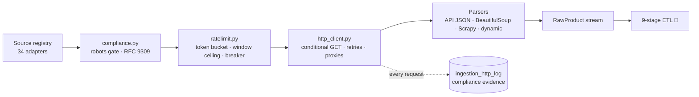
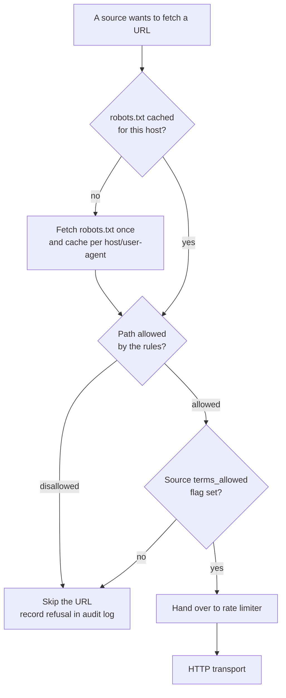
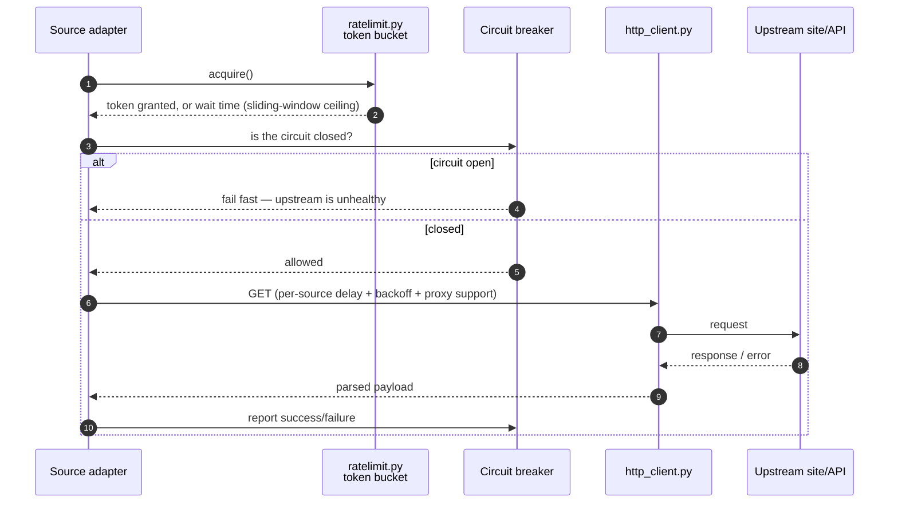
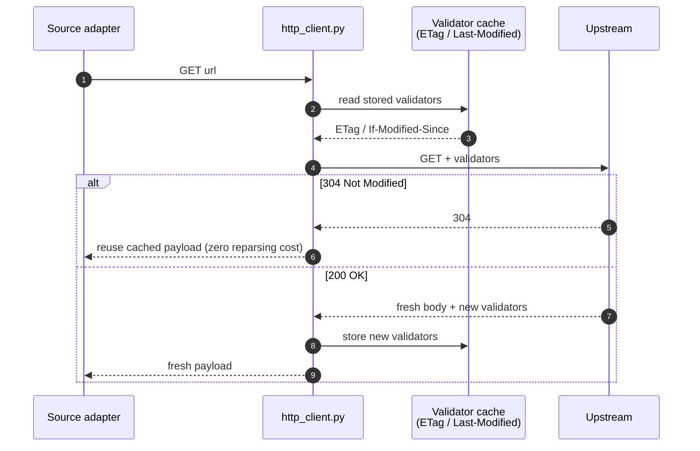
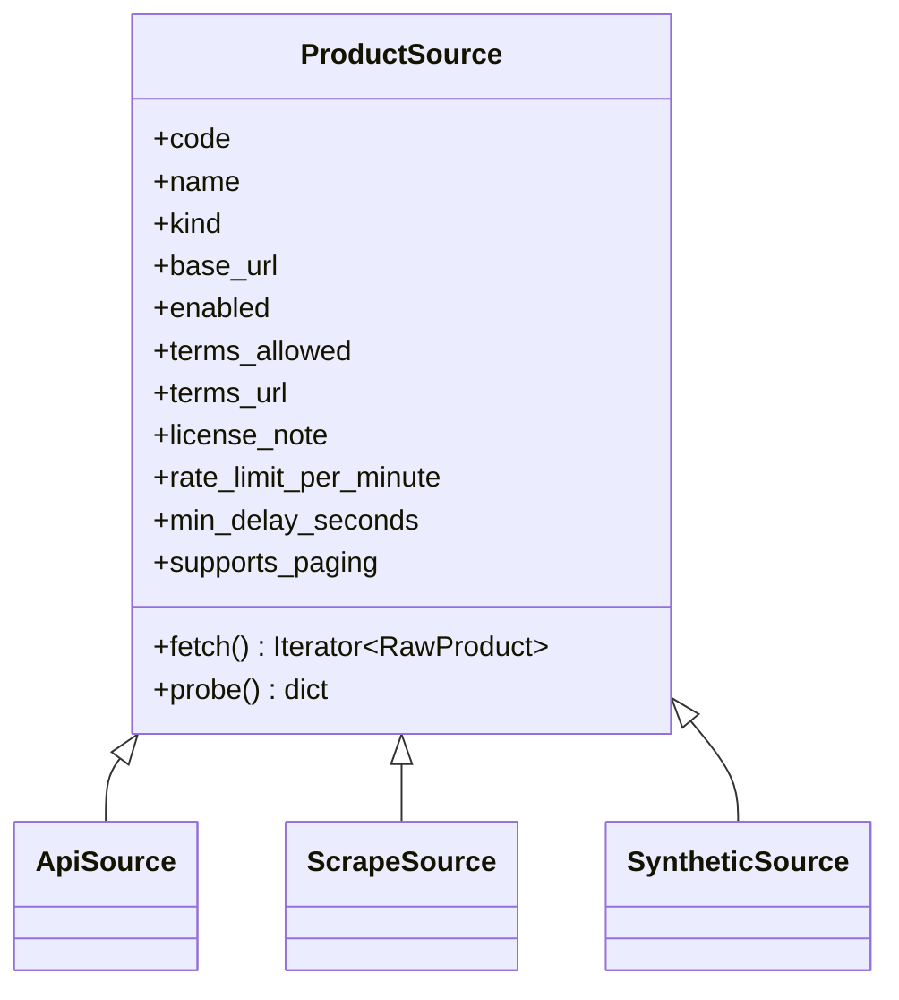
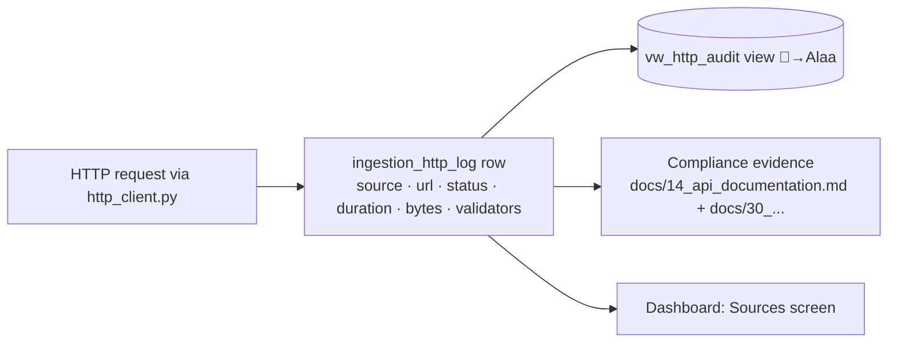

# Ahmed Abd alla — Ingestion & Compliance Lead

| | |
|---|---|
| **Weight** | 15% |
| **GitHub** | [@01124758140](https://github.com/01124758140) |
| **Role** | Ingestion & Compliance Lead |
| **Component** | robots.txt gate + 34 source adapters + rate limiter + conditional GET |
| **Full project** | [`project/`](project/) — complete pipeline, runs standalone |

---

## 1. Executive summary

Ahmed Abd alla owns the **front door of the pipeline**: everything that touches the outside world passes
through his layer. He built the **compliance-first transport stack** — a robots.txt gate implementing
RFC 9309, a token-bucket rate limiter with a sliding-window ceiling and a circuit breaker, conditional
GET revalidation (ETag / Last-Modified) that avoids re-downloading unchanged pages — and the **34 source
adapters** (JSON APIs, permitted HTML surfaces via BeautifulSoup/Scrapy, dynamic pages, synthetic/local
fixtures) that feed the 9-stage ETL. Every single HTTP request is recorded in the
`ingestion_http_log` audit table, which doubles as the compliance evidence for the project.

The design principle he enforces: **a source is only as good as it is polite** — respect robots,
respect rate limits, cache what you already have, and log everything.

---

## 2. Compliance gate — robots.txt (RFC 9309)

- The gate is enforced **in the transport layer**, so no adapter can bypass it.
- `respect_robots_txt` is configurable (`Settings`), and every source exposes
  `robots_respected`, `terms_allowed`, `terms_url` and `license_note` in the source registry /
  Sources screen.
- Refusals are first-class events: they are logged, not silently dropped.

---

## 3. Rate limiting & resilience

| Mechanism | File | Effect |
|-----------|------|--------|
| Token bucket | `app/ingestion/ratelimit.py` | smooth, per-source request pacing |
| Sliding-window ceiling | `app/ingestion/ratelimit.py` | hard cap per minute per source |
| Circuit breaker | `app/ingestion/ratelimit.py` | stop hammering a failing upstream |
| Per-source `rate_limit_per_minute` / `min_delay_seconds` | declared on each adapter | policy lives with the source |
| Retries + backoff + proxy | `app/ingestion/http_client.py` | resilient transport |

---

## 4. Conditional GET — never download the same page twice

---

## 5. The 34 source adapters

All adapters live in `app/ingestion/sources/` and register themselves in the global registry via the
`@register_source` decorator. Three families: **JSON APIs**, **permitted HTML surfaces**
(BeautifulSoup + Scrapy spider + dynamic-page support) and **synthetic/local fixtures** for offline runs.

| | | | |
|---|---|---|---|
| `archive` | `bitstamp` | `books_to_scrape` | `cheapshark` |
| `cocktaildb` | `coincap` | `coingecko` | `dummyjson` |
| `dummyjson_recipes` | `fakestore` | `freeapi` | `google_books` |
| `gutendex` | `itunes` | `itunes_ebooks` | `kraken` |
| `local_fixture` | `makeup` | `mealdb` | `mmobomb` |
| `openfoodfacts_prices` | `openlibrary` | `platzi` | `pokemontcg` |
| `predic8` | `restful_objects` | `sampleapis_coffee` | `sampleapis_switch` |
| `scrapeme` | `scryfall` | `steam_store` | `stooq` |
| `tvmaze` | `ygoprodeck` | | |

Each adapter declares its own contract:

---

## 6. Per-request audit log

---

## 7. Files he delivered (inside `project/`)

| Path | Deliverable |
|------|-------------|
| `app/ingestion/base.py` | `RawProduct`, `NormalizedProduct`, `ProductSource` base, registry, `load_builtin_sources()` |
| `app/ingestion/robots.py` | robots.txt gate (RFC 9309), caching per host |
| `app/ingestion/compliance.py` | compliance policies + evidence |
| `app/ingestion/http_client.py` | conditional GET, retries, backoff, proxies, user-agent |
| `app/ingestion/ratelimit.py` | token bucket, sliding-window ceiling, circuit breaker |
| `app/ingestion/dynamic.py` | dynamic/JS-rendered page handling |
| `app/ingestion/scrapy_spider.py` | Scrapy-based crawling path |
| `app/ingestion/sources/` | all 34 source adapters + `__init__.py` registry |
| `tests/` | ingestion, conditional GET, rate limiting, proxy, source tests |

## 8. Tests he owns

| Test | Covers |
|------|--------|
| `tests/test_ingestion.py` | base registry, error paths |
| `tests/test_ingestion_more.py` | adapter behaviour across sources |
| `tests/test_conditional_get.py` | ETag / Last-Modified revalidation (304 handling) |
| `tests/test_ratelimit.py` | token bucket, ceiling, circuit breaker |
| `tests/test_proxy.py` | proxy resolution from settings |
| `tests/test_gui_sources.py` | Sources screen API contract |
| `tests/test_new_sources.py` | newer adapters end to end |
| `tests/test_sources_status.py` | source status/probe endpoints |

## 9. Responsibilities (from `app/core/team.py`)

- robots.txt gate (RFC 9309) in the transport layer
- 34 source adapters: APIs + BeautifulSoup/Scrapy HTML + synthetic
- Token-bucket rate limiting, sliding-window ceiling, circuit breaker
- Conditional GET (ETag/Last-Modified) revalidation
- Per-request HTTP audit log
