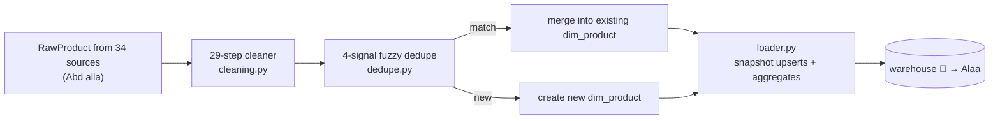
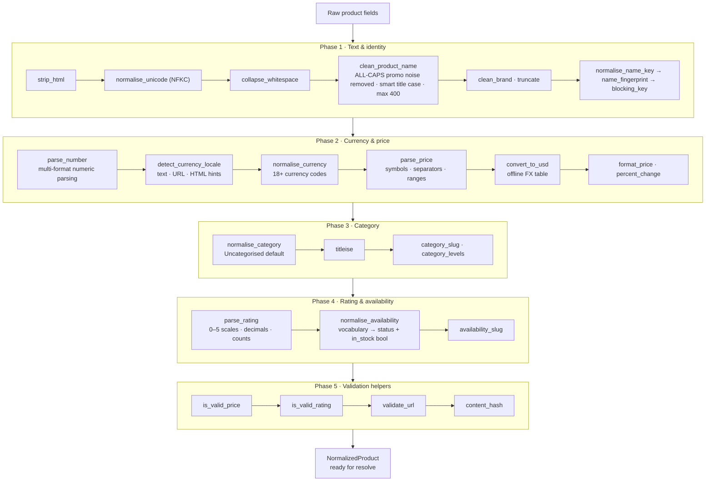
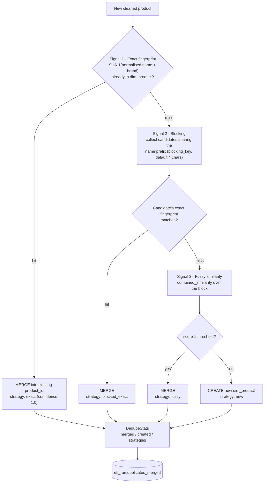
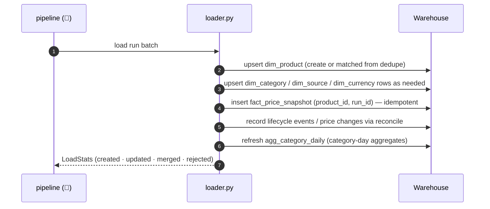

# Ahmed Medhat — ETL & Cleaning Lead

| | |
|---|---|
| **Weight** | 14% |
| **GitHub** | [@AhmedMedhatFarouk](https://github.com/AhmedMedhatFarouk) |
| **Role** | ETL & Cleaning Lead |
| **Component** | 29-step cleaner + 4-signal fuzzy dedupe + ETL loader support |
| **Full project** | [`project/`](project/) — complete pipeline, runs standalone |

---

## 1. Executive summary

Ahmed Medhat owns the **quality heart of the pipeline**: the 29-step normalisation engine that turns
messy upstream records into warehouse-grade products, and the 4-signal fuzzy dedupe that guarantees one
physical product = one `dim_product` row even when ten different sources spell it ten different ways.

His layer sits at stages **3–5** of the 9-stage ETL: *transform* (clean, normalise, enrich, validate),
*resolve* (match or create the product dimension, merge duplicates) and *load* (snapshot upserts into the
fact tables, keyed `(product_id, run_id)` so every run is idempotent).

The design principle he enforces: **clean deterministically, match fuzzily, and never let a duplicate
reach the warehouse.**



---

## 2. The 29-step cleaner — five phases



| Phase | Key functions | Guarantee |
|-------|---------------|-----------|
| Text & identity | `strip_html`, `normalise_unicode`, `collapse_whitespace`, `clean_product_name`, `clean_brand`, `normalise_name_key`, `name_fingerprint`, `blocking_key` | deterministic, stable keys for dedupe |
| Currency & price | `parse_number`, `detect_currency_locale`, `normalise_currency`, `parse_price`, `convert_to_usd`, `format_price`, `percent_change` | one comparable `price_usd` for every source |
| Category | `normalise_category`, `category_slug`, `category_levels` | consistent taxonomy + hierarchy depth |
| Rating & availability | `parse_rating`, `normalise_availability`, `availability_slug` | one vocabulary for all sources |
| Validation | `is_valid_price`, `is_valid_rating`, `validate_url`, `content_hash` | feeds the 12-rule DQ framework (Alaa) |

---

## 3. The 4-signal fuzzy dedupe



### Similarity metrics inside `combined_similarity`

| Metric | Function | Catches |
|--------|----------|---------|
| Levenshtein (+ratio) | `levenshtein`, `levenshtein_ratio` | typos, small edits |
| Jaro / Jaro-Winkler | `jaro`, `jaro_winkler` | transpositions, prefixes |
| Token sort ratio | `token_sort_ratio` | word-order changes |
| Token set ratio | `token_set_ratio` | extra/missing words |
| Trigram similarity | `trigram_similarity` | spelling variants |
| Digit signature | `digit_signature`, `digit_signature_factor` | model numbers, sizes ("A3", "500ml") |

The blocking step keeps this near-linear: only candidates sharing the prefix are ever compared, and the
fingerprint cache (`DimProduct.fingerprint` map) makes the common exact-match path a single dict lookup.

---

## 4. Loader — how resolved products land in the warehouse



---

## 5. Files he delivered (inside `project/`)

| Path | Deliverable |
|------|-------------|
| `app/ingestion/cleaning.py` | full 29-step normalisation engine (5 phases above) |
| `app/ingestion/dedupe.py` | fingerprints, blocking, 6 similarity metrics, `combined_similarity`, match strategies |
| `app/etl/loader.py` | snapshot upserts, dimension resolution, aggregates, resilience support |
| `tests/test_cleaning.py` | cleaner unit tests |
| `tests/test_dedupe.py` | dedupe + similarity tests |
| `tests/test_pipeline_resilience.py` | loader/pipeline resilience under failures and retries |

## 6. Responsibilities (from `app/core/team.py`)

- 29-step product-name/category normalisation engine
- 18+ currency price parsing + offline FX to USD
- 4-signal fuzzy dedupe (fingerprint + blocking + similarity)
- Rating/availability vocabularies

## 7. Verify his layer

```bash
cd project
source .venv/bin/activate
pytest tests/test_cleaning.py tests/test_dedupe.py tests/test_pipeline_resilience.py -q
```
