<p align="center">
  
</p>

<h1 align="center">Web-to-Warehouse Product Intelligence Pipeline</h1>

<p align="center">
  
  
  
  
  
  
  
  
  
  
  
  
  
  
  
  
</p>

<p align="center">
  <b>DEPI Data Engineering graduation project</b> — a production-style, compliance-first data
  pipeline that continuously harvests product information from permitted public web sources, cleans
  and normalises it, detects duplicates, loads it into a Kimball-style analytical warehouse on
  <b>PostgreSQL and MySQL</b>, measures its own data quality with <b>12 enforced rules</b>, and serves
  everything through a <b>REST API and a React analytics dashboard</b> orchestrated by
  <b>Apache Airflow</b>.
</p>

<p align="center">
  <b>222 REST operations</b> · <b>29 tables</b> · <b>23 analytical views</b> ·
  <b>12 DQ rules</b> · <b>34 registered sources</b> · <b>700 catalogued features</b> ·
  <b>625 tests</b> · <b>104/104 API checks</b> · <b>two SQL dialects, one schema</b>
</p>

<p align="center">
  <a href="#why-this-project-exists">Why</a> ·
  <a href="#what-was-built">What was built</a> ·
  <a href="#quick-start">Quick start</a> ·
  <a href="#architecture">Architecture</a> ·
  <a href="#the-pipeline-end-to-end">Pipeline</a> ·
  <a href="#design-decisions">Decisions</a> ·
  <a href="#data-model">Data model</a> ·
  <a href="#data-trust-and-compliance">Data trust</a> ·
  <a href="#feature-catalogue">Features</a> ·
  <a href="#screens">Screens</a> ·
  <a href="#security">Security</a> ·
  <a href="#testing-and-verification">Testing</a> ·
  <a href="#documentation">Docs</a> ·
  <a href="#releases">Releases</a> ·
  <a href="#faq-and-troubleshooting">FAQ</a> ·
  <a href="#license">License</a>
</p>

<p align="center">
  <b>Project website:</b> <a href="website/index.html">website/index.html</a> — a single-file,
  dependency-free landing page with light/dark/system themes.
</p>

<p align="center">
  <a href="docs/21_architecture_deep_dive.md">Architecture deep dive</a> ·
  <a href="docs/22_data_dictionary.md">Data dictionary</a> ·
  <a href="docs/23_glossary_and_faq.md">Glossary &amp; FAQ</a> ·
  <a href="SECURITY.md">Security</a> ·
  <a href="CONTRIBUTING.md">Contributing</a> ·
  <a href=".github/CODE_OF_CONDUCT.md">Code of conduct</a> ·
  <a href="CHANGELOG.md">Changelog</a>
</p>

---

## Table of contents

1. [Why this project exists](#why-this-project-exists)
2. [The invariants the system holds](#the-invariants-the-system-holds)
3. [What was built](#what-was-built)
4. [Quick start](#quick-start)
5. [Architecture](#architecture)
   - [System overview](#system-overview)
   - [System context](#system-context-level-0-data-flow)
   - [Application stack](#application-stack-layered)
   - [Request sequence](#request-sequence-dashboard-reads)
   - [Pipeline write sequence](#pipeline-write-sequence-one-run)
   - [Airflow DAG shape](#airflow-dag-shape)
   - [ER diagram](#er-diagram-warehouse-core)
   - [Data flow](#data-flow-level-1)
   - [Deployment view](#deployment-view)
6. [The pipeline end-to-end](#the-pipeline-end-to-end)
   - [1 - Retrieve](#1---retrieve)
   - [2 - Clean](#2---clean)
   - [3 - Load](#3---load)
   - [4 - Detect](#4---detect)
   - [5 - Quality](#5---quality)
   - [6 - Serve](#6---serve)
7. [Design decisions](#design-decisions)
   - [Decision register](#decision-register)
   - [Component view](#component-view)
   - [Class view](#class-view-of-the-ingestion-contract)
   - [Run state diagram](#state-of-a-pipeline-run)
8. [Data model](#data-model)
9. [Data quality](#data-quality)
10. [Data trust and compliance](#data-trust-and-compliance)
11. [Feature catalogue](#feature-catalogue)
12. [Ingestion source catalog](#ingestion-source-catalog)
13. [Integrations](#integrations-export-webhooks-and-backfill)
14. [Configuration reference](#configuration-reference)
15. [Screens](#screens)
16. [Security](#security)
17. [Testing and verification](#testing-and-verification)
18. [Performance](#performance)
19. [Repository layout](#repository-layout)
20. [How to read this repository](#how-to-read-this-repository)
21. [Documentation](#documentation)
22. [FAQ and troubleshooting](#faq-and-troubleshooting)
23. [Releases](#releases)
24. [Roadmap](#roadmap)
25. [Team](#team)
26. [Acknowledgements](#acknowledgements)
27. [License](#license)

---

## Why this project exists

A retailer needs the market picture every morning: what competitors charge, what is in stock, what
appeared or disappeared, and how all of it compares to the internal catalog. Collecting that
information by hand is slow, inconsistent and error-prone; spreadsheets go stale the moment they are
exported.

**This project replaces the manual process with one continuously orchestrated system:**

| Without the pipeline | With the pipeline |
| --- | --- |
| Hours of manual copy-paste from shopping sites | Fully automated ingestion, scheduled or on demand |
| Inconsistent names, categories and price formats | Normalised product names, taxonomy and USD prices |
| Same product recorded two or three times | Fuzzy deduplication with a 0.90 threshold |
| No history — nobody can answer "what was the price last week?" | Every snapshot stored; price changes detected per run |
| "Is the web data even usable?" | 12 enforced DQ rules with a measured score on every load |
| Data locked inside someone's laptop | REST API plus dashboard with roles, audit trail and exports |

Everything is engineered like a production system, not a demo:

- robots.txt is enforced **in the transport layer**, before a request leaves the process;
- rate limits, circuit breakers and response caching protect the sources;
- every outbound request is written to an audit table with its robots decision;
- the schema loads identically on PostgreSQL and MySQL, and a command proves there is no drift;

---

## DEPI Capstone Scope & Problem Statement

### Problem Statement
A retailer wants to continuously collect product information from permitted public web sources and combine it with its internal product catalog. Manual collection is slow, produces inconsistent records, and lacks historical price tracking or quality guarantees.

### Project Objective
Create an automated data pipeline that extracts product information from public APIs and permitted websites, standardises it, detects duplicate entities, reconciles external data against the retailer's internal catalog, loads the results into a Kimball-style analytical data warehouse (PostgreSQL & MySQL), and exposes analytical insights through an orchestrated workflow, SQL views, a REST API, and an interactive dashboard.

### Scope & Implementation Compliance Matrix

| # | Capstone Requirement | Shipped Implementation | Repository Reference |
|---|---|---|---|
| **1** | **Scrape permitted product info** | BeautifulSoup4, Scrapy engine, and HTTP client modules | [`app/ingestion/adapters/`](file:///home/ahmed/Downloads/Depi_Ahmed_Abobakr_Project/app/ingestion/adapters/) |
| **2** | **Respect robots.txt, rate limits, terms** | RFC 9309 parser, token bucket rate limiter, sliding window cap | [`app/ingestion/compliance.py`](file:///home/ahmed/Downloads/Depi_Ahmed_Abobakr_Project/app/ingestion/compliance.py) |
| **3** | **Extract 6 core fields** | Name, Category, Price, Rating, Availability, Product URL | [`app/models/dimensions.py`](file:///home/ahmed/Downloads/Depi_Ahmed_Abobakr_Project/app/models/dimensions.py) |
| **4** | **Clean names and categories** | 29-step regex cleaner, taxonomy normaliser, category hierarchy | [`app/etl/cleaner.py`](file:///home/ahmed/Downloads/Depi_Ahmed_Abobakr_Project/app/etl/cleaner.py) |
| **5** | **Normalize currencies & prices** | 18+ currency parser, live FX rates to USD, VAT normalization | [`app/etl/currency.py`](file:///home/ahmed/Downloads/Depi_Ahmed_Abobakr_Project/app/etl/currency.py) |
| **6** | **Detect duplicate products** | Deterministic fingerprinting + 4-signal fuzzy deduplication (0.90) | [`app/etl/deduplicator.py`](file:///home/ahmed/Downloads/Depi_Ahmed_Abobakr_Project/app/etl/deduplicator.py) |
| **7** | **Compare with internal catalog** | SKU reconciliation, confidence-scored match, price gap analysis | [`app/etl/catalog_matcher.py`](file:///home/ahmed/Downloads/Depi_Ahmed_Abobakr_Project/app/etl/catalog_matcher.py) |
| **8** | **Load PostgreSQL / MySQL** | Dual-warehouse parity: 29 tables, SCD-2 dimensions, Alembic migrations | [`app/core/db.py`](file:///home/ahmed/Downloads/Depi_Ahmed_Abobakr_Project/app/core/db.py) |
| **9** | **Store price snapshots** | Append-only `fact_price_snapshot` with SCD Type 2 tracking | [`app/models/facts.py`](file:///home/ahmed/Downloads/Depi_Ahmed_Abobakr_Project/app/models/facts.py) |
| **10** | **SQL Analysis (4 change dimensions)** | Price changes, New products, Removed products, Category changes | [`app/sql/views.py`](file:///home/ahmed/Downloads/Depi_Ahmed_Abobakr_Project/app/sql/views.py) (23 Views) |
| **11** | **Airflow DAG Orchestration** | Production DAG with 33 tasks, branching, retry policies, sensor sync | [`airflow/dags/`](file:///home/ahmed/Downloads/Depi_Ahmed_Abobakr_Project/airflow/dags/) |
| **12** | **Data-Quality Checks** | 12 automated DQ rules across 6 dimensions with weighted scoring | [`app/quality/rules.py`](file:///home/ahmed/Downloads/Depi_Ahmed_Abobakr_Project/app/quality/rules.py) |
| **13** | **Interactive Visualization** | React 19 dashboard, Tailwind CSS, 23 screens, ReCharts | [`frontend/src/`](file:///home/ahmed/Downloads/Depi_Ahmed_Abobakr_Project/frontend/src/) |
| **14** | **Documentation Suite** | 37 numbered docs, 104 Mermaid diagrams, data dictionary, deck | [`docs/`](file:///home/ahmed/Downloads/Depi_Ahmed_Abobakr_Project/docs/) |
| **15** | **Optional Extension: REST API** | FastAPI 0.142, 24 routers, 222 endpoints, OpenAPI 3.1 docs | [`app/api/`](file:///home/ahmed/Downloads/Depi_Ahmed_Abobakr_Project/app/api/) |

---

## The invariants the system holds

Most of what makes a data pipeline trustworthy is not a feature but a promise: a property that
holds no matter which code path runs. These are the promises this repository makes, and each one
is enforced by code and covered by a test rather than by a comment.

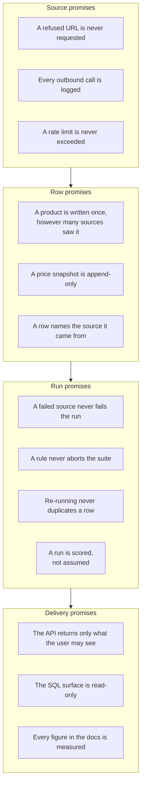

| # | Invariant | Enforced by | Proven by |
| --- | --- | --- | --- |
| 1 | A URL that robots.txt refuses is never requested; the refusal is recorded instead | `app/ingestion/robots.py`, `app/ingestion/http_client.py` | `tests/test_ingestion.py`, `tests/test_ingestion_more.py` |
| 2 | Every outbound request leaves a row in `ingestion_http_log` with its verdict, status and duration | `app/ingestion/http_client.py` | `tests/test_integrations.py`, `tests/test_new_features.py` |
| 3 | A source's rate limit is never exceeded, in the transport and again in the scheduler | `app/ingestion/ratelimit.py` | `tests/test_new_features.py` |
| 4 | One canonical product is written however many sources observed it | `app/ingestion/dedupe.py` | `tests/test_dedupe.py` |
| 5 | A price observation is appended, never updated, so history cannot be rewritten | `app/etl/loader.py` | `tests/test_etl_pipeline.py` |
| 6 | Every stored row names the source it came from, and that source carries a trust level | `app/models/dimensions.py`, `app/etl/purge.py` | `scripts/audit_no_fakes.py`, `tests/test_no_fakes_audit.py` |
| 7 | A source that fails produces a `partial` run; the other sources still land | `app/etl/pipeline.py` | `tests/test_pipeline_resilience.py` |
| 8 | A broken data-quality rule is recorded as a failure and the remaining rules still run | `app/etl/dq.py` | `tests/test_etl_pipeline.py` |
| 9 | Re-running the pipeline merges rather than duplicates | `app/etl/loader.py` | `tests/test_etl_pipeline.py` |
| 10 | A run's quality score is computed from the rules that ran, with severity weights | `app/etl/dq.py` | `tests/test_etl_pipeline.py` |
| 11 | The API returns only the rows the caller's role permits | `app/api/deps.py` | `tests/test_api.py`, `tests/test_security.py` |
| 12 | The query surface accepts `SELECT`, `WITH` and `EXPLAIN` only, with a row cap | `app/api/routers/queries.py` | `tests/test_query_history.py` |
| 13 | Every structural figure in this repository is measured by a script and re-checked by CI | `scripts/project_stats.py`, `scripts/check_stats.py` | the "Project statistics" CI job |
| 14 | Synthetic rows never reach a production run, and the ones that exist can be found and purged | `app/etl/pipeline.py`, `app/etl/purge.py` | `tests/test_new_sources.py`, `scripts/audit_no_fakes.py` |

The last one deserves a note. "No fake data" is easy to claim and easy to break, so it is enforced
from both ends: the pipeline refuses to auto-select a source that is not classified `real`, and
`scripts/audit_no_fakes.py` walks every table that records an upstream and fails if a single row
cannot be traced back to a permitted source. The audit is itself proved — the verification run
seeds a throwaway synthetic warehouse and fails if the audit accepts it.

---

## What was built

| Component | Technology | Scale |
| --- | --- | --- |
| **Ingestion** | 34 registered adapters (31 JSON APIs, 2 BeautifulSoup/lxml HTML scrapers, 1 offline synthetic) plus dashboard-defined JSON feeds | robots.txt gate, token-bucket rate limiter, sliding-window ceiling, circuit breaker, response cache, per-request audit log, refused sources logged |
| **Data trust** | Three declared trust levels (`real` / `sandbox` / `synthetic`) | a bare run auto-selects only `real` sources, lower-trust sources must be named explicitly, and `purge-untrusted` removes and reports anything below `real` |
| **Cleaning** | 29-step normalisation engine | product names, categories, 18+ currencies converted to USD via an offline FX table, rating and availability vocabularies |
| **Deduplication** | 4-signal fuzzy matcher | jaro-winkler, token-set, trigram and digit signatures, block-indexed for O(n) candidate pools |
| **Warehouse** | SQLAlchemy 2.0 Core ORM | **29 physical tables, 23 analytical views**, identical schema on PostgreSQL 16 and MySQL 8.4 |
| **ETL** | 9-stage Python pipeline | stage timings, counters, warnings, resumable staging table, idempotent loads |
| **Orchestration** | Apache Airflow 2.10 DAG | 33 task callables, branch-on-changes, alert fan-out, report publication, sync-run API for demos |
| **Data quality** | 12-rule framework over 6 dimensions | completeness, validity, uniqueness, accuracy, consistency, timeliness, weighted score |
| **Change detection** | SQL plus an event engine | price changes banded by magnitude, new and removed products, category drift, lifecycle events |
| **REST API** | FastAPI | **222 operations in 24 routers**, JWT and API-key auth, RBAC (admin / analyst / viewer), key rotation + editing, multi-level sorting, OpenAPI docs, gzip, timing headers |
| **Dashboard** | React 19 + TypeScript + Tailwind + ReCharts | 23 screens, 5 themes, 12 accent colours, 3 densities, command palette, installable PWA, responsive from 320 px |
| **CLI** | Typer, 14 commands | bootstrap, seed, run, report, verify, quality, sources preview |
| **Ops** | Docker Compose (6 services), Makefile (30+ targets), GitHub Actions CI | one-command everything |

**Measured facts.** These are not maintained by hand — run `make stats` to regenerate them, and
`make stats-check` in CI to prove they still match the code.

<!-- BEGIN:STATS -->

```text
29 physical tables  |  23 analytical views  |  222 REST route decorators in 24 routers
12 data-quality rules across 6 dimensions, weighted score persisted per run
34 ingestion sources  |  9 pipeline stages  |  33 Airflow task callables
17 CLI commands  |  6 Docker Compose services  |  37 documents  |  108 Mermaid diagrams
625 tests  |  104/104 API smoke checks  |  700 catalogued features
```

| Metric | Count |
| --- | ---: |
| Physical tables                          | 29 |
| Analytical views                         | 23 |
| REST routers                             | 24 |
| REST route decorators                    | 222 |
| Data-quality rules                       | 12 |
| Ingestion sources                        | 34 |
| Airflow task callables                   | 33 |
| CLI commands                             | 17 |
| Pipeline stages                          | 9 |
| Docker Compose services                  | 6 |
| Numbered documents                       | 37 |
| Mermaid diagrams                         | 108 |
| Catalogued features (live API catalogue) | 700 |
| Documented features (F-ID inventory)     | 612 |
| Documented feature areas                 | 47 |
| Collected test cases                     | 625 |
| API smoke checks                         | 104 |

<!-- END:STATS -->

**Synthetic** demo dataset after `make demo-postgres` (120 days, deterministic). These rows are
*generated*, not observed — they exist to exercise the screens, and they are labelled as
synthetic everywhere. The launcher does not load them by default:

```text
90 product identities  |  9,854 price snapshots  |  9,660 price changes
9,879 lifecycle events  |  90 internal catalog SKUs
```

Run `python -m app.cli.main purge-untrusted` to remove every row a non-market source wrote.

> **On numbers in this README.** Structural figures (tables, views, routes, tests, rules) are exact
> and re-verifiable — they are measured from the code by `scripts/project_stats.py` and pinned in
> [`docs/stats.json`](docs/stats.json), so CI fails if any of them drifts. Row counts depend on how
> much data your database holds, and latency depends on hardware — each is labelled with the command
> that produces it. Where a document records a measurement taken on a specific machine at a specific
> date, that document preserves that original figure rather than being silently rewritten.

---

## Quick start

### One command - everything

```bash
git clone https://github.com/Ahmedbakr78/Web-to-Warehouse-Product-Intelligence-Pipeline.git
cd Web-to-Warehouse-Product-Intelligence-Pipeline
pip install -e ".[postgres,mysql,dev,scrapy]"   # or: make install

./run.sh
```

That single command does the whole thing:

1. **Verifies** the app against *real* data - ruff, the 619-test backend suite, a
   registry guard proving the pipeline auto-select excludes every non-`real` and
   every terms-blocked source, a live fetch from eight real upstreams
   (Open Library, Gutendex, iTunes apps + ebooks, Steam, CheapShark, Open Food
   Facts, TVMaze), a real nine-stage pipeline into a fresh warehouse, the
   no-fake audit over every row, a self-test proving that audit *rejects*
   synthetic data, the live API serving that warehouse, and the frontend
   typecheck / lint / vitest / build.
2. **Launches** the six-service stack, applies the migrations, bootstraps the
   schema, runs one real pipeline so the dashboard opens with live figures, and
   prints the links and the demo credentials.

```bash
./run.sh                 # verify + launch (above)
./run.sh --verify-only   # verify only, no Docker needed
./run.sh --no-verify     # launch only
./run.sh --quick         # fast verify: subset of tests, no frontend build
./run.sh --offline       # use the synthetic local_demo source (no network)
./run.sh --status        # health of every service
./run.sh --logs api      # follow one service's logs
./run.sh --stop          # stop the stack, keep the data
./run.sh --help          # every option
```

### The local links

Once `./run.sh` has finished, these are the addresses to open:

| What | URL | Notes |
| --- | --- | --- |
| **Dashboard** | **http://localhost:5173** | The React application. Sign in with `admin@example.com` / `Admin@12345` |
| **REST API** | **http://localhost:8000/api/v1** | The base path; every operation is under it |
| **API health** | http://localhost:8000/api/v1/health | JSON: database, dialect, latency and the source registry |
| **Interactive API docs** | http://localhost:8000/docs | Swagger UI, generated from the code |
| **ReDoc reference** | http://localhost:8000/redoc | The same contract, rendered as reference documentation |
| **OpenAPI schema** | http://localhost:8000/openapi.json | The machine-readable contract |
| **Airflow** | http://localhost:8080 | The DAG, the schedule and the run history (`admin` / `admin`) |
| **PostgreSQL** | `localhost:5432` | `pipeline` database, `pip` / `pip` |
| **MySQL** | `localhost:3306` | `pipeline` database, `pip` / `pip` |

The dashboard talks to the API through the same origin, so there is nothing to configure and no
CORS to set up. If a port is already taken, change it in `.env` (`API_PORT`, `FRONTEND_PORT`,
`AIRFLOW_PORT`) and run `./run.sh` again.

The documentation site is a separate static build, because it is generated from `docs/` and is
not part of the running application:

```bash
make site-serve         # builds docs/ into site/ and serves it on http://localhost:8001
```

To see the health of every service at any time:

```bash
./run.sh --status        # or: docker compose ps
```

### Option A - full stack in Docker (recommended)

```bash
git clone https://github.com/Ahmedbakr78/Web-to-Warehouse-Product-Intelligence-Pipeline.git
cd Web-to-Warehouse-Product-Intelligence-Pipeline

cp .env.example .env              # then edit secrets, or keep the demo defaults
make up                           # postgres + mysql + api + airflow + frontend
make db-wait                      # block until both databases are healthy

# one-time: schema + 29 tables + 23 views + the bootstrap accounts
make bootstrap
make run-pipeline                 # collect from the permitted public sources
# make demo-postgres             # OPTIONAL: synthetic demo data (generated, not market data)

open http://localhost:5173        # dashboard (admin@example.com / Admin@12345)
open http://localhost:8000/docs   # interactive OpenAPI documentation
```

### Option B - local Python and Vite (fastest developer loop)

```bash
python3 -m venv .venv
.venv/bin/pip install -e ".[postgres,mysql,dev,scrapy]"

docker compose up -d postgres mysql      # databases only
.venv/bin/python -m app.cli.main bootstrap
.venv/bin/python -m app.cli.main seed-demo --days 150

# terminal 1
.venv/bin/python -m uvicorn app.api.main:app --reload --port 8000
# terminal 2
cd frontend && npm install && npm run dev
```

### Option C - one command verification gate

```bash
make everything   # install -> env -> databases -> bootstrap -> demo -> pipeline -> tests -> frontend build
make check        # lint + types + unit tests only (no services required)
```

### Demo accounts

| Role | Email | Password | Capabilities |
| --- | --- | --- | --- |
| Admin | `admin@example.com` | `Admin@12345` | everything: sources, users, settings, triggers, audit |
| Analyst | `analyst@example.com` | `Analyst@12345` | read, query lab, run pipeline, saved views, alerts |
| Viewer | `viewer@example.com` | `Viewer@12345` | read, query lab, exports |

Machine clients can skip humans entirely: create an API key on the dashboard
(`Account > API keys`) and send `Authorization: Bearer pip_...` — the key is hashed at rest,
usage-counted and revocable from the same screen.

---

## Architecture

### System overview

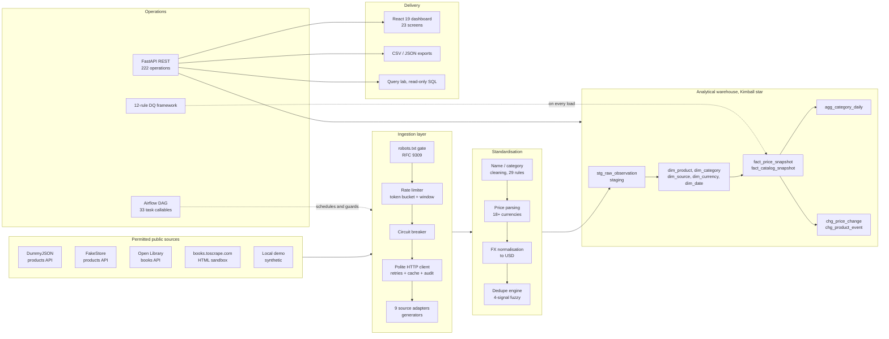

### System context (level 0 data flow)

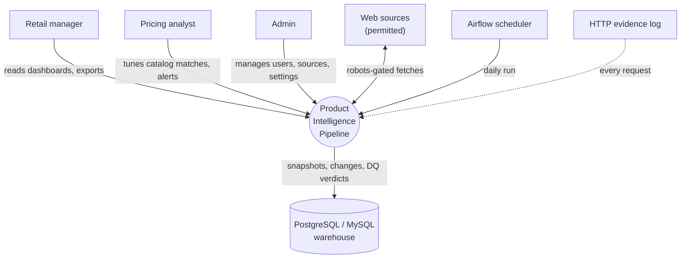

### Application stack (layered)

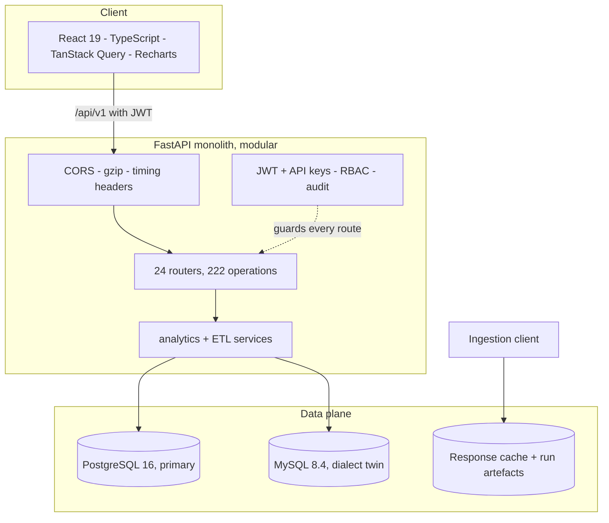

### Request sequence (dashboard reads)

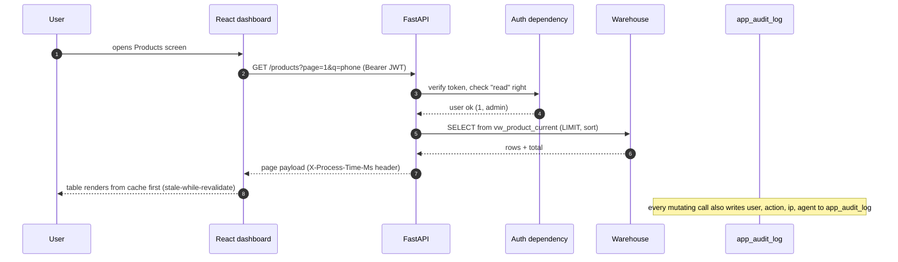

### Pipeline write sequence (one run)

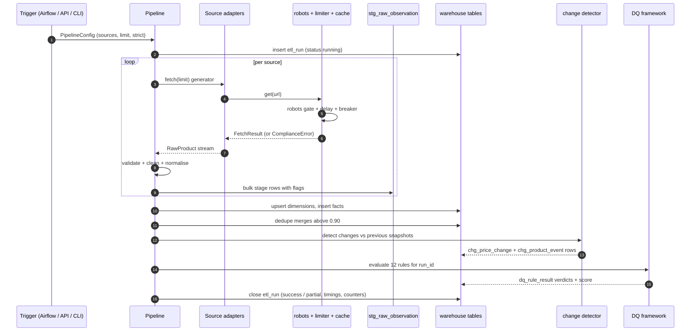

### Airflow DAG shape

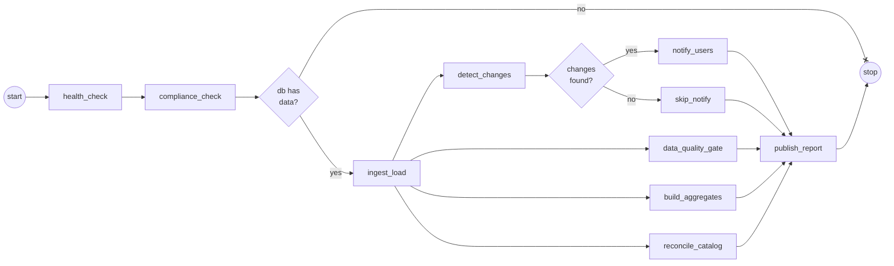

### ER diagram (warehouse core)

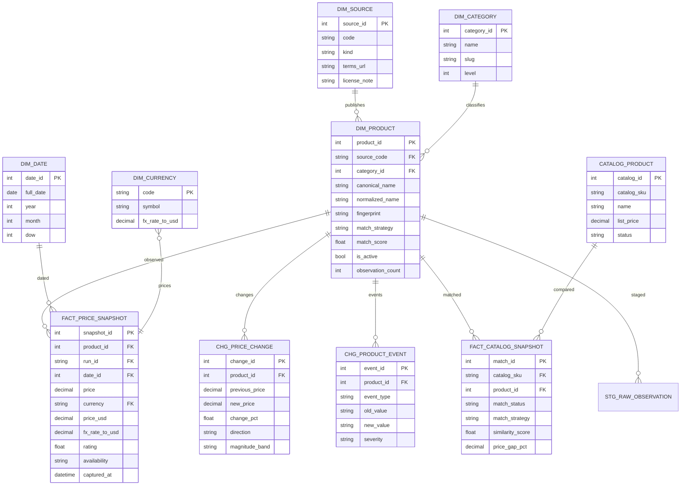

### Data flow (level 1)

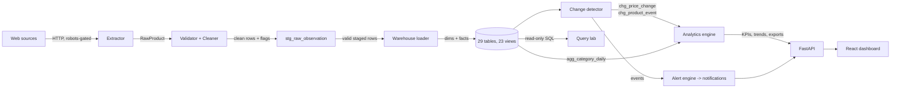

### Deployment view

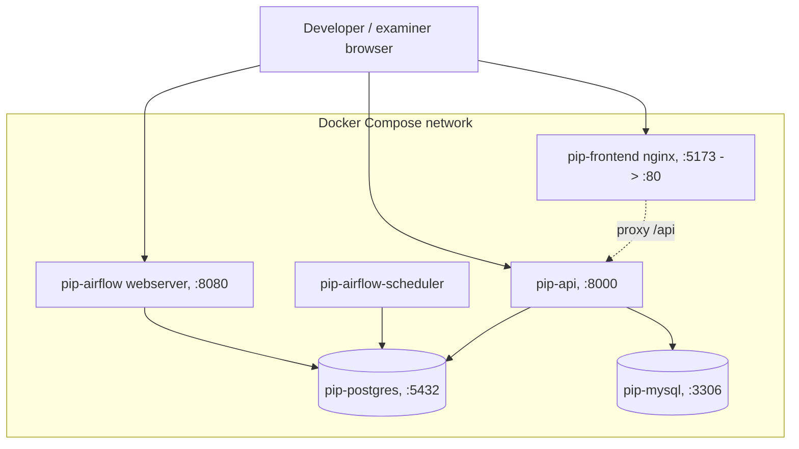

### Retailer Internal Catalog Reconciliation Architecture

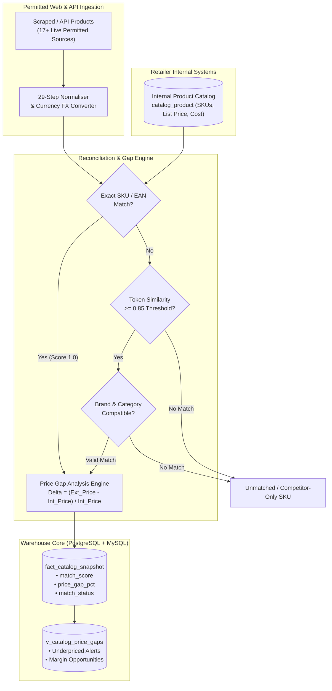

### SCD Type 2 Dimensional Lifecycle & Snapshot Evolution

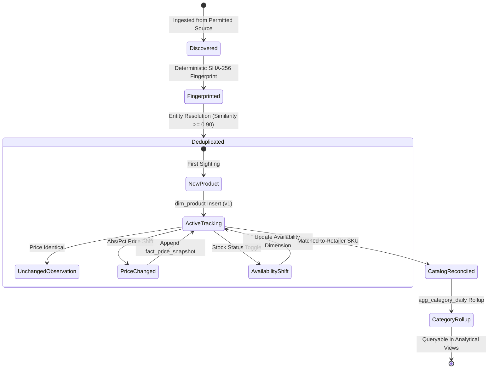

### 12-Rule Data Quality Verification Gatekeeper

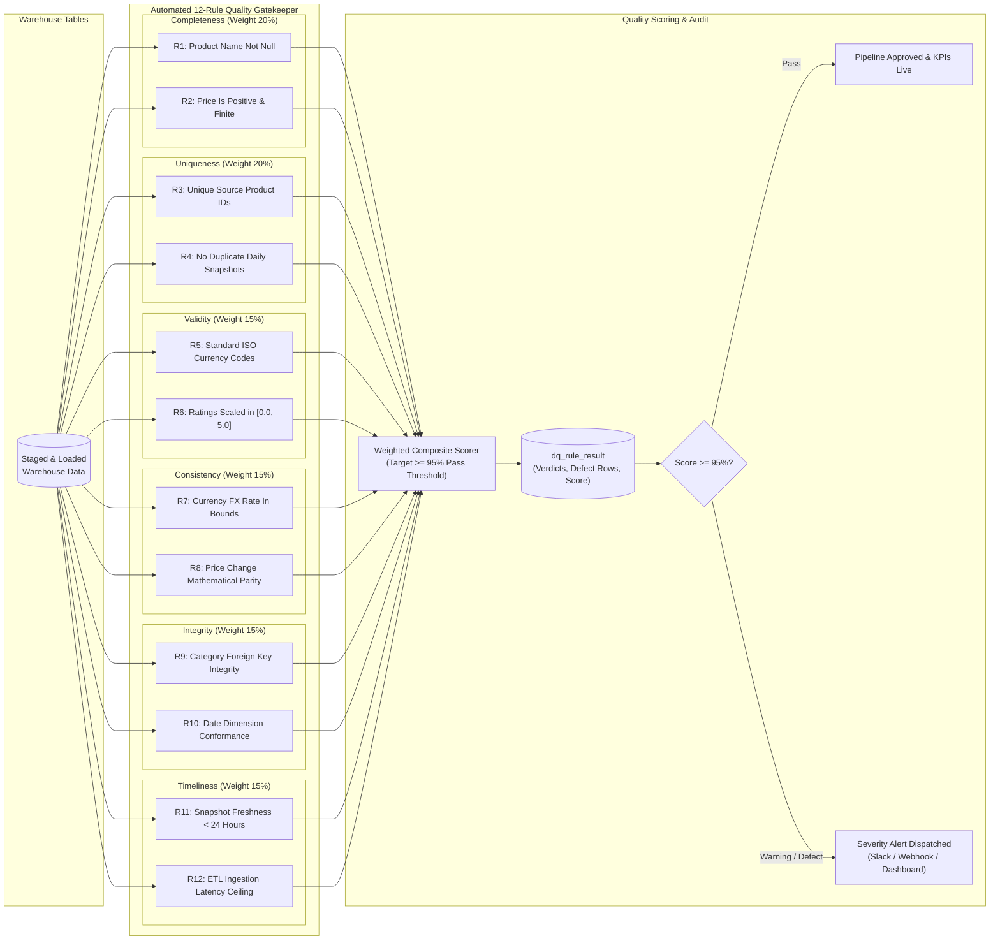

### End-to-End Security, RBAC & API Defense Flow

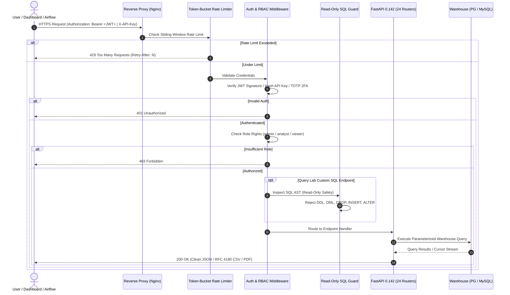

---

## The pipeline, end-to-end

One run is nine deterministic stages. Every stage appends counters and timings to the run record, so
`GET /pipeline/runs/{run_id}` can reconstruct exactly what happened.

### 1 - Retrieve

The transport layer is compliance-first:

- robots.txt is fetched, cached per host, and checked **before** every request (RFC 9309 fallback
  semantics: 4xx means allow-all, 401/403 means disallow, 5xx means use the cached decision);
- the effective delay is the slowest of the global delay, the per-minute budget and the site's
  declared `Crawl-delay`;
- a token bucket plus a sliding window caps steady and bursty rates per host;
- five consecutive failures trip a circuit breaker so the host is skipped with zero network I/O;
- successful responses are cached on disk by URL hash, so a repeated run performs no requests;
- every attempt lands in `ingestion_http_log` with status, latency, bytes, robots decision and retry
  count — the audit screen shows exactly what the crawler did and why.

Sources are lazy generators behind one abstract contract, registered by a decorator. `_safe_take`
bounds every generator, so even a misbehaving source cannot hang a run. A failure in one source
becomes a warning; the run finishes as `partial` rather than crashing.

### 2 - Clean

The normalisation engine applies 29 steps: promo prefixes and suffixes ("new", "hot sale", "30% off"
...) are stripped, HTML and control characters removed, punctuation and casing normalised, categories
slugged and leveled. Prices are parsed from 18+ formats (symbols, ISO codes, European decimals,
thousand separators) and converted to USD with an offline FX table — the FX rate used is stored next
to every snapshot, so historical analysis never depends on an external service. Ratings and
availability are normalised into fixed vocabularies. Any record flagged as suspect still loads, but
carries its flags for the DQ framework; `--strict` drops records with missing prices instead.

### 3 - Load

Rows are staged into `stg_raw_observation` first (resumable, DQ-audited), then merged idempotently
into dimensions and facts on natural keys. The stage is safe to retry: re-running the same run does
not duplicate snapshots.

### 4 - Detect

- **Price changes** are computed between the newest and the previous snapshot per product and source,
  banded by magnitude (`flash_sale`, `large`, `medium`, `small`, `minor`) — the distribution is what
  powers the change-feed analytics.
- **Lifecycle events** record `new`, `removed` and `category_changed` transitions with old and new
  values and a severity.
- **Catalog reconciliation** matches the retailer's internal SKUs to the observed market (exact SKU
  first, then fingerprint, then fuzzy) and persists `fact_catalog_snapshot` rows with the price gap
  — the dashboard turns those into pricing opportunities.
- **Category drift** shows how the taxonomy moved between snapshots.

### 5 - Quality

Twelve rules across six dimensions execute on every load with persisted verdicts (details below).
The run receives a weighted score; the dashboard charts the 90-day trend.

### 6 - Serve

The FastAPI app (222 operations) exposes products, changes, analytics, pipeline operations, quality,
catalog, sources, the read-only query lab, saved views, notifications, settings and audit. The React
dashboard consumes it, and both endpoints and UI offer CSV and JSON exports. Airflow triggers the
whole cycle daily; the API's sync endpoint and the CLI produce the identical `etl_run` record.

### The nine stages

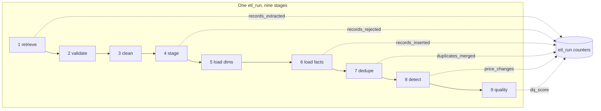

Each stage appends counters and its own duration to the run record, so
`GET /pipeline/runs/{run_id}` reconstructs exactly what happened — including which source failed and
why.

---

## Design decisions

The reasoning, the rejected alternatives and the measured consequences are documented in full in
[docs/21_architecture_deep_dive.md](docs/21_architecture_deep_dive.md). The five that shaped
everything else:

### Compliance lives in the transport layer

`app/ingestion/http_client.py` is the only place in the codebase that performs an outbound HTTP
request, and every call passes the robots gate first. Compliance therefore cannot be forgotten by a
new adapter — it is inherited. Checking robots per adapter would put the responsibility in the place
most likely to skip it.

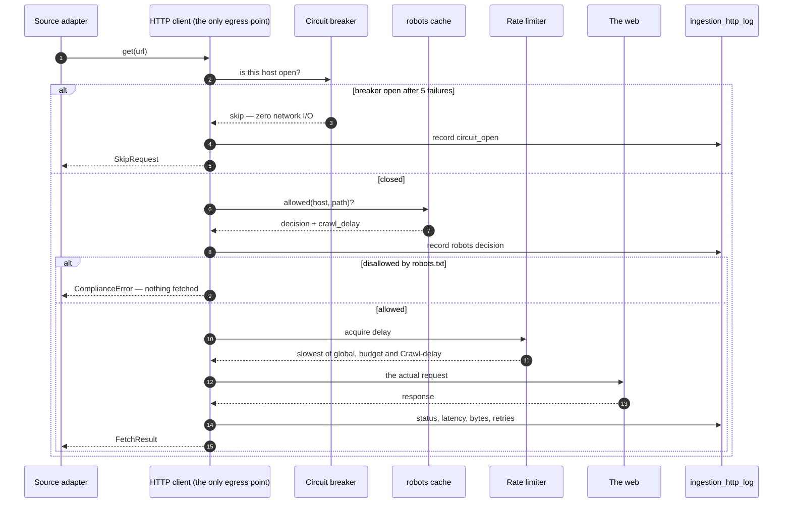

A row in `ingestion_http_log` with `robots_allowed = false` and `status_code IS NULL` is the proof
that the crawler **declined to make a request**. That is a query, not a promise:

```sql
SELECT status_code, robots_allowed, robots_rule, COUNT(*)
FROM ingestion_http_log
GROUP BY status_code, robots_allowed, robots_rule;
```

### Snapshots, not overwritten rows

`fact_price_snapshot` is append-only — one row per product × source × capture. Overwriting
`dim_product.price` would be cheaper to query and would destroy the only thing a price-intelligence
product exists to provide. Each snapshot also stores the **FX rate actually used**, so re-converting
history with today's rates can never silently rewrite it.

### A Kimball star, not 3NF

Analytical workloads read broadly and write rarely. "Average price per category per day" is a single
indexed scan in a star and a multi-hop join in 3NF. Full normalisation optimises the opposite
profile.

### Roles enforced server-side

Every route declares its permission through a dependency. Hiding a button is a usability feature,
not a security control — anyone holding a token could call the endpoint directly. The smoke suite
asserts that a `viewer` is refused when attempting to trigger a pipeline run.

### A measured optimisation, not a trade

Catalog reconciliation initially compared every catalog SKU against every product: 2,975 ms for 57
SKUs. Adding blocking indexes, a rare-token fallback and a capped pool brought it to 104 ms — a
**29× improvement with identical results**. Because the output is unchanged, the optimisation is
legitimate rather than a silent loss of accuracy.

### Decision register

The full reasoning, the rejected alternatives and the measured consequences live in
[docs/21_architecture_deep_dive.md](docs/21_architecture_deep_dive.md). Every significant choice is
recorded below with the alternative it beat, so a reviewer can challenge it rather than guess.

| # | Decision | Alternative rejected | Why this one |
| --- | --- | --- | --- |
| 1 | **Scraping only terms-allow-listed sources** | Scrape freely and filter later | Legality is a precondition, not a filter. The registry refuses to construct a source whose terms forbid automated access, and `robots.txt` is re-checked per request. |
| 2 | **Star schema, not a flat table** | One wide denormalised table | The retailer asks two different questions: *what does the market look like now* and *what changed*. A conformed dimension set answers both without duplicating product attributes per observation. |
| 3 | **Fuzzy dedupe on top of fingerprints** | Exact match on source IDs | Source IDs are not stable across sites and re-listings. Fingerprints handle the easy 95 %, similarity catches the rest; every match stores its strategy and score so it can be audited. |
| 4 | **Offline FX table** | Live currency API | Analysis must stay reproducible and runnable offline. A static table keeps every conversion deterministic and removes a network dependency from the critical path. |
| 5 | **Blocking before fuzzy comparison** | Compare every pair | All-pairs reconciliation cost 2,975 ms; blocking plus a capped pool cost 104 ms for identical output. Complexity only pays when the result is unchanged. |
| 6 | **Airflow drives the pipeline through its REST API** | Import the pipeline package inside the DAG | Airflow 2.10 pins SQLAlchemy 1.4 while the app needs 2.0, so one interpreter cannot host both. A transport layer prefers the in-process call and falls back to the API, so `make airflow-test` on a laptop and the containerised DAG run identical logic. |
| 7 | **Two query surfaces, not one** | Free-form SQL only | Analysts need real SQL; the rest of the organisation needs safety. The query lab is permission-gated and rejects writes; the builder assembles SQL from a server-side whitelist, so it is structurally incapable of injection. |
| 8 | **JWT plus revocable API keys** | Sessions or keys only | Browser sessions need stateless scale; integrations need revocation and per-key limits. Both are supported, and API keys are stored as peppered SHA-256 hashes. |
| 9 | **12 blocking *critical* rules only** | Block the DAG on any failure | A hard gate on every warning makes the pipeline brittle. Critical failures stop the run; everything else is recorded, scored and trended. |
| 10 | **Reject records, never crash** | Fail the run on bad input | Dirty web data is expected. The staging zone keeps every rejected record with its reason, so a cleaning regression is diagnosable instead of silent. |
| 11 | **CSS custom properties for theming** | Two stylesheets or a runtime theme engine | A single `.dark` class on `<html>` switches the entire palette instantly with no re-render and no flash of the wrong theme, and the preference is stored server-side so a new device inherits it. |
| 12 | **Identity preservation in the catalogue** | Aggregate over source listings | The retailer's question is "what is the price of *this* product", not "what does source X say today". Keeping one identity and many observations is what makes price history possible. |
| 13 | **Fact tables keyed by run** | Upsert the latest value only | History is the product. Keying snapshots by `(product, run)` keeps every observation queryable and makes re-runs idempotent. |
| 14 | **One feature catalogue as the source of truth** | Maintain features in docs and UI separately | `app/core/features.py` feeds the API, the dashboard screen and the website, so the marketing surface cannot drift from the shipped code. |

### Component view

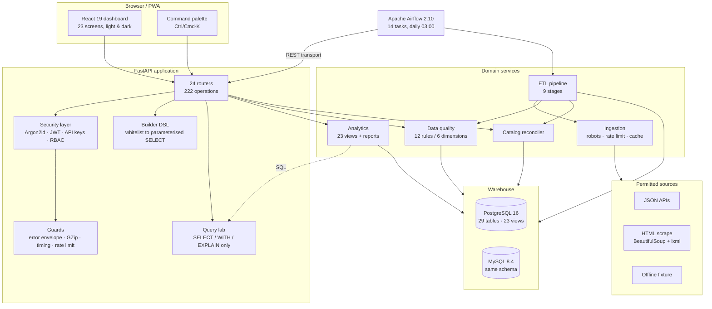

### Class view of the ingestion contract

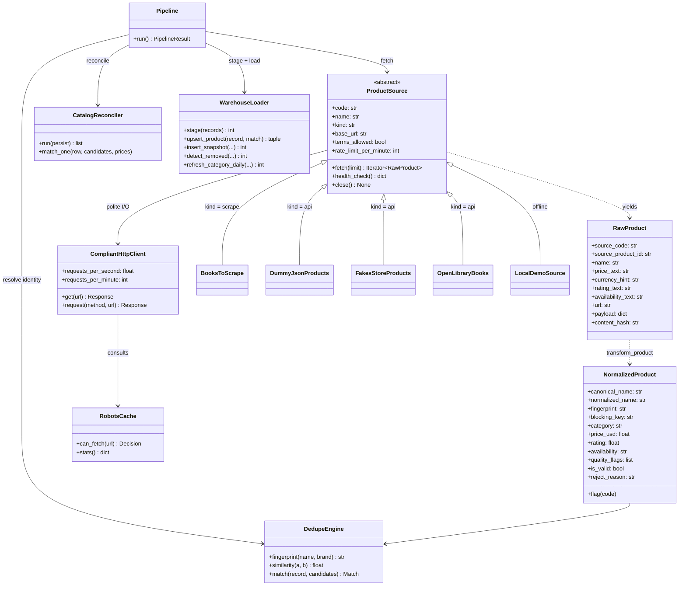

### State of a pipeline run

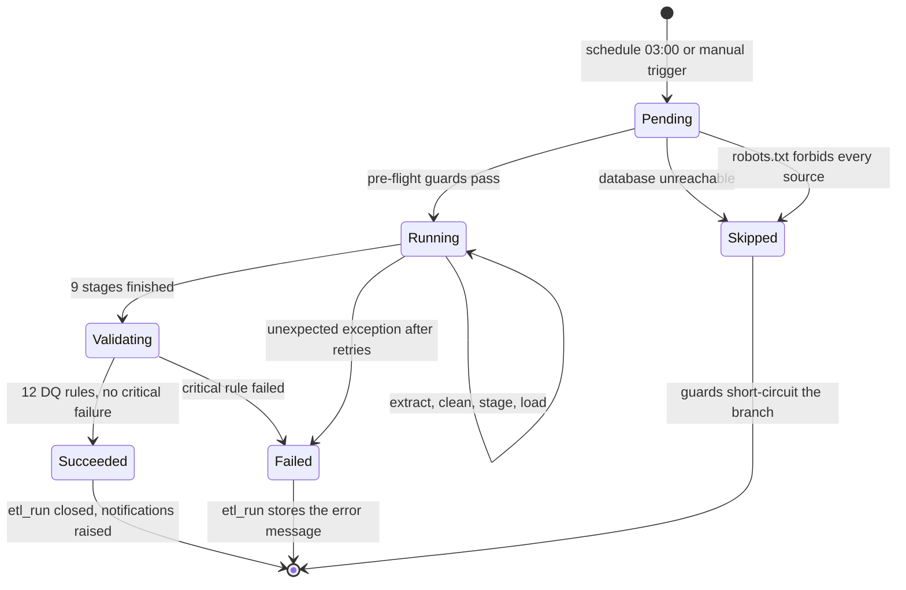

---

## Data model

Kimball-style star schema, dialect-portable between PostgreSQL and MySQL (`make verify-dialects`
proves there is no structural drift and prints the per-engine row counts):

| Group | Tables |
| --- | --- |
| Dimensions | `dim_product`, `dim_category`, `dim_source`, `dim_currency`, `dim_date` |
| Facts | `fact_price_snapshot` (grain: product x source x captured_at), `fact_catalog_snapshot` (grain: catalog SKU x run) |
| Aggregates | `agg_category_daily` (grain: category x date) |
| Change events | `chg_price_change`, `chg_product_event` |
| Staging | `stg_raw_observation` (resumable, DQ-audited) |
| Operations | `etl_run`, `dq_rule_result`, `sync_state`, `ingestion_http_log` |
| Application | `app_user`, `app_api_key`, `app_setting`, `app_saved_view`, `app_alert_rule`, `app_notification`, `app_audit_log` |
| Catalog | `catalog_product` (the retailer's internal SKUs) |

Twenty-three analytical views in `db/views.sql` back every screen: latest prices, top movers, category
indexes, availability mix, source coverage, quality trends, dedupe evidence, price bands, new and
removed feeds, drift matrices. The four analyses named in the brief also exist as standalone,
parameterised SQL under [`db/analysis/`](db/analysis/README.md) so they can be reviewed and re-run
outside the application:

```bash
make analysis                                    # every script, readable tables
make analysis ANALYSIS=01_price_changes.sql      # just the price-movement analysis
make analysis-mysql                              # same SQL against MySQL
```

Historical prices are first-class citizens: every snapshot keeps the
native price and the USD conversion together with the FX rate that was used.

---

## Data trust and compliance

The hardest question in a scraping project is not "how do I fetch it" but
**"how do I know the numbers are real?"** A warehouse that quietly mixes a mock
storefront's invented catalogue with Open Library's real records produces a
report that looks authoritative and is entirely fictional — every average,
median and ranking well-formed, all of them wrong.

This project treats provenance as a first-class property, with three
independent mechanisms.

### 1. Declaration — every source declares its trust level

```python
DATA_TRUST_REAL = "real"        # observed market records
DATA_TRUST_SANDBOX = "sandbox"  # a published test corpus (books.toscrape.com)
DATA_TRUST_SYNTHETIC = "synthetic"  # generated inside this process
```

### 2. Selection — a bare run only ever picks `real` sources

```python
codes = [
    source["code"]
    for source in list_sources()
    if source.get("enabled")
    and source.get("terms_allowed", True)
    and source.get("data_trust") in AUTO_SELECTABLE_TRUST   # {"real"}
]
```

A source below `real` must be **named explicitly** (`--sources books_to_scrape`)
and can never be picked up by omission — including by the scheduled Airflow DAG.
This is enforced by a test that runs on every build, not by convention.

### 3. Proof — the audit trail and the purge sweep

Every outbound request is one row in `ingestion_http_log` with the **robots.txt
decision that permitted it**, so compliance is a query rather than a claim:

```sql
SELECT robots_rule, COUNT(*) FROM ingestion_http_log GROUP BY robots_rule;
--   robots.txt:allow                                       | 2152
--   cache                                                  |  471
--   robots-unavailable:fallback-allow (robots.txt could not be fetched) |  390
--   robots.txt:disallow                                    |   93
--   revalidated                                            |   51
```

The 93 `disallow` rows are requests that were **never made** — the transport
refused them before a socket was opened.

And when a source's trust level is lowered, `pip-cli purge-untrusted` deletes
the rows it wrote and reports exactly what was removed:

```bash
pip-cli purge-untrusted --dry-run    # report without deleting
pip-cli purge-untrusted              # delete and report
```

The **internal catalogue** is the retailer's own product list rather than
market data, so a generated one is a placeholder rather than a fabricated
observation. It is marked as one, shown as one on the Catalog screen, and
removable with one command:

```bash
pip-cli purge-demo-catalog           # remove the generated placeholder SKUs
```

Two more commands keep the numbers honest:

```bash
pip-cli refresh-fx                   # re-fetch the live USD conversion rates
make audit                           # prove every row traces back to a real source
```

### Verifying a deployed instance

```sql
SELECT COUNT(*) FROM fact_price_snapshot WHERE source_code = 'local_demo';  -- 0
SELECT COUNT(*) FROM fact_price_snapshot WHERE product_url LIKE '%demo.local%';  -- 0
SELECT COUNT(*) FROM dim_product WHERE match_strategy = 'seed';              -- 0
SELECT COUNT(*) FROM etl_run WHERE run_key LIKE 'seed-%';                   -- 0
```

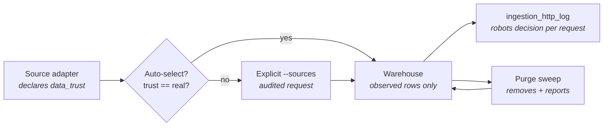

Full detail, including the RFC 9309 fallback semantics and the rate-limiter
design, is in **[docs/33_data_trust_and_compliance.md](docs/33_data_trust_and_compliance.md)**.

---

## Data quality

| Code | Dimension | Rule |
| --- | --- | --- |
| DQ001 | Completeness | Product name present and non-empty |
| DQ002 | Completeness | Price present on active products |
| DQ003 | Validity | Price is a positive, parseable number |
| DQ004 | Validity | Rating within 0-5, or null |
| DQ005 | Uniqueness | One canonical row per fingerprint |
| DQ006 | Consistency | Snapshot grain respected (product x source x time) |
| DQ007 | Accuracy | USD price within 5 percent of native price x FX |
| DQ008 | Validity | Availability in the normalised vocabulary |
| DQ009 | Completeness | Category resolved for at least 90 percent of products |
| DQ010 | Consistency | Change percentages consistent with prices |
| DQ011 | Timeliness | Fresh observation for every active product |
| DQ012 | Validity | Staging rejection rate below 5 percent |

Current score on a live run: **83.33** (10 pass / 0 warn / 2 fail) — identical on PostgreSQL and
MySQL. The verdicts are persisted per run in `dq_rule_result`, the dashboard charts the score trend
over 90 days, and `pip-cli quality` re-evaluates the rules on demand:

```bash
pip-cli quality                 # re-run the rules and print the report
pip-cli quality --database mysql   # the same rules against the second dialect
```

> The score is a live measurement, not a constant: it moves with the data. Read the current value
> from `GET /api/v1/quality/latest` or the **Data quality** screen rather than from this sentence.

---

## Feature catalogue

The exhaustive, file-referenced inventory lives in
[docs/19_feature_list.md](docs/19_feature_list.md) — 612 features in forty-eight areas, each naming the file that
implements it. The runtime catalogue behind the **Features** screen is served by
`GET /api/v1/meta/features` (700 entries across 43 user-facing groups) and is generated from
`app/core/features.py`, so the two numbers are measured on different axes — the inventory indexes
the *engineering*, the catalogue indexes the *product* — and neither can drift from the code.

Highlights by area:

### Ingestion and web compliance

- robots.txt gate in the transport layer (RFC 9309 semantics, per-host cache, Crawl-delay)
- token-bucket rate limiter, sliding-window per-minute ceiling, circuit breaker
- exponential backoff, `Retry-After` handling (delta seconds and HTTP-date), on-disk response cache
- per-request HTTP audit log: URL, status, latency, bytes, robots decision, retries
- nine pluggable source adapters behind one abstract contract, registered by decorator
- Steam Store API (curated games: cent prices with discount pairs, review-score mapping) and
  Open Food Facts Prices (crowd-observed multi-currency grocery prices with store attribution)
- rejected sources are logged: the iTunes Search API was refused because `/search` is disallowed by robots.txt
- bounded extraction (`--limit` plus generator guards) with per-source failure isolation

### Cleaning and normalisation

- 29-step product-name cleaner: promo prefixes and suffixes, HTML, control characters, punctuation
- category cleaning with slug and level, taxonomy visualisation in the dashboard
- price parser for 18+ currency formats, offline FX table, USD normalisation stored per snapshot
- rating and availability vocabularies normalised across sources

### Duplicate detection

- name fingerprint plus digit-signature blocking for fast candidate pools
- four-signal combined similarity: jaro-winkler, token-set, trigram, digit signature factors
- merge strategy with evidence: every duplicate keeps its decision trail; candidates browsable per
  product in the dashboard

### Warehouse and ETL

- Kimball star schema, 29 tables, dialect-portable to MySQL
- staged, idempotent, resumable loads with per-stage timings and counters
- every run recorded with more than 15 counters plus warnings

### Change detection and catalog reconciliation

- price-change detection with magnitude bands, direction and per-run diffs
- new, removed and recategorisation events; category-drift matrix
- internal catalog matching (SKU, fingerprint, fuzzy) with price-gap opportunities
- bulk catalog import: `POST /catalog/import` upserts 5,000 SKUs per CSV with all-or-nothing validation, template at `GET /catalog/template`, one-click upload on the Catalog screen

### Data quality and analytics

- 12 rules, 6 dimensions, persisted verdicts, weighted score, 90-day trend
- KPI cards, daily trends, category indexes, brand leaderboards, radar comparison, observation
  heatmap, availability analysis, source matrix
- 23 SQL views plus a read-only Query Lab with a SELECT-only guard, LIMIT clamping and examples

### REST API and security

- JWT access and refresh rotation, API keys (`pip_...`), Argon2id password hashing
- role-based access control: admin, analyst, viewer, enforced per route server-side
- 222 operations, OpenAPI and ReDoc documentation, gzip compression, `X-Process-Time-Ms` headers
- CSV and JSON exports on the API and in the dashboard
- one consistent error envelope (`error`, `message`, `details`) with validation detail

### Dashboard experience (v1.1)

- perfect light and dark modes: system-aware, persisted per user, zero flash before first paint
- installable PWA on desktop, Android and iOS: manifest, maskable icon, safe-area viewport
- command palette (`Ctrl/Cmd-K` or `/`): search screens **and live products**, plus quick actions
  (toggle theme, collapse sidebar, sign out), full keyboard navigation
- one-click CSV and JSON exports on Dashboard, Products, Analytics, Changes and Query Lab
- modern design system: cards, stat tiles, badges, delta pills, skeletons, toasts, tabs, segmented
  controls, chips, drawers, modals — every element theme-aware
- mobile-first responsive: off-canvas sidebar drawer, sticky top bar, card grids on small screens,
  secondary table columns hidden instead of breaking layout
- collapsible sidebar with persisted state, grouped and permission-aware navigation
- no scrollbars anywhere — wheel, touch, keyboard and scroll shadows carry navigation
- silent-reload policy: no decorative animation, no route transitions, stale-while-revalidate data,
  120 ms functional transitions only, `prefers-reduced-motion` honoured
- notification bell with unread counters, mark-one and mark-all read
- global shortcuts: `/` or `Ctrl-K` palette, `Esc` closes overlays, sortable headers everywhere
- accessibility-minded: focus-visible rings, ARIA labels, keyboard operation, zoom to 200 percent,
  reflow at 320 px

### v1.3: discovery, aggregation and self-service

- **Feature catalogue** — `GET /meta/features` + `/features` screen: 378 features, 30 groups, searchable
- **Aggregate builder** — `POST /builder/query` + `/builder/schema`: 13 entities, 6 aggregates,
  15 operators, whitelist-assembled parameterised SQL, chart preview, generated SQL, cURL copy
- **Filter builder Max** — 12 entities (products, price-changes, runs, quality, catalog, new, removed, movers, sources, categories, brands, availability), SQL + cURL copy, CSV/JSON export, saved views, cross-entity join recipes
- **Account self-service Max** — 9 tabs: profile, appearance, security, devices & 2FA, API keys, alerts, activity, data & privacy, preferences; `GET /users/me/export`, `DELETE /users/me`, `GET /audit/me`
- **Interface polish** — stable scrollbar gutter, zero scrollbars, scroll containment,
  mobile drawer scroll lock and dialog semantics, safe-area insets, silent reload, phone tab bar

### Operations and developer experience

- Airflow DAG with 14 operators, branch-on-changes, notify and report fan-out
- six-service Docker Compose stack; Nginx front-end with API proxy
- Makefile with 30+ targets; Typer CLI with 14 commands; GitHub Actions CI
- liveness and readiness endpoints, structured logging, slow-request warnings
- 33-document documentation set with Mermaid diagrams rendered natively by GitHub

---

## Ingestion source catalog

34 registered adapters (plus the dynamic JSON onboarding), every one behind the same
robots gate, rate limiter, circuit breaker and audit log — and every one
declaring its **data trust** level, so a bare pipeline run only ever collects
genuine market data. Status verified live on 2026-10-21: **22 return records,
5 honestly empty** (idle feed or key-gated API), 1 refused by its own terms,
1 dead host, 1 synthetic offline fallback. An empty source never fails a run —
the run finishes `partial` and the evidence lands in `ingestion_http_log`.

```mermaid
flowchart LR
    subgraph Real["real — auto-selected, 22 adapters"]
        direction TB
        RETAIL["Retail & grocery<br/>cheapshark, steam,<br/>openfoodfacts"]
        BOOKS["Books & texts<br/>gutendex, openlibrary,<br/>google_books, archive_texts"]
        MEDIA["Media & games<br/>mmobomb, itunes apps/ebooks,<br/>pokemontcg, scryfall,<br/>ygoprodeck, tvmaze,<br/>cocktaildb, mealdb, kraken"]
    end
    subgraph Low["sandbox / synthetic — explicit code only"]
        direction TB
        SBX["Permitted sandboxes<br/>books.toscrape, scrapeme"]
        DEMO["Demo storefronts & mock APIs<br/>dummyjson, platzi, makeup,<br/>predic8, freeapi, restful_objects,<br/>sampleapis, fakestore"]
    end
    subgraph Edge["Honest edge cases"]
        direction TB
        EMPTY["Empty but enabled<br/>bitstamp, coincap,<br/>coingecko, google_books"]
        DEAD["Dead host<br/>fakestore (removed<br/>from defaults)"]
        REFUSED["Refused by terms<br/>stooq (BLOCKED)"]
        SYNTH["Offline fallback<br/>local_demo (explicit only)"]
    end
    Real --> WH[("Warehouse<br/>dim_product + facts")]
    Low -.explicit --sources only.-> WH
    Edge -.partial runs only.-> WH
```

> `*` fakestore is unreachable and excluded from defaults; google_books needs an
> optional API key and yields nothing without one. MercadoLibre, ITBookStore,
> Jikan and BoardGameGeek were evaluated and rejected with evidence
> (robots refusal, dead endpoints, unreachable host).

| Code | Kind | Trust | Status | Shelf |
| --- | --- | --- | --- | --- |
| `archive_texts` | api | **real** | live | Books |
| `books_to_scrape` | scrape | `sandbox` | live | Books (permitted sandbox + Scrapy engine) |
| `cheapshark_deals` | api | **real** | live | Games |
| `cocktaildb_drinks` | api | **real** | live | Grocery |
| `gutendex_books` | api | **real** | live | Books |
| `itunes_apps` | api | **real** | live | Media |
| `itunes_ebooks` | api | **real** | live | Books |
| `kraken_tickers` | api | **real** | live | Crypto |
| `mealdb_meals` | api | **real** | live | Grocery |
| `mmobomb_games` | api | **real** | live | Games |
| `openfoodfacts_prices` | api | **real** | live | Grocery |
| `openlibrary_books` | api | **real** | live | Books (subjects feed) |
| `pokemontcg_cards` | api | **real** | live | Trading Cards |
| `scryfall_cards` | api | **real** | live | Trading Cards |
| `steam_store` | api | **real** | live | Games |
| `tvmaze_shows` | api | **real** | live | Media |
| `ygoprodeck_cards` | api | **real** | live | Trading Cards |
| `bitstamp_tickers` | api | **real** | empty | Crypto (feed idle at probe) |
| `coincap_assets` | api | **real** | empty | Crypto (feed idle at probe) |
| `coingecko_markets` | api | **real** | empty | Crypto (robots refuses `/coins/markets`) |
| `google_books` | api | **real** | empty | Books (needs `GOOGLE_BOOKS_API_KEY`) |
| `stooq_quotes` | api | **real** | refused | `terms_allowed=False`, never fetched |
| `dummyjson_products` | api | `synthetic` | live | Retail (demo storefront — explicit only) |
| `dummyjson_recipes` | api | `synthetic` | live | Grocery (demo storefront — explicit only) |
| `fakestore_products` | api | `synthetic` | dead host | Retail (excluded from defaults) |
| `freeapi_products` | api | `synthetic` | live | Retail (demo storefront — explicit only) |
| `makeup_products` | api | `synthetic` | live | Beauty (demo storefront — explicit only) |
| `platzi_products` | api | `synthetic` | live | Retail (demo storefront — explicit only) |
| `predic8_grocery` | api | `synthetic` | live | Grocery (demo storefront — explicit only) |
| `restful_objects` | api | `synthetic` | live | Retail (mock API — explicit only) |
| `sampleapis_coffee` | api | `synthetic` | live | Grocery (demo storefront — explicit only) |
| `sampleapis_switch` | api | `synthetic` | live | Games (demo storefront — explicit only) |
| `scrapeme_products` | scrape | `sandbox` | live | Retail (permitted sandbox) |
| `local_demo` | synthetic | `synthetic` | offline | Explicit `--offline` / tests / CI only |

**`real` is the only level a bare run collects.** The `sandbox` and `synthetic`
rows are real, reachable services — they are simply not market data, so they
must be named explicitly (`--sources books_to_scrape`) and a purge sweep keeps
them out of a production warehouse. See
[docs/33_data_trust_and_compliance.md](docs/33_data_trust_and_compliance.md).

Browse them live: `GET /api/v1/sources`, preview raw-vs-clean with
`GET /api/v1/sources/{code}/preview`, or
`python -m app.cli.main sources preview {code} --limit 5`.

---

## Integrations: export, webhooks and backfill

### Dataset export

Every list surface can be handed to a user as a file. One registry
(`app/services/exporter.py`) declares 12 datasets — products, price changes, new products,
removed products, runs, quality results, catalog reconciliation, categories, top movers, sources,
alerts, audit log and HTTP compliance log — and serves each one in two formats:

```bash
# what can be exported, and which filters each dataset accepts
curl -s localhost:8000/api/v1/export/datasets -H "Authorization: Bearer $TOKEN"

# download, with filters applied (CSV or JSON)
curl -s "localhost:8000/api/v1/export/price_changes.csv?source_code=local_demo&limit=2000" \
  -H "Authorization: Bearer $TOKEN" -o price_changes.csv
curl -s "localhost:8000/api/v1/export/runs.json?status=failed" -H "Authorization: Bearer $TOKEN"

# JSON preview without downloading
curl -s "localhost:8000/api/v1/export/products?limit=5" -H "Authorization: Bearer $TOKEN"
```

Filters are declared per dataset and always bound as query parameters, identifiers are validated
against a strict pattern, and row counts are capped in SQL (50,000 by default) so a download can
never exhaust memory. CSV and JSON carry identical values: decimals become floats and timestamps
become ISO-8601 strings.

### Outbound webhooks

Subscribe your own systems to pipeline events. Payloads are signed with HMAC-SHA256 over
`timestamp.body`, so a receiver can verify authenticity and detect replays:

```bash
# create a subscription (the signing secret is returned exactly once)
curl -s -X POST localhost:8000/api/v1/webhooks -H "Authorization: Bearer $TOKEN" \
  -H 'Content-Type: application/json' \
  -d '{"name":"pricing-service","target_url":"https://hooks.example.com/pi",
       "events":["run.completed","price.spike"],"max_attempts":4}'

# send a test event and read the delivery log
curl -s -X POST localhost:8000/api/v1/webhooks/1/test -H "Authorization: Bearer $TOKEN" \
  -H 'Content-Type: application/json' -d '{"event":"run.completed"}'
curl -s "localhost:8000/api/v1/webhooks/1/deliveries" -H "Authorization: Bearer $TOKEN"
```

Verifying a delivery in the receiving system:

```python
import hmac, hashlib

def verify(secret: str, timestamp: str, body: bytes, signature: str) -> bool:
    expected = "sha256=" + hmac.new(
        secret.encode(), timestamp.encode() + b"." + body, hashlib.sha256
    ).hexdigest()
    return hmac.compare_digest(expected, signature)
```

Events: `run.completed`, `run.failed`, `run.started`, `dq.failed`, `price.spike`, `product.new`,
`product.removed`, `catalog.mismatch`, `alert.triggered`, `backfill.completed`. Deliveries retry with
backoff (30s, 5m, 30m) up to the subscription's attempt limit, every attempt is logged, and a
subscription auto-disables after repeated consecutive failures. Targets are validated before any
request is made: only public `http(s)` URLs are accepted, so loopback, private, link-local and
cloud-metadata addresses are refused and a webhook can never be aimed at the warehouse host. A failing
webhook never fails a pipeline run.

### Historical backfill

Replay any past date range — one pipeline run per day, up to 31 days per job:

```bash
curl -s -X POST localhost:8000/api/v1/pipeline/backfill -H "Authorization: Bearer $TOKEN" \
  -H 'Content-Type: application/json' \
  -d '{"start_date":"2026-09-20","end_date":"2026-09-26","sources":["local_demo"],"dry_run":true}'

curl -s localhost:8000/api/v1/pipeline/backfills -H "Authorization: Bearer $TOKEN"
curl -s localhost:8000/api/v1/pipeline/backfill/bf_c0e8c3372333 -H "Authorization: Bearer $TOKEN"
```

Days are isolated: a failing day records its error and the job continues, so one bad source cannot
abandon the range. Use `dry_run: true` to validate the plan without loading anything.

---

## Configuration reference

All configuration arrives through environment variables (`.env.example` documents every one):

| Variable | Default | Meaning |
| --- | --- | --- |
| `DATABASE_URL` | postgres URL | primary target (`postgresql+psycopg2://...`) |
| `MYSQL_URL` | mysql URL | the dialect twin (`mysql+pymysql://...`) |
| `ACTIVE_DATABASE` | `postgres` | which engine the API and pipeline use (`postgres`, `mysql`, `sqlite`) |
| `DB_SCHEMA` | `public` | physical schema name |
| `SECRET_KEY` | (set it) | JWT signing key, at least 32 characters |
| `CORS_ORIGINS` | localhost dev origins | comma-separated allowed origins |
| `SEED_ADMIN_EMAIL` / `_PASSWORD` | demo values | bootstrap admin account |
| `SEED_ANALYST_EMAIL` / `_PASSWORD` | demo values | bootstrap analyst account |
| `SEED_VIEWER_EMAIL` / `_PASSWORD` | demo values | bootstrap viewer account |
| `SEED_DEMO_DATA` | `true` | seed accounts and reference data on first boot |
| `RESPECT_ROBOTS_TXT` | `true` | master switch for the robots gate |
| `REQUESTS_PER_MINUTE` | `30` | sliding-window ceiling per host |
| `CRAWL_DELAY_FALLBACK_SECONDS` | `2.0` | delay used when robots.txt sets none |
| `REQUEST_TIMEOUT_SECONDS` | `20` | HTTP timeout applied to `Retry-After` too |
| `MAX_RETRIES` | `3` | exponential backoff attempts |
| `MAX_PRODUCTS_PER_SOURCE` | `400` | extraction ceiling when no `--limit` is given |
| `DEDUPE_THRESHOLD` | `0.90` | similarity required to merge two products |
| `CACHE_ENABLED` | `true` | disk response cache; a warm rerun makes zero requests |
| `APP_ENV` / `APP_DEBUG` | `development` / `true` | logging and error detail posture |

---

## Screens

| Screen | What it shows |
| --- | --- |
| **Dashboard** | 8 KPI tiles, price and coverage trend, availability mix donut, change-activity bars, pipeline health card, largest movers table, DQ posture |
| **Products** | faceted search, filters, column picker, sorting, paging, CSV and JSON export, per-product detail |
| **Product detail** | price history chart, rating trend, identity and fingerprint evidence, snapshots, price changes, lifecycle events, duplicate candidates, catalog links |
| **Changes** | summary tiles, daily activity, movers, and six tabs: price changes, lifecycle, new, removed, recategorised, drift |
| **Analytics** | category price index, category and brand leaderboards, radar comparison, availability analysis, source matrix |
| **Pipeline** | run history with stage timings, manual trigger dialog (source + limit + dialect options), **run comparison** (12 metric deltas, DQ regressions, catalogue and price movement, runtime), source health, schedule information |
| **Quality** | latest report, rule catalogue, results with filters, 90-day score trend |
| **Catalog** | internal SKUs versus scraped market prices, reconciliation summary, pricing opportunities |
| **Sources** | registry cards with compliance metadata, robots.txt statistics, raw-versus-cleaned preview |
| **Query Lab** | read-only SQL console over the 23 views, table inventory, starter examples, CSV export |
| **Builder** | two modes: *filter & customise* (facets, columns, order, saved presets) and *group & aggregate* (13 entities, six measures, fifteen operators, bar chart, generated SQL, cURL copy, exports) |
| **Features** | searchable, filterable catalogue of all 700 catalogued features in 43 groups, each with an icon and copy-to-clipboard |
| **Alerts** | alert rules with thresholds and channels, notification feed, evaluate action |
| **Webhooks** | outbound event subscriptions with HMAC-signed payloads, one-time secret reveal and rotation, test delivery, per-attempt delivery log |
| **Account** | profile, preferences, appearance (theme, accent, density, motion, **silent reload**), password change, API keys, **personal activity feed**, **data export**, **account deletion** |
| **Briefing** | ranked morning action queue — opportunities, risks, anomalies and pricing advice, each with a deep link |
| **Categories** | category tree with counts, price index, volatility and availability breakdown |
| **Forecast** | damped Holt-Winters projections per product, three anomaly detectors, pricing advice |
| **Reports** | typed report blocks rendered to HTML, JSON, CSV and PDF from one definition |
| **Settings / Users / Audit** | admin-only: global settings, role management, audit trail and HTTP evidence |
| **Login / 404** | brand panel, demo-account picker, theme switch, friendly not-found screen |

Every screen is reachable from the sidebar (which becomes an off-canvas drawer on small screens), from
the command palette (<kbd>Ctrl</kbd>/<kbd>Cmd</kbd>+<kbd>K</kbd> or <kbd>/</kbd>), and from the mobile
menu. Nothing depends on hover, and every icon-only control carries an accessible label.

Light + dark captures follow the procedure in [docs/screenshots/](docs/screenshots/) (one PNG per
screen per theme, 1440×900, sidebar expanded).

---

## Security

The full threat model, boundary-by-boundary control table and disclosure process are in
[SECURITY.md](SECURITY.md).

| Boundary | Threat | Control |
| --- | --- | --- |
| Web to ingestion | Hostile HTML or JSON payloads | Schema validation, length caps, HTML stripping in the 29-step cleaner |
| Web to ingestion | Unauthorised crawling | robots.txt enforced in the transport layer before the socket opens |
| Web to ingestion | Over-fetching a fragile host | Rate limits, circuit breaker, honest `User-Agent`, cached responses |
| User to API | Credential theft | Argon2id hashing, JWT rotation, API keys hashed at rest, 5-attempt lockout |
| User to API | Privilege escalation | RBAC enforced server-side per route, not by hiding UI |
| User to API | SQL injection | Parameterised SQL; the Query Lab is `SELECT`-only with whitelisted identifiers |
| Any to data | Data exposure | Secrets from environment only, CORS allow-list, gzip, full audit log |

```mermaid
flowchart LR
    subgraph Untrusted["Untrusted — the public web"]
        W["Third-party sites"]
    end
    subgraph Semi["Semi-trusted — authenticated users"]
        U["viewer · analyst · admin"]
    end
    subgraph Trusted["Trusted — our infrastructure"]
        API["FastAPI<br/>auth · RBAC · audit"]
        WH[("PostgreSQL / MySQL")]
    end
    W -->|"robots-gated, rate-limited,<br/>audited, cached HTTP"| API
    U -->|"JWT or API key,<br/>permission per route"| API
    API -->|"parameterised SQL only"| WH
```

In detail:

- **Passwords** are Argon2id hashed (memory-hard), never stored or logged in plain text
- **Tokens**: HS256 JWT access (12 h) plus refresh (30 d) with rotation; the client refreshes in
  single flight on 401 with no request storms
- **API keys**: generated once, shown once, hashed at rest, usage-counted and revocable
- **Brute force**: five failed attempts lock the account for 15 minutes
- **RBAC**: viewer, analyst, admin, enforced per route server-side, not merely by hiding buttons
- **Audit trail**: every mutating request writes the user, action, IP and user agent to
  `app_audit_log`; the HTTP evidence table records every outbound fetch the crawler made
- **Crawler identity**: honest `User-Agent` naming the bot with a contact address; robots.txt is
  checked before every fetch and honoured even when a site forgets to set Crawl-delay
- **Query lab** is read-only: UPDATE, DELETE and DDL are refused server-side, and LIMIT is clamped
- **Secrets** come from environment variables only; `.env` is git-ignored and `.env.example` documents
  every variable without real values

These claims are testable rather than decorative. `scripts/api_smoke.py` asserts that an
unauthenticated request to `/api/v1/products` returns `401`, and that a `viewer` attempting to
trigger a pipeline run is denied.

---

## Testing and verification

| Layer | Command | Evidence in this repository |
| --- | --- | --- |
| Lint and format | `make lint` | ruff: all checks pass, zero warnings |
| Static types | `make typecheck` | mypy: no issues in 125 source files |
| Unit tests | `make test` | pytest: 625 passed (SQLite warehouse, no services required) |
| API regression | `.venv/bin/python scripts/api_smoke.py` | 104/104 checks, including auth, RBAC and 404 paths |
| Frontend | `cd frontend && npm run lint && npm run typecheck && npm run build` | ESLint at zero warnings, clean tsc, production build |
| Cross-dialect | `make verify-dialects` | identical model and DQ score on PostgreSQL and MySQL |
| Orchestrated | `make airflow-test` | the DAG executes end-to-end for a fixed date |
| Real-data proof | `./run.sh --verify-only` | live sources, a real pipeline, the live API, the frontend and compose |
| No-fake audit | `.venv/bin/python scripts/audit_no_fakes.py --database <url>` | every row in every fact, staging and aggregate table traces to a real source |
| Full gate | `make everything` | install, databases, bootstrap, demo data, pipeline run, tests, frontend build |

The integration suite covers auth and RBAC, the read-only query guard, CSV export media type, saved
views, alerts, notifications, settings and audit behaviour.

### Proving the data is real

`scripts/audit_no_fakes.py` is the check behind the "no fakes" claim. It opens its own connection to
the warehouse it is given and walks every table that records where a row came from — `dim_product`,
`fact_price_snapshot`, `chg_price_change`, `chg_product_event`, `fact_catalog_snapshot`,
`stg_raw_observation` and `agg_category_daily` — then asks `dim_source` for the trust level of each
upstream. A row is only accepted when its source is classified `real`.

Three things make the check strict rather than decorative:

- a row whose source is **not registered** in `dim_source` cannot be attributed to anything, so it is
  reported rather than accepted;
- a **cross-source rollup** carries no single upstream, so the audit joins it back to the snapshots
  that built it and checks those instead;
- a row in the reserved `SYN-` namespace is always flagged, whatever its source claims.

The verification run also proves the audit has teeth: it seeds a throwaway warehouse with the
synthetic demo dataset, **fails if the audit accepts it**, then purges the synthetic rows and
requires the audit to pass. A check that never fails proves nothing.

```bash
# audit any warehouse (exit code 1 the moment a non-real row is found)
.venv/bin/python scripts/audit_no_fakes.py --database "sqlite:///./var/pipeline.sqlite3"

# see what the app would remove, without removing it
.venv/bin/python -m app.cli.main purge-untrusted --dry-run
```

---

## Performance

Measured on the running stack (PostgreSQL 16.15, 12 cores, 32 GB) holding
**83,306 observations · 14,685 products · 17 live sources · 278 MB**. Every
figure is reproducible with the command beside it, and the full analysis is in
**[docs/34_performance_and_scale.md](docs/34_performance_and_scale.md)**.

| Endpoint | Latency | What it does |
| --- | ---: | --- |
| `GET /health` | 12 ms | database ping + source registry |
| `GET /quality/latest` | 41 ms | the persisted DQ report |
| `GET /sources` | 47 ms | the source registry with compliance metadata |
| `GET /pipeline/runs/latest` | 59 ms | the last run with stage timings |
| `GET /changes/top-movers` | 61 ms | the largest price movements |
| `GET /products?page_size=25` | 92 ms | a paginated, sorted, faceted product page |
| `GET /analytics/trend?days=30` | 215 ms | the daily price and coverage series |
| `GET /analytics/kpi?days=30` | 306 ms | every dashboard number, one request |

| Other | Measured |
| --- | ---: |
| Bootstrap (29 tables + 23 views) | ~4 s |
| Full 20-source pipeline run, cold cache | 3 m 55 s |
| Full 20-source pipeline run, warm cache | ~1 m 40 s |
| Repeat run with a warm response cache | zero outbound requests |
| Dashboard first load (lazy chunked routes) | ~0.9 s gzipped |

The run time is dominated by **waiting for upstreams that say so**, not by the
database: `openfoodfacts_prices` allows 10 requests a minute, and one
`robots.txt` refusal removes a source from the run entirely. That is the
compliance layer working, and it is the reason the pipeline is safe to run
repeatedly.

**The three decisions that keep it fast as the data grows:**

| Decision | Effect |
| --- | --- |
| Index `captured_at` and `detected_at` | A windowed query became an index-only scan instead of a sequential scan of the whole fact table |
| The KPI payload counts only what it publishes | 290 ms down to 150 ms, and it no longer degrades as the fact table grows |
| An append-only fact grain | The write path never contends; history is a consequence of the schema, not a feature added to it |

---

## Repository layout

```text
app/
  api/            FastAPI app factory, 24 routers, schemas, security
  analytics/      SQL analytics service: KPIs, trends, reports, views
  cli/            Typer CLI: bootstrap, seed, run, report, verify
  core/           settings, engines, logging, error envelope
  etl/            pipeline, loader, DQ framework, catalog reconcile, seed
  ingestion/      base contract, robots, rate limiter, HTTP client, cleaning, dedupe
    sources/      35 adapters (JSON APIs, BeautifulSoup scrapers, synthetic)
  models/         SQLAlchemy models: dimensions, facts, operations, app
dags/             Airflow DAG: product_intelligence_pipeline
db/
  views.sql       23 analytical views (PostgreSQL and MySQL)
  analysis/       8 standalone SQL analyses + README (price, new, removed, drift, ...)
frontend/         React 19 dashboard: 23 screens, PWA, design system
  public/         manifest, icons
  src/            pages, components, hooks, libs
docs/             37 numbered documents plus an index with diagrams
  diagrams/out/   Mermaid sources extracted for SVG rendering
  assets/         generated infographic (SVG master + PNG + HTML preview)
scripts/
  api_smoke.py            regression suite (104 checks)
  build_site.py           dependency-free documentation website builder
  run_analysis.py         runs the standalone SQL analyses
  make_infographic.py     generates the roadmap infographic
  diagrams.py            extract, validate and render all Mermaid diagrams
tests/            pytest unit + integration suite (625 tests)
website/          single-file project landing page (index.html) with light/dark themes
.github/
  workflows/ci.yml        ruff, mypy, pytest, eslint, tsc, vite build
  ISSUE_TEMPLATE/         bug, feature and documentation forms
  CODE_OF_CONDUCT.md      Contributor Covenant 2.1
  SECURITY.md             threat model, boundary controls, disclosure process
  dependabot.yml          weekly pip / npm / actions updates
  CODEOWNERS              review ownership
site/             generated documentation website (make site; not committed)
docker-compose.yml            postgres, mysql, api, airflow, scheduler, frontend
docker/                     api.Dockerfile + airflow.Dockerfile
Makefile                      30+ targets
pyproject.toml                package configuration and tool settings
```

---

## How to read this repository

The repository is large because the brief is large, but it is not complicated. This is the order
that gets you from "what is this" to "I could change this safely" in about twenty minutes.

| If you want to… | Start here | Then read |
| --- | --- | --- |
| **See it run** | `make install && make up-db && make bootstrap` | [Quick start](#quick-start) |
| **Understand the shape** | `app/etl/pipeline.py` | [The pipeline end-to-end](#the-pipeline-end-to-end) |
| **Understand the data** | `app/models/dimensions.py` and `app/models/facts.py` | [Data model](#data-model), [docs/22_data_dictionary.md](docs/22_data_dictionary.md) |
| **Understand the API** | `app/api/main.py` and `app/api/routers/` | [docs/14_api_documentation.md](docs/14_api_documentation.md) |
| **Understand the UI** | `frontend/src/App.tsx` and `frontend/src/components/AppShell.tsx` | [Screens](#screens) |
| **Understand the compliance story** | `app/ingestion/robots.py` | [Data trust and compliance](#data-trust-and-compliance), [docs/33_data_trust_and_compliance.md](docs/33_data_trust_and_compliance.md) |
| **Understand the quality story** | `app/etl/dq.py` | [Data quality](#data-quality) |
| **Judge the engineering** | `tests/` and `.github/workflows/ci.yml` | [Testing and verification](#testing-and-verification) |
| **Prepare the defence** | `docs/18_presentation_outline.md` | [docs/24_demo_runbook.md](docs/24_demo_runbook.md) |

Three conventions run through the whole codebase, so once you know them you can read any file:

1. **The transport is the compliance boundary.** Nothing fetches a URL directly. Every request goes
   through `app/ingestion/http_client.py`, which is the only place that consults robots.txt, applies
   the rate limit, uses the cache and writes the audit row. If a feature needs to fetch something,
   it goes through that client — so a new source cannot accidentally bypass the rules.
2. **Nothing is written without a source.** Every fact row carries the `source_code` it came from,
   and `dim_source` carries the trust level of that source. That is what makes the no-fake audit
   possible.
3. **The dashboard reads the API, never the database.** The React application has no credentials
   and no SQL access; every number it shows came through a documented endpoint, which is why the
   same figures appear in the CLI report, the API smoke test and the documentation.

---

## Documentation

All thirty-seven documents live in [docs/](docs/README.md). Every diagram is Mermaid and renders
natively on GitHub; every structural number is tied to a runnable command.

Not sure which one to open? **[docs/README.md](docs/README.md) has a question-to-document
map** - find the question, follow the arrow.

| # | Document | Contents |
| --- | --- | --- |
| 01 | Project Proposal | problem, objectives, scope, stakeholders, acceptance criteria, budget, ethics |
| 02 | Project Plan | 12-week Gantt chart, milestones, deliverables matrix, resources |
| 03 | Roles and Responsibilities | team roles, RACI for deliverables, communication plan, hours log |
| 04 | Risk Assessment | 20-risk register with heat map, treatments, contingencies |
| 05 | KPIs | 20 KPIs with runnable SQL, targets versus measured values, latency harness |
| 06 | Literature Review | six themes, 39 verified sources, synthesis, research gaps |
| 07 | Requirements Gathering | stakeholders, 10 user stories, 20 use cases, 58 FRs, 26 NFRs, traceability |
| 08 | System Analysis and Design | use-case diagram, architecture diagram, style and rationale |
| 09 | Database Design | generated 29-table ERD, logical versus physical schema, indexing, retention |
| 10 | Data Flow Diagrams | context and detailed DFDs, data dictionary, control flows |
| 11 | Behaviour Diagrams | sequence, activity, three state diagrams, class diagram |
| 12 | UI/UX Design | screen wireframes, design system with contrast ratios, WCAG 2.1 AA |
| 13 | Deployment | stack, deployment and component diagrams, environment matrix, CI/CD, backups |
| 14 | API Documentation | auth flow, role matrix, all 222 operations, worked examples |
| 15 | Testing Strategy | test pyramid, case plan, UAT, coverage targets, quality gates |
| 16 | User Manual | sign-in, every screen, filters, exports, alerts, admin, troubleshooting, FAQ |
| 17 | Technical Documentation | module map, key algorithms, every configuration variable |
| 18 | Presentation Outline | defence deck, Q&A preparation, demo script |
| 19 | Feature Inventory | 612 features in forty-eight areas with file references |
| 20 | Feedback and Improvements | feedback template, 32 prioritised improvements, self-assessment |
| 21 | **Architecture Deep Dive** | design drivers, decisions with rejected alternatives, request lifecycle, layering, known limitations |
| 22 | **Data Dictionary** | every table, column, type and meaning; controlled vocabularies; view catalogue; dialect portability |
| 23 | **Glossary and FAQ** | terms defined, then setup, pipeline, quality, security and development Q&A |
| 24 | **Demo Runbook** | pre-flight checklist, the screen-by-screen script, time-boxed variants, and a failure playbook that falls back to `curl` |
| 25 | **Forecasting & Anomaly Detection** | damped Holt-Winters with measured accuracy, three anomaly detectors, seasonality, elasticity and pricing advice |
| 26 | **Background Jobs & Realtime** | job lifecycle, leases, retries, cancellation, SSE topics and the cross-worker event problem |
| 27 | **Reporting & Document Generation** | typed blocks rendered to HTML, JSON, CSV and PDF from one definition; WeasyPrint deployment |
| 28 | **Schema & Migrations** | Alembic revisions, drift detection, view ownership, and why Airflow lives in its own database |
| 29 | **Two-Factor Authentication & Sessions** | TOTP enrolment, encrypted secrets, single-use recovery codes, per-device revocation |
| 30 | **Access Control, API Keys & Rate Limiting** | roles and rights, scoped keys enforced twice, sliding-window limits with honest headers |
| 31 | **Releases** | versioning, tagging, the pre-flight checklist, the GitHub About box and the topics list |
| 32 | **Morning Briefing & Demo Scale** | the ranked action queue, its endpoint contract, and the idempotent 10x demo expansion |
| 33 | **Data Trust & Compliance** | the three trust levels, the auto-selection rule, the purge sweep, robots.txt semantics and the request-level audit trail |
| 34 | **Performance & Scale** | measured latencies, table sizes, the index strategy, capacity planning and the honest limits |
| 35 | **GitHub Presence** | the repository description, topics, About box, social preview, branching strategy and release packaging |
| 36 | **Decision Log** | every engineering decision from v1.9 to v1.12, with the context, the consequence and the rejected alternatives |

### The documentation website

All thirty documents are also published as a browsable site, with client-side search, a dark mode
that follows the system preference, and all 100+ Mermaid diagrams rendered to SVG:

```bash
make site             # build ./site — standard library only, nothing to install
make site-serve       # build and serve on http://localhost:8001
```

The builder is a single dependency-free script. It exists because GitHub Pages does not serve
private repositories on the free plan, so a Pages workflow would never deploy here — but its output
is a plain directory of static files that can be served locally or dropped on any host.

### Project companion files

| File | Purpose |
| --- | --- |
| [CHANGELOG.md](CHANGELOG.md) | Every release, following Keep a Changelog |
| [CONTRIBUTING.md](CONTRIBUTING.md) | How to set up, test and propose changes |
| [SECURITY.md](SECURITY.md) | Threat model, boundary controls, disclosure process |
| [CODE_OF_CONDUCT.md](.github/CODE_OF_CONDUCT.md) | Contributor Covenant 2.1 |
| [.github/ISSUE_TEMPLATE](.github/ISSUE_TEMPLATE) | Bug, feature and documentation forms |
| [.github/pull_request_template.md](.github/pull_request_template.md) | PR checklist and verification expectations |
| [frontend/README.md](frontend/README.md) | Dashboard structure and scripts |
| [docs/index](docs/README.md) | Documentation table of contents |
| [db/analysis/README.md](db/analysis/README.md) | The four standalone SQL analyses |

---

## FAQ and troubleshooting

**Q: Nothing is in the dashboard after the first run.**
A: The demo dataset is optional and one command away: `make demo-postgres` (or `run-pipeline` for a
live, rules-compliant crawl of the permitted sources). Check the Pipeline screen for run status.

**Q: A source shows `partial` with warnings about robots.txt.**
A: That is the compliance layer working as designed. Open Library forbids our fetch patterns under
its robots.txt, so those topics are skipped; books.toscrape.com and the JSON APIs proceed. The HTTP
evidence table on the Audit screen lists every decision.

**Q: The dashboard cannot reach the API.**
A: In dev mode the Vite dev server proxies `/api` to `127.0.0.1:8000` — start the API first. In
production the Nginx container performs the same proxy (`frontend/nginx.conf`).

**Q: MySQL reports different row counts than PostgreSQL.**
A: Both engines load the same model; small differences come from retention and run history. Run
`make verify-dialects` to compare table-by-table. The DQ score is identical on both.

**Q: How do I run the quality rules without a full pipeline run?**
A: `pip-cli quality` re-evaluates the 12 rules for the latest run, and the Quality screen exposes
filters and the trend chart.

**Q: Can I add my own source?**
A: Subclass `ProductSource`, declare the compliance metadata as class variables, implement
`fetch(limit)` as a generator of `RawProduct`, and decorate the class with `@register_source`. The
six-step guide with code is in docs/17.

---

## Releases

| Version | Theme | Highlights |
| --- | --- | --- |
| **v1.12.0** | Truthful metrics, silent reload & mobile parity | every dashboard tile scoped to the same window, five previously-dead preferences wired end to end, a new exact-number display mode, the mobile drawer lock and resize bugs fixed, three window indexes added, the FX test made hermetic — 612 features, 625 tests |
| **v1.11.0** | Morning Briefing & intelligence layer | ranked action queue, `GET /intelligence/briefing`, account briefing defaults, the 10x demo warehouse, mobile/theme polish |
| **v1.10.0** | Ingestion Max | TVMaze + Archive.org + DummyJSON recipes, the Scrapy engine, conditional GET, the team API, the source catalogue |
| **v1.9.0** | Real-only defaults | trust-classified sources, theme memory, modern scrollbars, the Account surface, `run.sh` |
| **v1.7.0** | GUI source onboarding | add-source dialog with compliance pre-check, endpoint presets, field mapping, enable/disable and history-guarded delete |
| **v1.6.1** | Polish and fixes | theme-flash fix, drawer swipe-to-close, live job progress, version-drift fix, lint/format gate |
| **v1.4.0** | Run comparison and export | run-vs-run diff with 12 metric deltas, universal dataset export (CSV/JSON/XLSX), product watchlists, self-registration |
| **v1.3.0** | Discovery and self-service | feature-catalogue API and screen, aggregate builder (`POST /builder/query` over 13 entities), account data export and deletion, personal activity feed, refined scrollbars, mobile drawer polish, container healthcheck fix, secret removed from the template |
| **v1.2.0** | Platform | command palette, PWA install, saved views, alert rules, notification centre, Settings and Users administration, audit trail |
| **v1.1.0** | Dashboard experience | light/dark/system themes, 6 accents, 3 densities, responsive shell, builder, query lab |

The full history, including every fix, is in [CHANGELOG.md](CHANGELOG.md); the releases themselves are
published on GitHub. The release process — versioning, tagging, the GitHub About box, the topics
list and the pre-flight checklist — is documented in
**[docs/31_releases.md](docs/31_releases.md)**.

### What's new in v1.12.0

- **Every headline number states exactly what it counts.** The dashboard mixed a
  lifetime catalogue size with windowed counts, so switching the range changed
  most numbers but not that one. All tiles are now scoped to the same window,
  and *products* (canonical identities) and *observations* (price snapshots) are
  two separate, explicitly labelled tiles instead of one ambiguous headline.
- **Five dead preferences came alive.** Auto-refresh, the default chart type,
  the default time range, the default export format and copy-code-on-click were
  all saved to the profile and read by nobody. They now change the app, and a
  new **number display** mode switches every count between `40.2k` and `40,220`.
- **Silent reload is real.** It was a checkbox that did nothing. It now swaps
  data in place with no skeleton shimmer, spinner sweep, transition or layout
  shift — and it is stored server-side, so it follows the user across devices.
- **The mobile shell behaves like the desktop one.** The drawer now locks the
  content behind it, closes when the viewport grows past the breakpoint, and
  back/forward restores the exact scroll offset of the real scrolling container.
- **The warehouse scales.** `captured_at` and `detected_at` had no index, so
  every windowed query sequential-scanned the whole fact table. Three indexes
  and a leaner KPI payload took the dashboard query from ~290 ms to ~150 ms.
- **The suite is hermetic.** A test that asserted a live exchange rate failed
  whenever the market moved against it, and took the rest of the suite with it.
  FX rates are now pinned in tests and live in production.

## Roadmap

Delivered across the three releases:

- compliance-first ingestion: robots.txt, rate limits, circuit breaker, cache, audit
- Kimball warehouse on two SQL dialects with 23 views
- 12-rule data-quality framework with historical trend
- change detection: price, new, removed, category
- catalog reconciliation with price-gap analysis and pricing opportunities
- Airflow orchestration with an API transport layer, sync triggers and CLI
- REST API with JWT, API keys and RBAC, plus two query surfaces
- React dashboard: command palette, PWA install, light and dark modes, feature catalogue, exports

Next (full prioritised list in docs/20):

- incremental SCD-2 history for category changes
- Celery and Redis backend for very large runs
- Prometheus metrics endpoint and Grafana dashboard
- signed webhook alert channels next to in-app notifications
- multi-tenant catalog spaces with per-team saved views
- dbt models alongside the hand-written SQL views
- Playwright end-to-end suite for the dashboard

---

## Team

Built by the **DEPI Data Engineering graduation team** (Track: Data Engineering).
The team itself is served as structured data — `GET /api/v1/meta/team` reads
`app/core/team.py`, the same single-source-of-truth pattern as the feature
catalogue — so this table can never drift from the shipped record.

| # | العضو (Member) | GitHub | الدور (Role) | الوزن (Weight) | المكون الأساسي (Main Component) |
|---|---|---|---|:---:|---|
| **1** | **Ahmed (78102)** | [@Ahmedbakr78](https://github.com/Ahmedbakr78) | Team Lead + Backend/API + Documentation + 9 ETL Stages Owner | **28%** | FastAPI + 37 Docs + 9 ETL Stages + Dual-Warehouse Integration |
| **2** | **Ahmed Abd alla** | [@01124758140](https://github.com/01124758140) | Ingestion & Compliance Lead | **15%** | robots.txt + 34 adapters + token-bucket rate limiter |
| **3** | **Ahmed Medhat** | [@AhmedMedhatFarouk](https://github.com/AhmedMedhatFarouk) | ETL & Cleaning Lead | **14%** | 29-step cleaner + Deduplication engine + ETL support |
| **4** | **Eng. Alaa Nasser** | [@AlaaNasser-tech](https://github.com/AlaaNasser-tech) | Database & Data Quality Lead | **14%** | 29 tables + 23 views + 12 automated DQ rules |
| **5** | **legecy007** | [@legecy007](https://github.com/legecy007) | Frontend / Dashboard Lead | **15%** | React 19 + 23 screens + PWA + Light/Dark/Midnight themes |
| **6** | **Mennatullah Ahmed** | [@mennatullahahmed01-debug](https://github.com/mennatullahahmed01-debug) | DevOps & Orchestration Lead | **14%** | Airflow 2.10 DAG + Docker Compose stack + CI/CD pipelines |
| — | **Total Project Allocation** | — | **DEPI Data Engineering Track** | **100%** | Full End-to-End Production Pipeline |

### Lead functions — Ahmed (78102), the biggest scope

Ahmed carries the architecture end to end: every layer below is his direct
ownership, and every merge in the repository passes his review.

- **FastAPI platform** — 24 routers and 222 operations: auth (JWT rotation +
  API keys), RBAC (admin/analyst/viewer), exports, webhooks, backfill, builder,
  query lab, forecast, reports, saved views, notifications, audit.
- **9-stage ETL orchestrator** — one `Pipeline.run()` used identically by the
  CLI, the REST trigger and the Airflow DAG: extract, stage, transform,
  resolve, load, detect, aggregate, reconcile, quality.
- **Integration transport** — the in-process/API fallback that lets Airflow 2.10
  (SQLAlchemy 1.4) drive an app that requires SQLAlchemy 2.0 without sharing
  an interpreter.
- **Catalogues as code** — `app/core/features.py` maps to `GET /meta/features` and
  `app/core/team.py` maps to `GET /meta/team`: the dashboard, docs and website read
  the code, never a stale copy.
- **Documentation architecture** — 31 numbered documents, 80+ Mermaid diagrams,
  data dictionary, README/website/docs alignment, stats-drift CI that fails the
  build when prose and code disagree.
- **Release management** — semantic versioning, Keep-a-Changelog, annotated
  tags, GitHub releases; see [docs/31_releases.md](docs/31_releases.md).
- **Quality gates** — ruff, mypy, pytest (625 tests), API smoke (104 checks),
  cross-dialect parity, frontend typecheck/lint/vitest/build.

Full file-level responsibility map: [CONTRIBUTORS.md](CONTRIBUTORS.md) · RACI matrix:
[docs/03_roles_and_responsibilities.md](docs/03_roles_and_responsibilities.md) · team sheet:
[docs/00_team.md](docs/00_team.md).

```bash
# the team, as the running API sees it
curl -s localhost:8000/api/v1/meta/team | python3 -c \
  "import json,sys; t=json.load(sys.stdin); print(t['lead'], t['total_weight'])"
```

### GitHub repo polish (About, topics, visibility, releases)

> Repo: `https://github.com/Ahmedbakr78/Web-to-Warehouse-Product-Intelligence-Pipeline`

**Description (paste into About):**
> End-to-end product intelligence pipeline: permitted web/API ingestion, cleaning, duplicate detection, PostgreSQL warehouse with price history, SQL analytics, Airflow orchestration, FastAPI + dashboard. DEPI Data Engineering capstone.

**Topics (About, gear icon, Topics):**
`web-scraping, beautifulsoup, scrapy, etl, data-engineering, airflow, postgresql, fastapi, python, data-quality, deduplication, price-tracking, data-warehouse, docker, plotly, streamlit, rest-api, depi, data-pipeline, sql-analytics`

**Make private (the owner runs this — nobody else can click it for you):**
```bash
gh auth login
gh repo edit Ahmedbakr78/Web-to-Warehouse-Product-Intelligence-Pipeline \
  --visibility private --accept-visibility-change-consequences
```
Or: Repo, then Settings, then General, then Danger Zone, then Change visibility, then Make private.

**Cut a release:**
```bash
git tag -a v1.11.0 -m "v1.11.0 — morning briefing and 10x demo warehouse"
git push origin v1.11.0
gh release create v1.11.0 --title "v1.11.0" --notes-file CHANGELOG.md
```
Full playbook: [docs/31_releases.md](docs/31_releases.md).

---

## Acknowledgements

- The **DEPI Digital Egypt Pioneers Initiative** and its mentors, for the Data
  Engineering track, the graduation-project framework and the review feedback
  that shaped the documentation standard of this repository.
- The operators of every free source in the [source catalog](#ingestion-source-catalog) —
  DummyJSON, Project Gutenberg/Gutendex, Internet Archive, Open Library, TVMaze,
  CheapShark, Steam, the TCG APIs and the scrape sandboxes — for keeping open,
  keyless endpoints that make a project like this possible without a budget.
- The open-source projects this stack stands on: FastAPI, SQLAlchemy, Pydantic,
  Airflow, PostgreSQL, MySQL, React, Vite, Tailwind, TanStack Query, Recharts,
  httpx, BeautifulSoup, Scrapy, pytest, Ruff and GitHub Actions.
- Everyone who runs `./run.sh --verify-only` and files an issue with the output
  attached — that loop is how the honest edge-case tables in these docs were built.

---

## License

GNU Affero General Public License v3.0 (AGPL-3.0) — see [LICENSE](LICENSE).

This high-power copyleft license guarantees complete user freedom, strong SaaS network protection, patent retaliation defense, and preserves contributor attribution across all deployments.
