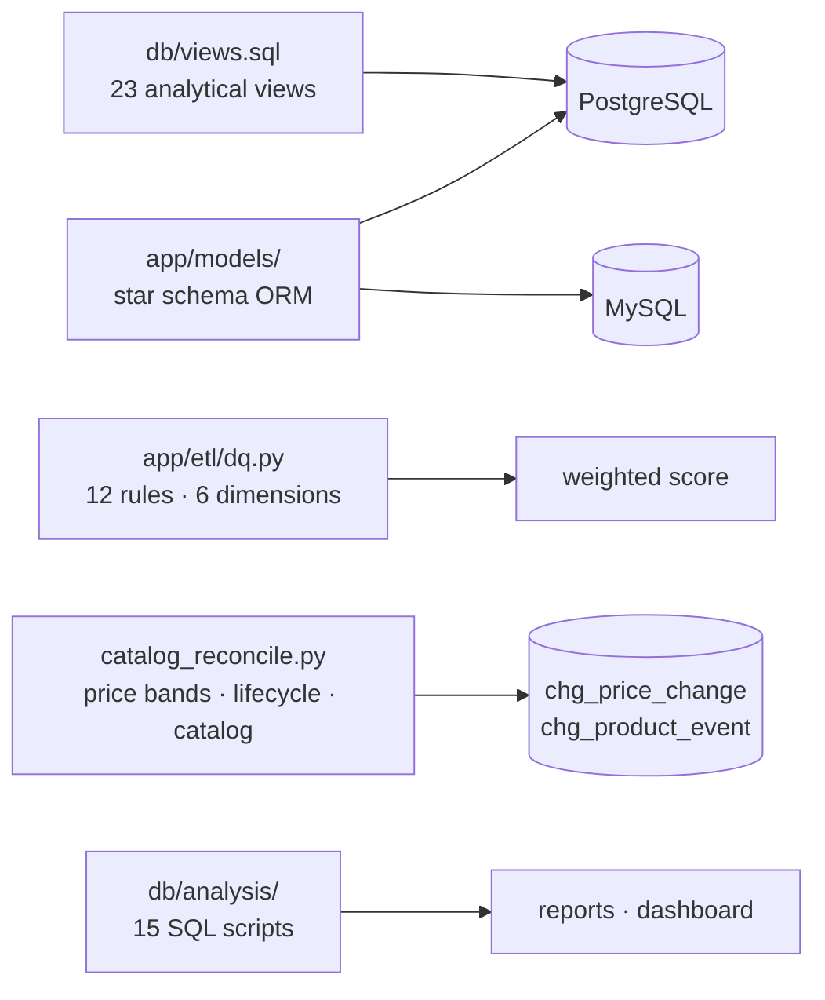
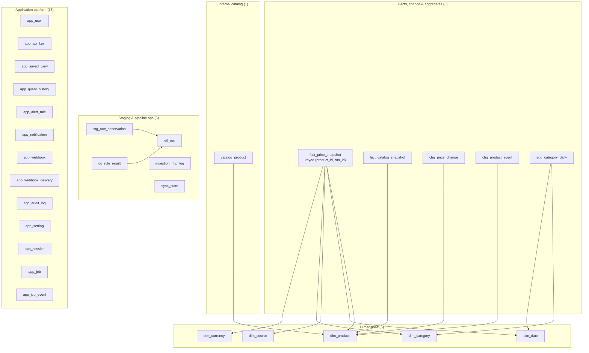
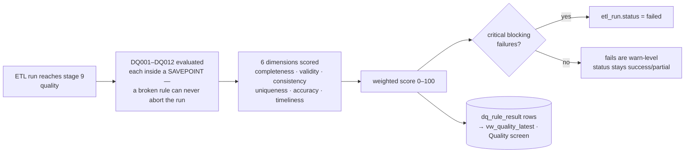
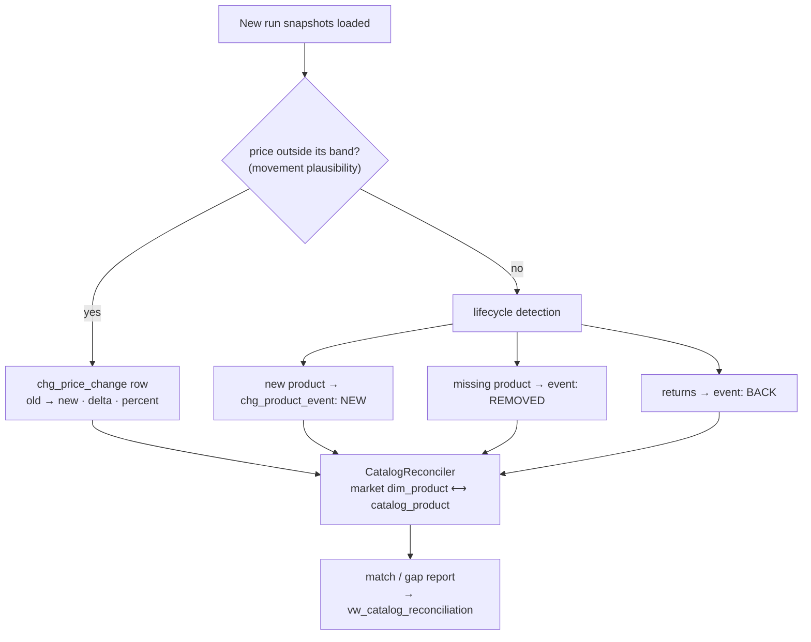
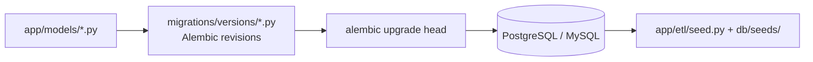

# Eng. Alaa Nasser — Database & Data Quality Lead

| | |
|---|---|
| **Weight** | 14% |
| **GitHub** | [@AlaaNasser-tech](https://github.com/AlaaNasser-tech) |
| **Role** | Database & Data Quality Lead |
| **Component** | 29 tables + 23 views + 12 DQ rules |
| **Full project** | [`project/`](project/) — complete pipeline, runs standalone |

---

## 1. Executive summary

Eng. Alaa Nasser owns the **memory and the conscience of the pipeline**. The memory: a Kimball star
schema — 5 dimensions, 5 fact/change/aggregate tables, an internal catalog table for reconciliation, 5
staging/ops tables and the 13 application tables — implemented dialect-portable across PostgreSQL and
MySQL with Alembic migrations. The conscience: a **12-rule data-quality framework** (DQ001–DQ012) across
**6 quality dimensions** with a weighted score that literally gates the pipeline run status, plus the
**23 analytical views** and **15 analysis SQL scripts** that turn raw snapshots into the market
intelligence the dashboard shows.

She also owns **change detection**: price bands, lifecycle events (new / removed / back) and catalog
reconciliation against the project's own product catalog (`catalog_product`).



---

## 2. The warehouse — 29 tables



| Group | Tables | Purpose |
|-------|--------|---------|
| Dimensions (5) | `dim_source`, `dim_category`, `dim_product`, `dim_date`, `dim_currency` | Kimball conformed dimensions, `fingerprint` on products for dedupe |
| Facts & change (5) | `fact_price_snapshot`, `fact_catalog_snapshot`, `chg_price_change`, `chg_product_event`, `agg_category_daily` | history, change events, pre-aggregated category-days |
| Catalog (1) | `catalog_product` | the project's own SKUs, reconciled against the market |
| Staging & ops (5) | `stg_raw_observation`, `etl_run`, `dq_rule_result`, `ingestion_http_log`, `sync_state` | raw landing zone, run bookkeeping, DQ results, HTTP audit |
| Application (13) | `app_user`, `app_api_key`, `app_saved_view`, `app_query_history`, `app_alert_rule`, `app_notification`, `app_webhook`, `app_webhook_delivery`, `app_audit_log`, `app_setting`, `app_session`, `app_job`, `app_job_event` | auth/RBAC, saved views, alerts, webhooks, audit, jobs |

**Total: 5 + 5 + 1 + 5 + 13 = 29 tables.**

---

## 3. The 23 analytical views (`db/views.sql`)

| # | View | Answers |
|---|------|---------|
| 1 | `vw_product_current` | what does every product look like *right now* |
| 2 | `vw_price_history` | full snapshot history per product |
| 3 | `vw_price_movements` | price deltas between runs |
| 4 | `vw_price_changes` | every recorded change event |
| 5 | `vw_product_events` | lifecycle events (new, removed, returned) |
| 6 | `vw_new_products` | first time a product was seen |
| 7 | `vw_removed_products` | products that disappeared upstream |
| 8 | `vw_category_changes` | change counts per category |
| 9 | `vw_category_price_index` | category-level price index |
| 10 | `vw_brand_summary` | brand positioning aggregates |
| 11 | `vw_source_coverage` | which source covers which catalog |
| 12 | `vw_quality_latest` | latest DQ posture |
| 13 | `vw_pipeline_health` | run durations and health |
| 14 | `vw_catalog_reconciliation` | own catalog vs market matches |
| 15 | `vw_top_movers` | biggest price movers |
| 16 | `vw_availability_summary` | stock posture |
| 17 | `vw_daily_kpis` | daily KPI rollup |
| 18 | `vw_http_audit` | ingestion compliance trail |
| 19 | `vw_product_index` | searchable product index |
| 20 | `vw_category_tree` | category hierarchy |
| 21 | `vw_price_volatility` | volatility per product/category |
| 22 | `vw_discount_leaders` | deepest discounts |
| 23 | `vw_rating_leaders` | best-rated value products |

---

## 4. The 12-rule DQ framework (6 dimensions)

| Rule | Name | Dimension |
|------|------|-----------|
| DQ001 | Required fields populated | completeness |
| DQ002 | Prices within valid range | validity |
| DQ003 | Ratings within 0–5 scale | validity |
| DQ004 | Currency codes known | consistency |
| DQ005 | Product fingerprints unique | uniqueness |
| DQ006 | One snapshot per product per run | uniqueness |
| DQ007 | Data freshness (hours since last snapshot) | timeliness |
| DQ008 | Category coverage | completeness |
| DQ009 | Price movement plausibility | accuracy |
| DQ010 | Availability captured | completeness |
| DQ011 | Run produced observations | completeness |
| DQ012 | Rejection rate in staging zone | validity |



---

## 5. Change detection & catalog reconciliation



---

## 6. The 15 analysis SQL scripts (`db/analysis/`)

| Script | Script | Script |
|--------|--------|--------|
| `01_price_changes` | `02_new_products` | `03_removed_products` |
| `04_category_changes` | `05_price_volatility_by_category` | `06_catalog_price_gaps` |
| `07_data_quality_posture` | `08_market_and_compliance` | `09_brand_price_positioning` |
| `10_source_overlap` | `11_rating_value_picks` | `12_discount_depth` |
| `13_category_concentration` | `14_new_product_velocity` | `15_stockout_risk` |

Run them all with `scripts/run_analysis.py` (part of the DevOps tooling).

---

## 7. Migrations



Files: `alembic.ini`, `migrations/env.py`, `migrations/script.py.mako`,
`migrations/versions/`, `db/views.sql`, `db/seeds/`, plus `docs/22_data_dictionary.md` and
`docs/28_schema_and_migrations.md` documenting every table and revision.

---

## 8. Files she delivered (inside `project/`)

| Path | Deliverable |
|------|-------------|
| `app/models/` | `dimensions.py`, `facts.py`, `catalog.py`, `operations.py`, `app_users.py`, `base.py` |
| `app/etl/dq.py` | 12 declarative rules, 6 dimensions, weighted scoring, blocking failures |
| `app/etl/catalog_reconcile.py` | price bands, lifecycle events, catalog reconciliation |
| `db/views.sql` | 23 analytical views |
| `db/analysis/` | 15 analysis SQL scripts + README |
| `db/seeds/` | seed data |
| `migrations/`, `alembic.ini` | schema migrations across PostgreSQL/MySQL |

## 9. Responsibilities (from `app/core/team.py`)

- Kimball star schema, dialect-portable PostgreSQL/MySQL
- 23 analytical views + 15 analysis SQL scripts
- 12-rule DQ framework across 6 dimensions + weighted score
- Change detection: price bands, lifecycle events, catalog reconciliation

## 10. Verify her layer

```bash
cd project
alembic upgrade head                                 # build the schema
python scripts/run_analysis.py                       # run all 15 analyses
pytest tests/test_analytics_market.py tests/test_etl_pipeline.py -q
```
