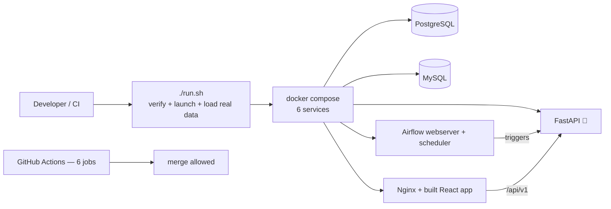
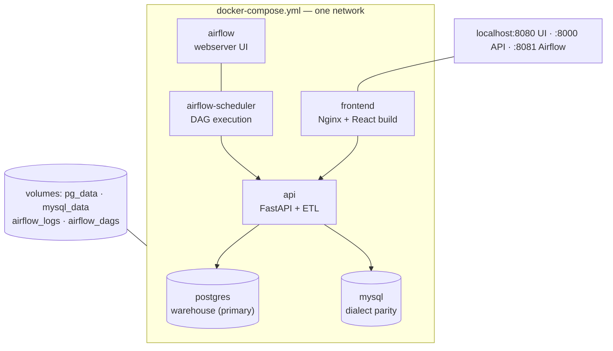
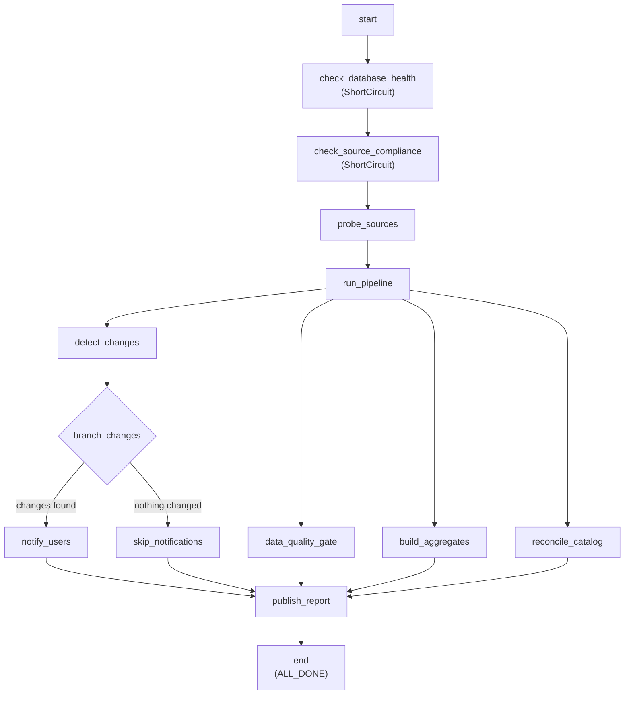
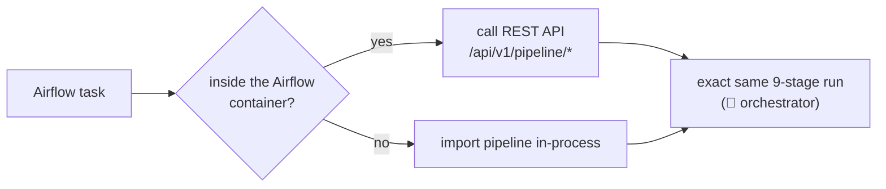
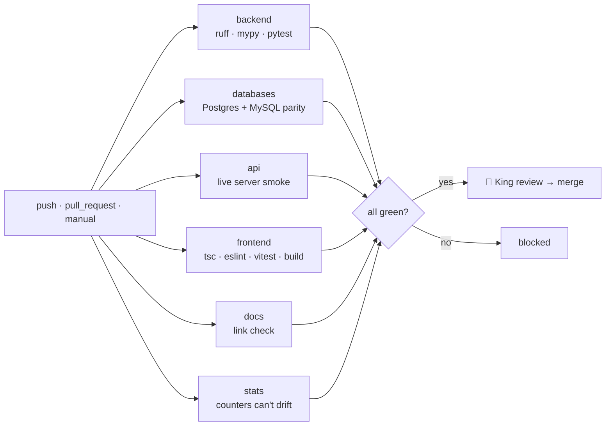

# Mennatullah Ahmed — DevOps & Orchestration Lead

| | |
|---|---|
| **Weight** | 14% |
| **GitHub** | [@mennatullahahmed01-debug](https://github.com/mennatullahahmed01-debug) |
| **Role** | DevOps & Orchestration Lead |
| **Component** | Airflow + Docker (6 services) + CI/CD + scripts |
| **Full project** | [`project/`](project/) — complete pipeline, runs standalone |

---

## 1. Executive summary

Mennatullah Ahmed owns **how the whole thing runs**: the 6-service Docker Compose stack, the Airflow
2.10 DAG that schedules the pipeline with 14 tasks and branch-on-changes fan-out, the GitHub Actions
CI that guards every layer of the repository, and the developer experience — a 73-target Makefile and
the one-command run scripts (`run.sh`, `run-full-app.sh`, `run-local.sh`) that take a fresh machine to
a fully loaded, verified stack.

The design principle she enforces: **one command, everything green** — if a change breaks lint, tests,
parity between dialects, the frontend build, the docs or the stats counters, CI catches it before it
can merge.



---

## 2. Docker — the 6-service stack



| Service | Image / build | Role |
|---------|---------------|------|
| `postgres` | Postgres | primary warehouse (star schema + views) |
| `mysql` | MySQL | cross-dialect verification target |
| `api` | `docker/api.Dockerfile` | FastAPI platform + ETL runner |
| `airflow` | `docker/airflow.Dockerfile` | webserver UI for the DAG |
| `airflow-scheduler` | same image | executes the 14-task DAG |
| `frontend` | built React app + Nginx | serves the dashboard, proxies `/api/v1` |

Init scripts in `docker/postgres-init/` create the Airflow metadata database on first boot.

---

## 3. Airflow — 14 tasks, branch-on-changes



Design guarantees baked into the DAG:

- **Idempotent tasks** — every run gets a fresh `run_id`; facts are keyed `(product_id, run_id)`, so
  retries are always safe.
- **ShortCircuit guards** — the DAG stops quietly (not fails loudly) when the database is unreachable
  or robots.txt forbids every configured source.
- **branch-on-changes** — notifications only fire when change counts are non-zero.
- **Resilient transport** — inside the container the DAG drives the pipeline over its REST API with a
  shared HTTP client; on a developer machine it imports the pipeline directly (in-process path,
  exercised by `make airflow-test`).



---

## 4. CI — 6 guarded jobs on every push / PR



---

## 5. Makefile — 73 targets, three families

| Family | Example targets |
|--------|-----------------|
| Environment & stack | `install`, `env`, `up-db`, `up`, `down`, `clean`, `ps`, `logs`, `bootstrap`, `bootstrap-mysql` |
| Data & migrations | `migrate`, `migrate-status`, `migrate-new`, `migrate-check`, `init-db`, `demo-postgres`, `demo-mysql`, `run-pipeline`, `run-all-sources`, `sources`, `analytics`, `verify-dialects` |
| Quality & run | `test`, `test-cov`, `lint`, `format`, `typecheck`, `frontend-lint`, `frontend-test`, `frontend-build`, `run`, `run-verify`, `run-full`, `airflow-init`, `airflow-test` |

Run `make help` for the annotated list.

---

## 6. The one-command scripts

| Command | Mode | What it does |
|---------|------|--------------|
| `./run.sh` | default | verify with **real data**, launch the Docker stack, load real data |
| `./run.sh --verify-only` | verify | lint, tests, live-source smoke, real pipeline, frontend build |
| `./run.sh --offline` | verify | synthetic `local_demo` source — no network needed |
| `./run.sh --quick` | verify | fast subset of tests, no frontend build |
| `./run.sh --stop` / `--clean` | ops | stop (keep data) / stop and delete volumes |
| `./run.sh --status` | ops | health of every service |
| `./run-full-app.sh` | full | end-to-end real-data verification + full stack |
| `./run-local.sh` | local | run everything without Docker (local venv + DBs) |

---

## 7. Scripts (`scripts/`)

| Script | Purpose |
|--------|---------|
| `api_smoke.py` | live API smoke test |
| `backup.sh` | database backup |
| `build_site.py` | build the documentation microsite (`site/`) |
| `check_links.py` | docs link checker (also run in CI) |
| `check_slugify.py` | slug/taxonomy consistency checks |
| `check_stats.py` | stats-drift guard (counts must match the code) |
| `diagrams.py` | render Mermaid diagrams from `docs/diagrams/` |
| `make_deck.py` | build the presentation deck |
| `make_infographic.py` | build the project infographic |
| `project_stats.py` | compute the project statistics (`docs/stats.json`) |
| `run_analysis.py` | run all 15 SQL analyses (Alaa's set) |
| `sync_version.py` | keep `VERSION` consistent across surfaces |

---

## 8. Files she delivered (inside `project/`)

| Path | Deliverable |
|------|-------------|
| `dags/product_intelligence_pipeline.py` | the 14-task Airflow DAG (graph above) |
| `docker/api.Dockerfile`, `docker/airflow.Dockerfile` | service images |
| `docker/postgres-init/` | first-boot database setup |
| `docker-compose.yml` | the 6-service stack + volumes |
| `.github/workflows/ci.yml` | the 6 guarded CI jobs |
| `.github/` | CODEOWNERS, dependabot, issue/PR templates, code of conduct |
| `Makefile` | 73 targets across environment, data, quality |
| `run.sh`, `run-full-app.sh`, `run-local.sh` | one-command environments |
| `scripts/` | the 12 operational scripts above |
| `pyproject.toml`, `.pre-commit-config.yaml` | ruff / mypy / pytest / pre-commit tooling |
| `.env.example`, `.gitignore` | environment template + ignores |

## 9. Responsibilities (from `app/core/team.py`)

- Airflow 2.10 DAG: 14 operators, branch-on-changes, notify/report fan-out
- 6-service Docker Compose stack + Dockerfiles
- GitHub Actions CI (backend, parity, smoke, frontend, docs, stats)
- Makefile (30+ targets), run.sh / run-full-app.sh / run-local.sh

## 10. Run & verify

```bash
cd project
./run.sh                  # the full path: verify + launch + real data
./run.sh --status         # are all 6 services healthy?
make airflow-test         # execute the DAG once, in-process
./run.sh --stop           # done for the day
```
