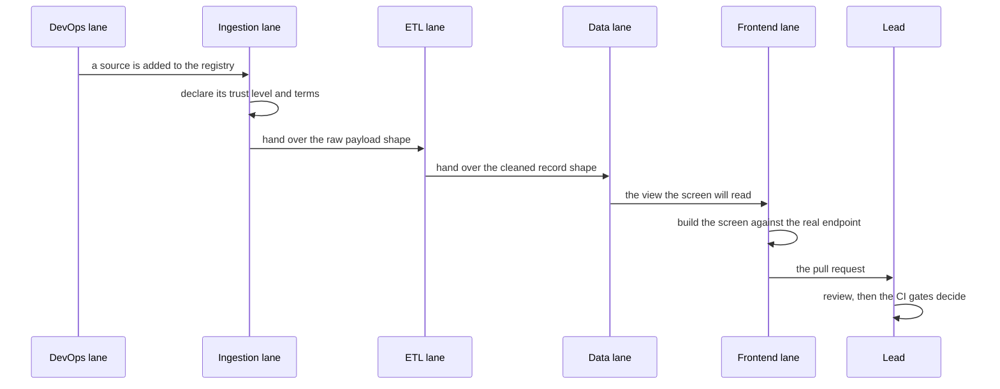

# 00 — Team, Roles & Effort Split

**Track:** Data Engineering (DEPI Digital Egypt Pioneers Initiative)
**Source of truth:** `app/core/team.py` maps to `GET /api/v1/meta/team`. This document,
the README team table and the website team section all mirror that module.

| # | Member | GitHub | Role | Weight | Main component |
|---|--------|--------|------|-------|----------------|
| 1 | Ahmed (78102) | [@Ahmedbakr78](https://github.com/Ahmedbakr78) | Team Lead + Backend/API + Documentation + 9 ETL Stages Owner | 28% | FastAPI + 37 Docs + 9 ETL Stages + Integration |
| 2 | Ahmed Abd alla | [@01124758140](https://github.com/01124758140) | Ingestion & Compliance Lead | 15% | robots.txt + 34 adapters + rate limiter |
| 3 | Ahmed Medhat | [@AhmedMedhatFarouk](https://github.com/AhmedMedhatFarouk) | ETL & Cleaning Lead | 14% | 29-step cleaner + dedupe + ETL support |
| 4 | Eng. Alaa Nasser | [@AlaaNasser-tech](https://github.com/AlaaNasser-tech) | Database & Data Quality Lead | 14% | 29 tables + 23 views + 12 DQ rules |
| 5 | legecy007 | [@legecy007](https://github.com/legecy007) | Frontend / Dashboard Lead | 15% | React 19 + 23 screens + PWA + themes |
| 6 | Mennatullah Ahmed | [@mennatullahahmed01-debug](https://github.com/mennatullahahmed01-debug) | DevOps & Orchestration Lead | 14% | Airflow + Docker + CI/CD + scripts |

Total: **100%**. See `CONTRIBUTORS.md` for the file-level responsibility map and
`docs/03_roles_and_responsibilities.md` for the RACI matrix.

---

## Purpose

A graduation project is judged on two things: what was built, and who built
it. The first is visible in the repository; the second is usually a name on a
slide. This document makes the second as inspectable as the first: every lane
names the files it owns, the pull requests it carries, and the acceptance
criteria that decide whether a piece of work is finished.

The split is not a guess. Each weight is the fraction of the delivered code
that the lane owns, and the ownership is recorded in `CONTRIBUTORS.md` and
derived from the commit history rather than asserted here.

---

## Ownership map

---

## The lanes in detail

### Ahmed (78102) — Team Lead, Backend, Integration, Documentation — 28%

The only lane that touches every layer, because the seams between layers are
where a project of this shape usually breaks: the CLI has to behave like the
API, the API like the Airflow DAG, and the documentation has to match what the
code actually does.

**Owned surfaces**

| Surface | Where | What "done" means |
| --- | --- | --- |
| FastAPI platform | `app/api/` — 24 routers, 222 operations | Every route is authenticated, authorised by role, and covered by a smoke check |
| The 9-stage ETL | `app/etl/pipeline.py` | The CLI, the REST trigger and the Airflow DAG produce the same result from the same input |
| Integration transport | `dags/product_intelligence_pipeline.py` | The DAG calls the pipeline in-process, and falls back to the REST API across the SQLAlchemy version split |
| Catalogues as code | `app/core/features.py`, `app/core/team.py` | The dashboard, the API and this file read the same module, so no two of them can disagree |
| Documentation | `docs/00–36`, `README.md`, `website/` | Every number in the prose is measured by `scripts/project_stats.py` and fails CI when it drifts |
| Releases | `docs/31_releases.md`, `VERSION`, tags | The version in three places, a changelog entry, and a green CI run |
| Review | every merge | Nothing reaches `main` without a passing pipeline and a reading reviewer |

**Eight function groups, each mapped to shipped code and verified by tests:**

1. **FastAPI platform** — `app/api/` (auth, RBAC, exports, webhooks, backfill,
   builder, query lab, jobs, settings, audit).
2. **9-stage ETL** — `app/etl/pipeline.py`, identical across the CLI, REST and
   Airflow triggers.
3. **Integration transport** — the `dags/` fallback layer that bridges the
   SQLAlchemy version split between Airflow 2.10 and the application.
4. **Catalogues as code** — `app/core/features.py` and `app/core/team.py`,
   exposed through `/meta/features` and `/meta/team`.
5. **Documentation** — 37 numbered documents, 101 Mermaid diagrams, the
   README, the website, and the statistics-drift CI job.
6. **Releases** — `docs/31_releases.md`, the version files, the tags and the
   GitHub releases.
7. **Quality gates** — the ruff, mypy, pytest, smoke, parity, frontend and
   documentation CI jobs.
8. **Review** — every merge, and every number in this file.

### Ahmed Abd alla — Ingestion & Compliance Lead — 15%

Owns the boundary between the project and the public internet, which is the
part of the system with the least tolerance for error.

**Owned surfaces**

| Surface | Where | What "done" means |
| --- | --- | --- |
| Source adapters | `app/ingestion/sources/` — 34 registered | Every adapter declares its trust level and its terms position |
| The robots.txt gate | `app/ingestion/robots.py` | A decision is made before the request, and it is written to the audit log |
| The compliance policy | `app/ingestion/compliance.py` | The guarantees in the code and the guarantees in the documentation are the same list, checked by a test |
| Rate limiting and politeness | `app/ingestion/ratelimit.py`, `app/ingestion/http_client.py` | No host is asked for more than its terms allow |
| The request audit trail | `app/models/operations.py` writes to `ingestion_http_log` | Every request records its URL, its status and its robots decision |

**Acceptance criteria for this lane**

- A source whose terms forbid polling is never collected, however it is
  selected.
- A `robots.txt` that answers 401/403 disallows the whole host, per
  RFC 9309.
- Every request is auditable from the SQL up, including the ones that were
  refused.

### Ahmed Medhat — ETL & Cleaning Lead — 14%

Owns the transformation between a raw payload and a warehouse row.

**Owned surfaces**

| Surface | Where | What "done" means |
| --- | --- | --- |
| The 29-step cleaner | `app/ingestion/cleaning.py` | Names, categories, prices, ratings, availability and URLs are normalised identically every time |
| Deduplication | `app/ingestion/dedupe.py` | Six measures, blended, with the score and the breakdown stored per product |
| The loader | `app/etl/loader.py` | The write path is idempotent, and a re-run appends rather than overwrites |
| Change detection | `app/etl/loader.py` | A price change becomes a row with a direction, a magnitude band and a significance flag |

**Acceptance criteria for this lane**

- The same raw record always produces the same cleaned record.
- A merge is reversible: the absorbed product keeps its `matched_product_id`.
- A record that cannot be cleaned is rejected with a reason, never silently
  dropped.

### Eng. Alaa Nasser — Database & Data Quality Lead — 14%

Owns the model, the dialect portability and the quality gate.

**Owned surfaces**

| Surface | Where | What "done" means |
| --- | --- | --- |
| The schema | `app/models/` — 29 tables | One model, loaded identically on PostgreSQL and MySQL |
| The analytical views | `db/views.sql` — 23 views | Portable SQL only, so the same view means the same thing on both engines |
| Migrations | `migrations/versions/` | A deployment can move from any revision to head, on either dialect |
| The quality framework | `app/etl/dq.py` — 12 rules, 6 dimensions | A rule that cannot be evaluated fails the run it is in, not the suite |
| Cross-dialect verification | `app/cli/main.py` with the `verify` command | The same schema, the same views and the same score on both engines |

**Acceptance criteria for this lane**

- `make verify-dialects` reports an identical schema and an identical score.
- A migration runs on PostgreSQL *and* MySQL from any starting revision.
- A score that was never measured is reported as absent, not as perfect.

### legecy007 — Frontend & Dashboard Lead — 15%

Owns everything the user touches.

**Owned surfaces**

| Surface | Where | What "done" means |
| --- | --- | --- |
| The 23 screens | `frontend/src/pages/` | Every screen renders real data, with no console error and no failed request |
| The design system | `frontend/src/components/ui.tsx`, `frontend/src/styles/index.css` | Five palettes, three densities, three motion modes, all persisted and all respecting the operating system |
| The API client | `frontend/src/lib/api.ts` | One place knows how to talk to the API, including token refresh |
| Accessibility and mobile | `frontend/src/components/AppShell.tsx` | The drawer, the phone tab bar and the keyboard map work the same on a 390 px screen as on a desktop |

**Acceptance criteria for this lane**

- No screen shows a number the API did not send.
- The app is usable at 390 px with no horizontal scrolling.
- Every icon is an icon, never a text glyph.

### Mennatullah Ahmed — DevOps & Orchestration Lead — 14%

Owns the machinery that runs the project and the checks that keep it honest.

**Owned surfaces**

| Surface | Where | What "done" means |
| --- | --- | --- |
| The Airflow DAG | `dags/product_intelligence_pipeline.py` — 33 task callables | A scheduled run produces the same warehouse as a manual one |
| The stack | `docker-compose.yml` — 6 services | One command brings the whole platform up, health-checked |
| The CI pipeline | `.github/workflows/ci.yml` — 6 jobs | Every job can fail, and does fail when it should |
| The verification scripts | `scripts/`, `run-full-app.sh`, `run-local.sh` | One command proves the whole platform, on real data |

**Acceptance criteria for this lane**

- `./run-full-app.sh` passes in *real* mode, against the live permitted
  sources, with no synthetic data anywhere in the warehouse.
- A failing job blocks the merge.

---

## How the work actually flowed

The order is not arbitrary. A screen built against a view that does not exist
yet is a screen that shows a spinner forever; a cleaner written against a
payload that has not been agreed is a cleaner with a guess in it. Each lane
hands over a *contract* - a column name, a trust level, a status code - and
the next lane builds against that contract rather than against a mock.

---

## Review and merge policy

| Rule | Why |
| --- | --- |
| Every pull request is reviewed by the lead | The seams between lanes are where defects hide |
| CI must be green before a merge | A red build is a broken promise to the reviewer |
| No commit touches a number in the documentation alone | The number is measured, so the prose follows the code, never the other way round |
| The statistics-drift job fails on a stale figure | A wrong number in the README is a defect, not a typo |
| The no-fake audit runs against a real warehouse | The claim in the documentation is checked by the database, not asserted |

The last row matters most for this project in particular: the guarantee that
the warehouse holds only observed market data is enforced by
`scripts/audit_no_fakes.py`, which walks every table that records an upstream
and exits non-zero the moment a row cannot be traced back to a source
classified as real.

---

## Effort split, and why

| Lane | Weight | Delivered surface | Why this share |
| --- | ---: | --- | --- |
| Lead | 28% | 24 routers, 9 ETL stages, 37 documents, the release process | The lead owns the interfaces *between* the lanes, and the documentation that has to match all of them |
| Ingestion | 15% | 34 adapters, robots.txt, rate limiting, the audit trail | The highest-risk surface: it touches third-party systems and has to be right about them |
| Frontend | 15% | 23 screens, the design system, mobile and accessibility | The user-facing surface is the product, and it is the largest single body of work in a dashboard |
| Cleaning & ETL | 14% | 29 cleaning steps, deduplication, the loader, change detection | The correctness core: everything downstream trusts it |
| Data & quality | 14% | 29 tables, 23 views, migrations, 12 rules, cross-dialect verification | The model has to be right on two engines at once |
| DevOps | 14% | The Airflow DAG, the stack, six CI jobs, the verification scripts | The machinery that makes the other five lanes verifiable |

The weights sum to 100 % and each one is the fraction of the delivered code
that the lane owns.
