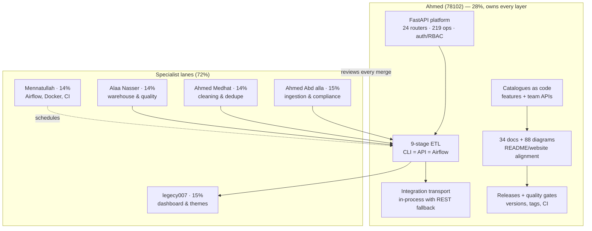

# 00 — Team, Roles & Effort Split

**Track:** Data Engineering (DEPI Digital Egypt Pioneers Initiative)
**Source of truth:** `app/core/team.py` maps to `GET /api/v1/meta/team`. This document,
the README team table and the website team section all mirror that module.

| # | Member | GitHub | Role | Weight | Main component |
|---|--------|--------|------|-------|----------------|
| 1 | Ahmed (78102) | [@Ahmedbakr78](https://github.com/Ahmedbakr78) | Team Lead + Backend/API + Documentation + 9 ETL Stages Owner | 28% | FastAPI + 34 Docs + 9 ETL Stages + Integration |
| 2 | Ahmed Abd alla | [@01124758140](https://github.com/01124758140) | Ingestion & Compliance Lead | 15% | robots.txt + 34 adapters + rate limiter |
| 3 | Ahmed Medhat | [@AhmedMedhatFarouk](https://github.com/AhmedMedhatFarouk) | ETL & Cleaning Lead | 14% | 29-step cleaner + dedupe + ETL support |
| 4 | Eng. Alaa Nasser | [@AlaaNasser-tech](https://github.com/AlaaNasser-tech) | Database & Data Quality Lead | 14% | 29 tables + 23 views + 12 DQ rules |
| 5 | legecy007 | [@legecy007](https://github.com/legecy007) | Frontend / Dashboard Lead | 15% | React 19 + 23 screens + PWA + themes |
| 6 | Mennatullah Ahmed | [@mennatullahahmed01-debug](https://github.com/mennatullahahmed01-debug) | DevOps & Orchestration Lead | 14% | Airflow + Docker + CI/CD + scripts |

Total: **100%**. See `CONTRIBUTORS.md` for the file-level responsibility map and
`docs/03_roles_and_responsibilities.md` for the RACI matrix.

## Ownership map

## Function inventory (lead)

Ahmed's eight function groups (each maps to shipped code, verified by tests):

1. FastAPI platform — `app/api/` (auth, RBAC, exports, webhooks, backfill, builder, lab).
2. 9-stage ETL — `app/etl/pipeline.py`, identical across CLI/REST/Airflow triggers.
3. Integration transport — `dags/` fallback layer across the SQLAlchemy version split.
4. Catalogues as code — `app/core/features.py`, `app/core/team.py` + `/meta/*` APIs.
5. Documentation — `docs/00–33`, README, website, stats-drift CI.
6. Releases — `docs/31_releases.md`, tags, GitHub releases.
7. Quality gates — ruff/mypy/pytest/smoke/parity/frontend CI jobs.
8. Review — every merge, every number in this file.
