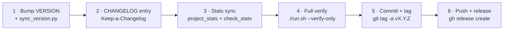
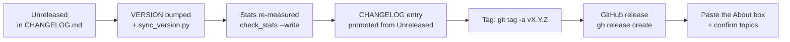

# 31 — Releases: Versioning, Tagging & GitHub Delivery

How this project ships: one version number in exactly one place, a changelog
entry per release, an annotated tag, and a GitHub release with notes. The flow
is designed so a release can never be half-done.

## Versioning

Semantic versioning (`MAJOR.MINOR.PATCH`), single source in `VERSION`:

- `MAJOR` — breaking API or schema change.
- `MINOR` — new sources, endpoints, screens (e.g. 1.9.0 to 1.10.0).
- `PATCH` — fixes with no new surface.

`scripts/sync_version.py` propagates `VERSION` into `pyproject.toml`,
`frontend/package.json` and the app settings — never edit those by hand:

```bash
printf '1.11.0' > VERSION
.venv/bin/python scripts/sync_version.py
```

## Release flow



Commands (owner runs these — nobody else can release for you):

```bash
# 1-2: version + changelog (Unreleased section becomes the new version)
printf '1.11.0' > VERSION
.venv/bin/python scripts/sync_version.py

# 3: re-measure every structural figure; fail loudly on drift
.venv/bin/python scripts/check_stats.py docs/stats.json --write
.venv/bin/python scripts/project_stats.py --sync-readme
.venv/bin/python scripts/check_stats.py docs/stats.json

# 4: prove it (lint, tests, live sources, real pipeline, frontend, compose)
./run.sh --verify-only

# 5-6: commit, tag, publish
git add -A && git commit -m "Release v1.11.0 — <one-line theme>"
git tag -a v1.11.0 -m "v1.11.0 — <one-line theme>"
git push origin main v1.11.0
gh release create v1.11.0 --title "v1.11.0" --notes-file CHANGELOG.md
```

## GitHub About box (paste-ready)

**Description:**

> End-to-end product intelligence pipeline: permitted web/API ingestion (35
> sources), compliance-first cleaning, fuzzy duplicate detection, PostgreSQL and
> MySQL warehouse with price history, SQL analytics, Airflow orchestration,
> FastAPI (219 ops) and a React 19 dashboard. Every row is provably observed
> market data. DEPI Data Engineering capstone.

**Topics:**

```
web-scraping  beautifulsoup  scrapy  etl  data-engineering  airflow  postgresql
fastapi  python  data-quality  deduplication  price-tracking  data-warehouse
docker  plotly  streamlit  rest-api  depi  data-pipeline  sql-analytics
data-lineage  provenance  robots-txt  rate-limiting  analytics-engineering
product-intelligence  kimball  react  typescript  airflow-dag  etl-pipeline
observability  alerting  openapi  clickhouse  duckdb  pandas  numpy
```

**Website:** link `website/index.html` (or the Pages URL once enabled).

**Visibility:** Repo, then Settings, then General, then Danger Zone, then Change visibility,
Make private (or `gh repo edit <repo> --visibility private
--accept-visibility-change-consequences`).

---

## Pre-flight checklist

A release is not done because the code works. It is done because every claim
attached to it is true and verifiable. Before tagging:

| # | Check | Command | Passes when |
| --- | --- | --- | --- |
| 1 | Version is propagated | `.venv/bin/python scripts/sync_version.py --check` | `VERSION`, `pyproject.toml`, `frontend/package.json` and the API all agree |
| 2 | Structural figures match the code | `.venv/bin/python scripts/check_stats.py docs/stats.json` | "No drift: all N pinned figures match" |
| 3 | README figures regenerated | `.venv/bin/python scripts/project_stats.py --sync-readme` | the stats block changes with the code |
| 4 | Backend tests | `.venv/bin/python -m pytest` | every test passes |
| 5 | Backend lint | `.venv/bin/python -m ruff check app/ tests/ scripts/` | no findings |
| 6 | Frontend lint, types, tests | `npm run lint && npm run typecheck && npm run test` (in `frontend/`) | zero warnings, zero errors, all tests green |
| 7 | Frontend production build | `npm run build` (in `frontend/`) | the bundle builds with `tsc -b` |
| 8 | The warehouse is clean | `pip-cli purge-untrusted --dry-run` | nothing to remove |
| 9 | The pipeline really runs | `pip-cli run-pipeline` | the run succeeds against live sources |
| 10 | The API really answers | `.venv/bin/python scripts/api_smoke.py` | 104/104 checks pass |
| 11 | The docs site builds | `make site && .venv/bin/python scripts/check_links.py site` | every internal link resolves |
| 12 | The infographic is current | `make infographic` | the assets are regenerated from the live stats |

Steps 8 to 12 are the ones that catch the failures a unit test cannot: a
source that started returning garbage, a table that grew without an index, a
documentation page that stopped existing.

---

## What a release note must contain



A release note is written for a reader who has not seen the project. It says
what changed, what it means, and how to verify it — not which files moved.

| Section | What goes in it |
| --- | --- |
| Theme | One line. The single idea the release is about. |
| Added | New capability, with the endpoint or screen that proves it. |
| Fixed | The bug, **the cause**, and what now prevents it recurring. |
| Changed | Behaviour that is different, with the migration note. |
| Verified | The commands that were run and their results. |

The last section is what distinguishes a release note from a wish list. It
should quote real output — `594 passed`, `104/104`, `No drift: all 15 pinned
figures match` — not intentions.

---

## History

| Version | Theme |
|---|---|
| 1.12.0 | Truthful metrics, silent reload & mobile parity; window indexes; hermetic test suite |
| 1.11.0 | Morning Briefing, 10x demo warehouse, account briefing defaults, mobile/theme polish |
| 1.10.0 | Ingestion Max: TVMaze + Archive.org + DummyJSON recipes, Scrapy engine, conditional GET, team API |
| 1.9.0 | Real-only defaults, theme memory, modern scrollbars, Account Max, run.sh |
| 1.8.0 | Query power Max (HAVING, OR logic, saved-view lifecycle, query history) |

Full detail per version: `CHANGELOG.md`.

---

## Related

| Document | Covers |
| --- | --- |
| [33 — Data Trust & Compliance](33_data_trust_and_compliance.md) | Why a release cannot quietly introduce fabricated rows |
| [24 — Demo Runbook](24_demo_runbook.md) | What to show, and what to do when a source is down |
| [15 — Testing Strategy](15_testing_strategy.md) | The full test matrix and the quality gates |
| [31 — Releases](31_releases.md) | This document |

