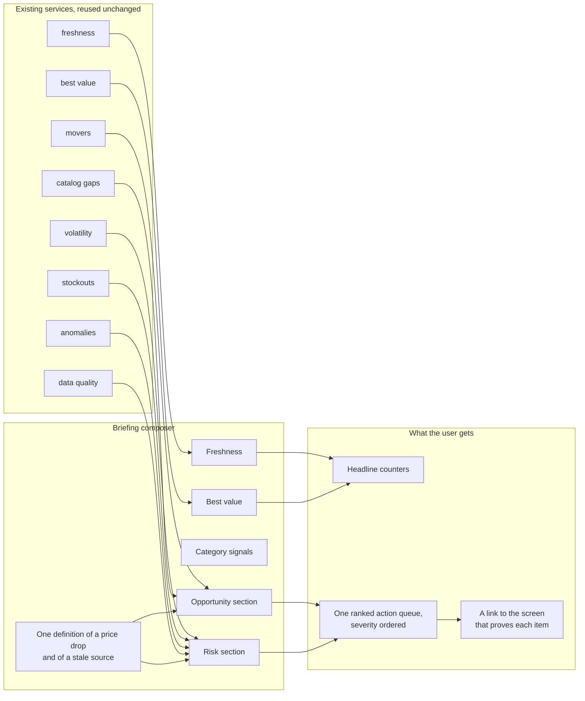

# Morning Briefing & 10x Demo Scale

This document covers the v1.11 intelligence layer and the synthetic expansion used
for demos and screenshots. Both are additive: no existing ingest path, table or
metric definition was replaced.

## 1. Morning briefing



### Why a composition layer

The dashboard already had individual reports (movers, volatility, catalog gaps,
stockouts, DQ, freshness). A user still had to open five screens to answer “what
should I do first?”. The briefing composes those services into one ranked queue so
the definition of a price drop or a stale source never forks.

Source: `app/analytics/briefing.py`.
Transport: `app/api/routers/intelligence.py`.

### Endpoint

```http
GET /api/v1/intelligence/briefing?days=30&limit=6
Authorization: Bearer <token>
```

| Parameter | Type | Default | Bounds | Meaning |
| --- | --- | --- | --- | --- |
| `days` | integer | 30 | 1–3650 | Analysis window |
| `limit` | integer | 6 | 1–20 | Maximum items per section |

Response sections:

- `headline` — observations, canonical products, live sources, price changes,
  significant changes, new/removed products, DQ score, opportunity/risk counts.
- `opportunities` — drops, catalog gaps below market, discounts.
- `risks` — increases, stockout pressure, anomalies, DQ failures, stale sources.
- `category_signals` — categories ranked by average absolute move.
- `freshness` — healthy vs stale sources and up to six stale source rows.
- `best_value` — rating-per-dollar listings with at least ten reviews.
- `actions` — the merged, severity-ranked queue rendered by the UI.

Every insight has the same shape:

```json
{
  "id": "drop-123",
  "kind": "opportunity",
  "severity": "high",
  "title": "Product name",
  "detail": "Category · $19.00 to $15.20 on source_code",
  "metric": "-20.0%",
  "delta": -20.0,
  "icon": "trending-down",
  "link": "/products/123",
  "action": "Review the new price"
}
```

### Ranking and noise controls

1. Sort by severity (`critical`, `high`, `medium`, `low`), then by absolute delta.
2. Exclude moves above 65% — these are nearly always unit, currency or ingestion
   errors and belong in the anomaly/DQ screens.
3. Exclude catalog gaps above 60% for the same reason.
4. Suppress duplicate product IDs and duplicate catalog SKUs from historical
   snapshots.
5. Format sub-dollar prices with 4–8 decimals instead of rounding to `$0.00`.
6. Cache the assembled response for 120 seconds per API worker.

The cache is intentionally in-process. A pipeline run is followed by an API
restart in the demo flow; tests and normal page refreshes still see fresh numbers
within two minutes.

### Account defaults

`Account, then Preferences`, persists `briefing_window` and `briefing_size` in the
profile's `preferences` JSON. `/briefing` reads them on mount, so every device
opens the same window and queue length.

### Verification

```bash
.venv/bin/python -m pytest tests/test_intelligence.py -q
curl -s "http://localhost:8000/api/v1/health"
```

`tests/test_intelligence.py` covers authentication, the response contract, bounded
sections, deep links and 422 validation for an out-of-range window.

## 2. 10x demo warehouse

### Command

```bash
# inside the API container
docker exec pip-api python -m app.cli.main expand-demo --products 19500 --days 26

# or locally
.venv/bin/python -m app.cli.main expand-demo --products 19500 --days 26
```

The command is idempotent: if the reserved cohort already has at least the
requested number of products and any snapshots, it reports live totals and skips.

### What is generated

| Artefact | Approximate volume |
| --- | --- |
| Synthetic products (`SYN-000001` …) | 19,500 |
| Price snapshots | 506,000 |
| Price-change records | ~343,000 |
| Lifecycle events | ~20,000 |
| Internal catalog SKUs | ~13,000 |
| Catalog match snapshots | ~13,000 |

All rows use source `local_demo` and the reserved `SYN-` external-id prefix, so
they are easy to identify or delete. The cohort uses deterministic seeds, price
walks with periodic promotions, rare clearance shocks, lifecycle gaps, and seeded
DQ defects.

After the append, `agg_category_daily` is rebuilt from `fact_price_snapshot` for
the generated window. `dim_product.current_price`, `dim_category.product_count`
and `dim_source` counters are refreshed.

### Resulting demo totals

- Products: **25,076**
- Observations: **~538k** after removing 66 known outlier snapshots from the old
  seed history
- Catalog SKUs: **13,000**
- Sources reporting: **31 of 34**
- Postgres size: ~90 MB at the original seed, substantially larger after the
  expansion (measure with `docker exec pip-postgres psql -U pip -d pipeline -c
  "SELECT pg_size_pretty(pg_database_size('pipeline'));"`).

### Why some source rows were removed

The original `local_demo` seed had 120 days of history, and several older manual
pipeline runs appended a second snapshot for the same product/date. Those runs
produced interleaved day-over-day changes in the thousands of percent. v1.11
removes:

- the 66 clearly out-of-range snapshots from historical runs, and
- 4,521 non-seed `DEMO-` snapshots plus their changes/events.

The remaining seed series is the intended walk (daily moves ≤18%), so movers and
charts show credible values.
