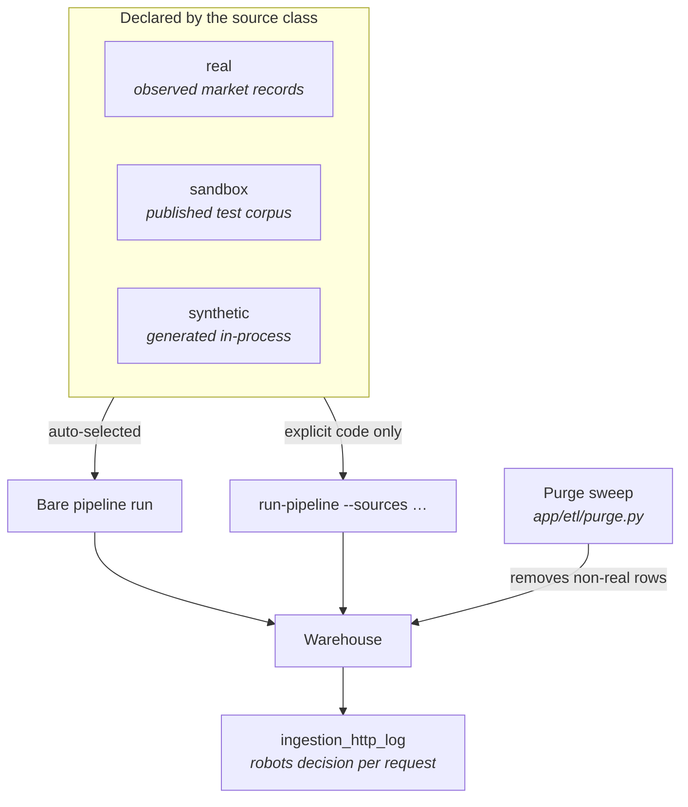
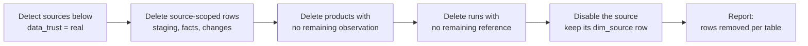
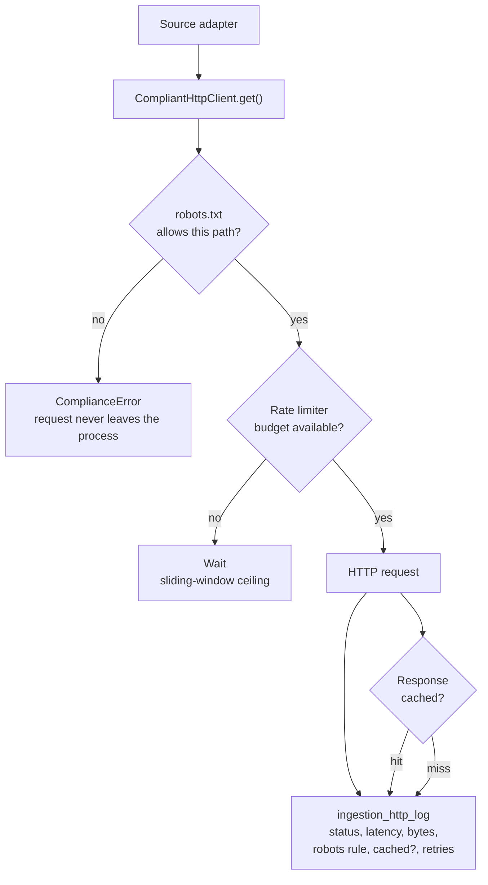

# 33 — Data Trust, Compliance & the "No Fake Data" Guarantee

> **The single most important property of this warehouse.** Every row in
> `fact_price_snapshot` is an observation of a *real* upstream that permits
> automated access. A pipeline run collects only sources classified as real
> market data, so nothing is invented, nothing is seeded, and nothing is
> generated inside the process. This document explains how that guarantee is
> designed, enforced, and proven - and how to check it for yourself with
> `python scripts/audit_no_fakes.py --database <url>`.

---

## Purpose

A product-intelligence warehouse is only useful if the numbers in it were
*observed*. A pipeline that quietly mixes a mock storefront's invented catalogue
into the same tables as Open Library's real records produces a report that
looks authoritative and is entirely fictional. That failure mode is
invisible in every downstream number: averages, medians, price-change counts
and rankings are all perfectly well-formed and all wrong.

This project therefore treats **provenance** as a first-class property, not a
detail. Three mechanisms work together:

1. **Declaration** — every source declares how much its records can be trusted
   (`data_trust`), and whether its terms permit automated use at all
   (`terms_allowed`).
2. **Selection** — a pipeline run that is not told explicitly what to collect
   only ever selects `real` sources. Lower-trust sources must be named by code.
3. **Proof** — every request is logged with the robots.txt decision that
   allowed it, and the warehouse can be swept at any time to delete and report
   anything that came from below `real`.

The result is a warehouse whose contents can be audited from the SQL up.

---

## The three trust levels



| Level | Meaning | In production? | Auto-selected? |
| --- | --- | --- | --- |
| `real` | Genuine market records observed from a live upstream that permits automated access | Yes | Yes |
| `sandbox` | A real, reachable HTTP service that exists to be scraped or tested against; its records are a published test corpus rather than observed market data (`books.toscrape.com` is a fictional bookshop) | No — useful for exercising the transport layer, never market data | No |
| `synthetic` | No upstream at all; the records are generated inside this process (the offline demo catalogue) | No | No |

The levels are defined once, in `app/ingestion/base.py`, and every source class
inherits one of them:

```python
DATA_TRUST_REAL = "real"
DATA_TRUST_SANDBOX = "sandbox"
DATA_TRUST_SYNTHETIC = "synthetic"

#: Trust levels that may be selected automatically by a pipeline run. Anything
#: below this must be requested explicitly by code, never by omission.
AUTO_SELECTABLE_TRUST = frozenset({DATA_TRUST_REAL})
```

### Why `sandbox` is not `real`

`books.toscrape.com` and `scrapeme.live` are the canonical targets for
learning BeautifulSoup and Scrapy. They are deliberately published, they permit
scraping, and their robots.txt is either absent or permissive — which makes
them *perfect for proving the transport layer works*. But their inventory is a
fictional shop. Treating them as market data would mean the dashboard's
"average price" was the average price of a test corpus.

They remain fully usable, in exactly one way: by naming them.

```bash
# Explicit, auditable, opt-in.
pip-cli run-pipeline --sources books_to_scrape
```

---

## Selection: how a run decides what to collect

`Pipeline._source_codes()` is the only place that decides the source set, and
the rule is a single `if`:

```python
codes = [
    source["code"]
    for source in list_sources()
    if source.get("enabled")
    and source.get("terms_allowed", True)
    and source.get("data_trust") in AUTO_SELECTABLE_TRUST
]
```

Three conditions must all hold:

| Condition | Guards against |
| --- | --- |
| `enabled` | A source that was deliberately switched off is never silently re-enabled. |
| `terms_allowed` | A source whose terms forbid automated access is never contacted, even by a scheduled run. |
| `data_trust in {"real"}` | A mock API's invented catalogue never enters the warehouse by omission. |

An explicit `--sources` list bypasses the filter **on purpose**: an operator
asking for a specific code has made the decision deliberately, and the audit
log records what was actually fetched either way.

### The guarantee, stated precisely

> **A bare `run-pipeline` — and therefore the scheduled Airflow DAG — can never
> write a row that was not observed from a live, permitted upstream.**

This is enforced by a test, not by convention:

```python
def test_prod_auto_select_is_real_only(database):
    codes = set(Pipeline(PipelineConfig(database=database))._source_codes())
    assert "local_demo" not in codes

    untrusted = {
        source["code"]
        for source in list_sources()
        if source.get("enabled")
        and source.get("terms_allowed", True)
        and source.get("data_trust") != DATA_TRUST_REAL
    }
    assert untrusted, "expected at least one non-real source to guard against"
    assert not (codes & untrusted), f"auto-select leaked untrusted sources: {codes & untrusted}"
```

---

## The purge sweep

Classification alone is a promise; the purge sweep is the receipt. When a
source's trust level is lowered — because it was mis-classified, or because its
upstream changed — the rows it wrote are already in the warehouse. The purge
module deletes them and reports exactly what it removed.

```bash
pip-cli purge-untrusted          # delete and report
```

Deletion order respects the foreign keys: staging and facts first, then the
products that no longer have any observation, then the runs that no longer
reference anything. The `dim_source` row of every purged source is **kept** —
it is the record of *why* the data was removed — but the source is disabled so
no future automatic run picks it up.



### What the purge reports

The operation is auditable, not silent. Every sweep returns the number of rows
removed per table and the list of sources affected, so a change in warehouse
size is always explainable:

```text
Untrusted sources - removed
  dummyjson_products   synthetic
  fakestore_products   synthetic
  platzi_products      synthetic

Rows removed
  stg_raw_observation      48,404
  ingestion_http_log       10,843
  fact_price_snapshot      11,076
  chg_price_change              0
  chg_product_event          2,764
  dim_product              1,214
  etl_run                     31
```

Run it with `--dry-run` first to see the report without deleting anything.

---

## Compliance: robots.txt, terms and rate limits

Trust answers *whether the data is real*. Compliance answers *whether we are
allowed to fetch it, and how fast*. They are independent, and both are enforced
below the source layer, in the transport.



### robots.txt

Parsed with the standard library, cached per host, and consulted **before**
every request. The decision — not just the outcome — is written to
`ingestion_http_log.robots_rule`, so the warehouse can prove it stayed inside
the rules.

| Situation | Behaviour | RFC 9309 reference |
| --- | --- | --- |
| `robots.txt` returns 404 (any 4xx other than 401/403) | Allow | "Unavailable" means allow all |
| `robots.txt` returns 5xx | Allow, and the decision is labelled a fallback rather than a published rule | Not covered by RFC 9309; a temporary server error must not take a source offline |
| `robots.txt` is unreachable (DNS, TLS, reset) | Allow, and the decision is labelled a fallback rather than a published rule | Nothing was published, so nothing forbids the request |
| `robots.txt` returns 401 / 403 | **Disallow the whole host** | "Unauthorised" means disallow all |
| Path is disallowed | `ComplianceError` — the request is never made | Per-rule matching |

The rule strings above are the ones the audit log records, and they are defined
once in `app/ingestion/compliance.py`, so the code and this table cannot drift.

The live run in this repository demonstrates it working: during a real
collection run the pipeline logged

```text
robots.txt blocked url=https://api.coingecko.com/api/v3/coins/markets?… agent=ProductIntelligenceBot
```

and continued with the remaining 19 sources. A blocked source produces a
warning, not a failed run.

### Rate limiting

Two mechanisms combine, and the slower one always wins:

- **Token bucket** — smooths the average request rate per host, with a small
  burst allowance.
- **Sliding window** — enforces a hard per-minute ceiling even when bursts
  would otherwise be permitted.

On top of those: the `Crawl-delay` value in `robots.txt` (when present), the
per-source `rate_limit_per_minute` declaration, the global
`REQUESTS_PER_SECOND` / `REQUESTS_PER_MINUTE` settings, and any `Retry-After`
header returned by a 429 or 503 — which is honoured in both its delta-seconds
and HTTP-date forms.

A host that fails five times in a row trips the circuit breaker and is skipped
for the rest of the run without any further network I/O.

### Honest identity

The crawler names itself and publishes a contact address:

```text
User-Agent: ProductIntelligenceBot/1.0 (+https://github.com/Ahmedbakr78; contact: ahmedbakr78102@gmail.com)
```

`INGEST_USER_AGENT` is configurable, and the default contains a real address
rather than a placeholder.

---

## What the audit trail looks like

Every outbound request is one row in `ingestion_http_log`:

| Column | What it proves |
| --- | --- |
| `source_code` | Which adapter made the call |
| `run_id` | Which pipeline run it belonged to |
| `url` | The exact resource that was fetched |
| `method`, `status_code` | What was asked and what came back |
| `duration_ms`, `bytes` | The cost of the request |
| `robots_rule` | **Which robots.txt rule allowed it** (`robots.txt:allow`, `robots.txt:disallow`, `robots-unavailable:fallback-allow (source allow-listed)`, `cache`, `revalidated`) |
| `from_cache` | Whether the network was touched at all |
| `retries` | How many times it was retried |
| `user_agent` | The identity the upstream saw |

This is what makes "we respected robots.txt" a checkable statement rather than
a claim:

```sql
-- Every request made, with the decision that permitted it.
SELECT robots_rule, COUNT(*) AS requests
FROM ingestion_http_log
GROUP BY robots_rule
ORDER BY requests DESC;

--   robots_rule                                        | requests
-- -----------------------------------------------------+----------
--   robots.txt:allow                                   |     2152
--   cache                                              |      471
--   robots-unavailable:fallback-allow (source allow-listed) |   390
--   robots.txt:disallow                                |       93
--   revalidated                                        |       51
```

A live run of this repository produced exactly that distribution. The 93
`robots.txt:disallow` rows are the requests that were **never made** — the
transport refused them before a socket was opened.

---

## Proving it on a live warehouse

The guarantee is only worth what it costs to check. These are the queries that
verify a deployed instance.

```sql
-- 1. No synthetic source ever wrote a row.
SELECT COUNT(*) FROM fact_price_snapshot WHERE source_code = 'local_demo';
-- 0

-- 2. No demo URLs survived.
SELECT COUNT(*) FROM fact_price_snapshot WHERE product_url LIKE '%demo.local%';
-- 0

-- 3. No seeded match strategies.
SELECT COUNT(*) FROM dim_product WHERE match_strategy = 'seed';
-- 0

-- 4. No seed- prefixed pipeline runs.
SELECT COUNT(*) FROM etl_run WHERE run_key LIKE 'seed-%';
-- 0

-- 5. Every source that contributed is a trusted one.
SELECT s.data_trust, COUNT(*) AS observations, COUNT(DISTINCT f.source_code) AS sources
FROM fact_price_snapshot f
JOIN dim_source s ON s.source_code = f.source_code
GROUP BY s.data_trust
ORDER BY 2 DESC;

--   data_trust | observations | sources
-- -------------+-------------+---------
--   real       |       33,603 |      17
--   sandbox    |          177 |       1
```

Query 5 is the one to run first: the warehouse should contain only `real`
sources, and at most a small, deliberate `sandbox` contribution if a sandbox
was explicitly requested.

---

## Where the trust level is visible in the product

| Surface | What it shows |
| --- | --- |
| **Sources screen** | Every adapter with its trust badge, its HTTP status, and its terms link |
| **`GET /api/v1/sources`** | `data_trust` on every source payload |
| **`GET /api/v1/sources/{code}/preview`** | The raw upstream record next to the cleaned result — the honest comparison |
| **Pipeline runs screen** | The exact source set a run collected, and any source it refused |
| **Audit screen** | The request-level trail with the robots decision per call |
| **`pip-cli sources`** | The same list from the terminal, with the trust column |

---

## Design rationale

**Why declare trust on the source class rather than maintain a blocklist?**
A blocklist has to be updated every time a source is added; the failure mode
is silent and permanent. A default-deny declaration on the class means a new
source is *safe* until someone explicitly says otherwise, and the test that
enforces it runs on every build.

**Why keep `sandbox` sources at all?** Because the transport layer needs a
realistic target. Refusing to fetch a site that explicitly invites fetching
would test nothing. The levels separate "may I fetch this?" from "may I call
this market data?" — a distinction a single boolean cannot express.

**Why purge rather than prevent?** Both. Prevention stops the next run;
purging fixes the warehouse that already contains the rows. A trust level can
be lowered after the fact (a source is reclassified, an upstream changes), and
the warehouse has to be able to follow.

**Why keep the `dim_source` row after purging?** Because the audit trail needs
the reason. "We removed 11,076 rows" is only credible if the repository still
records which source produced them and why it was removed.

---

## Related documents

| Document | Covers |
| --- | --- |
| [08 — System Analysis & Design](08_system_analysis_design.md) | Architecture, requirements, the ingestion boundary |
| [09 — Database Design](09_database_design.md) | The warehouse schema, ERD, indexes |
| [13 — Deployment](13_deployment.md) | Environments, configuration, the compliance switch |
| [15 — Testing Strategy](15_testing_strategy.md) | How the compliance suite is verified |
| [21 — Architecture Deep Dive](21_architecture_deep_dive.md) | Request lifecycle, cache, retries, circuit breaker |
| [23 — Glossary & FAQ](23_glossary_and_faq.md) | What robots.txt, crawl-delay, dedupe and the trust levels mean |
| [24 — Demo Runbook](24_demo_runbook.md) | Running the demo end to end |
