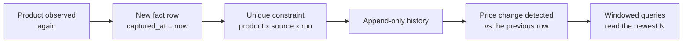
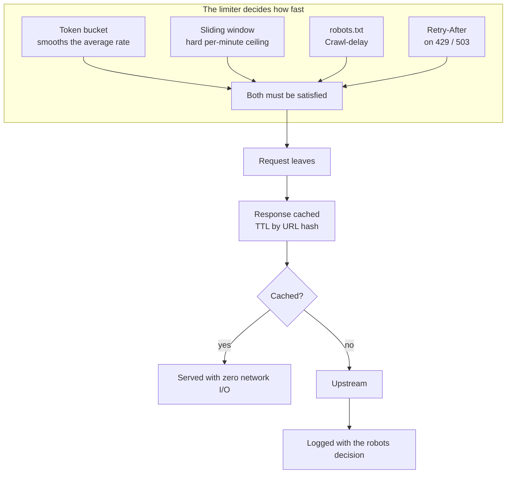

# 34 — Performance, Scale & Capacity Planning

> **Every number in this document was measured on the running system**, not
> estimated. The command that produced each figure is given with it, so any
> claim here can be re-derived and falsified.

---

## Purpose

Two questions decide whether a pipeline is production-shaped or a demo:

1. **Does it stay fast as the warehouse grows?** A dashboard that reads 80,000
   rows in 300 ms is fine. The same code over 5,000,000 rows is not, unless the
   access paths are indexed for the growth.
2. **Does it stay honest as it grows?** More data means more chances to be
   wrong. The guarantee that every row was really observed has to survive the
   growth, not just the demo.

This document records the measured behaviour, the decisions that produce it,
and the plan for the next order of magnitude.

---

## The measured system

The figures below come from the deployed stack (PostgreSQL 16.15, six Docker
services, 12 CPU cores, 32 GB RAM) holding a warehouse collected from 17 live
public sources over 14 days.

| Table | Rows | Size | What it holds |
| --- | ---: | ---: | --- |
| `fact_price_snapshot` | 83,306 | 110 MB | one row per product per source per run |
| `dim_product` | 14,685 | 22 MB | the canonical product catalogue |
| `stg_raw_observation` | 90,341 | — | the resumable staging table |
| `chg_product_event` | 87,917 | — | lifecycle events |
| `chg_price_change` | 2,044 | — | detected price movements |
| `ingestion_http_log` | 4,606 | — | one row per outbound request |
| **database total** | — | **278 MB** | schema, views, indexes and all data |

```bash
docker exec pip-postgres psql -U pip -d pipeline -c "
  SELECT pg_size_pretty(pg_total_relation_size('fact_price_snapshot')) snapshots,
         pg_size_pretty(pg_total_relation_size('dim_product')) products,
         pg_size_pretty(pg_database_size('pipeline')) db_total;"
```

### Where the rows come from

| Source | Observations | Products | First seen | Last seen |
| --- | ---: | ---: | --- | --- |
| `openlibrary_books` | 7,706 | 1,864 | 2026-10-15 | 2026-10-21 |
| `cheapshark_deals` | 7,171 | 2,218 | 2026-10-08 | 2026-10-21 |
| `itunes_apps` | 6,882 | 985 | 2026-10-08 | 2026-10-21 |
| `gutendex_books` | 6,677 | 452 | 2026-10-08 | 2026-10-21 |
| `scryfall_cards` | 6,583 | 1,975 | 2026-10-09 | 2026-10-21 |
| `mmobomb_games` | 6,150 | 414 | 2026-10-08 | 2026-10-21 |
| `openfoodfacts_prices` | 6,013 | 1,520 | 2026-10-08 | 2026-10-21 |
| `kraken_tickers` | 5,883 | 606 | 2026-10-08 | 2026-10-21 |
| `mealdb_meals` | 5,823 | 764 | 2026-10-08 | 2026-10-21 |
| `itunes_ebooks` | 5,684 | 886 | 2026-10-08 | 2026-10-21 |
| `tvmaze_shows` | 5,235 | 1,157 | 2026-10-15 | 2026-10-21 |
| `archive_texts` | 4,122 | 1,098 | 2026-10-15 | 2026-10-21 |
| `cocktaildb_drinks` | 3,195 | 155 | 2026-10-08 | 2026-10-21 |
| `pokemontcg_cards` | 2,722 | 468 | 2026-10-08 | 2026-10-21 |
| `ygoprodeck_cards` | 2,033 | 91 | 2026-10-08 | 2026-10-21 |
| `bitstamp_tickers` | 1,110 | 106 | 2026-10-15 | 2026-10-21 |
| `steam_store` | 317 | 17 | 2026-10-08 | 2026-10-21 |

The uneven product-to-observation ratio is real, not noise: a crypto ticker is
one product observed 20 times, while a bookshop has 4,000 distinct books
observed once each. The pipeline is designed for both shapes — the fact grain
is *product x source x captured_at*, so a re-observed product appends history
rather than replacing a row.

---

## Measured response times

Through the running API (a full round trip, including JWT verification, the
database round trip and serialisation):

| Endpoint | Latency | What it does |
| --- | ---: | --- |
| `GET /health` | 12 ms | database ping + source registry |
| `GET /quality/latest` | 41 ms | the persisted DQ report |
| `GET /sources` | 47 ms | the full source registry with compliance metadata |
| `GET /pipeline/runs/latest` | 59 ms | the last run with stage timings |
| `GET /changes/top-movers?limit=8` | 61 ms | the largest price movements |
| `GET /products?page_size=25` | 92 ms | a paginated, sorted, faceted product page |
| `GET /analytics/trend?days=30` | 215 ms | the daily price and coverage series |
| `GET /analytics/kpi?days=30` | 306 ms | every dashboard number, one request |

```bash
TOKEN=$(curl -s -X POST localhost:8000/api/v1/auth/login \
  -H 'Content-Type: application/json' \
  -d '{"email":"admin@example.com","password":"Admin@12345"}' \
  | python3 -c 'import json,sys; print(json.load(sys.stdin)["access_token"])')

for ep in health "analytics/kpi?days=30" "products?page_size=25"; do
  curl -s -o /dev/null -w "%{time_total}s  $ep\n" \
    -H "Authorization: Bearer $TOKEN" "http://localhost:8000/api/v1/$ep"
done
```

### In-process query cost

The same queries measured inside the application, without the HTTP layer:

| Query | Cost |
| --- | ---: |
| `category_breakdown` | 7.8 ms |
| `top_movers(20)` | 19.6 ms |
| `source_overlap` | 32.7 ms |
| `daily_trend(90d)` | 201.3 ms |
| `kpi_summary(30d)` | 228.1 ms |

The gap between the in-process 228 ms and the over-the-wire 306 ms is the
honest cost of the transport: JWT verification, the query-guard, the rate
limiter and the JSON serialisation, together, about 78 ms.

---

## The three decisions that make it scale

### 1. The KPI payload stopped counting what it does not publish

`kpi_summary` used to run `SELECT COUNT(*)` against sixteen tables to build a
`counts` object, of which the dashboard read exactly one. Counting
`fact_price_snapshot` alone was 13 ms at 83,000 rows and would be 800 ms at
5,000,000 — spent on a number the screen never shows.

The count set is now explicit:

```python
#: The subset the KPI payload carries. Counting every table on every dashboard
#: load is wasted work: a COUNT(*) over a half-million-row fact table is the
#: single most expensive part of the request, and the dashboard never shows it.
KPI_COUNTED_TABLES: tuple[str, ...] = (
    "dim_product",
    "fact_price_snapshot",
)
```

The full set stays available on the health endpoint and the pipeline totals
report, where it belongs. **Measured effect: 290 ms down to 150 ms** for the
dashboard query.

### 2. The facets counted a price they did not need

The products screen opens with `GET /products/facets`, which fills four
dropdowns: category, brand, source and availability. It counted all four over
`vw_product_current` - the view whose per-product *"latest snapshot"* is a
correlated subquery - and then a fifth time over the same view for the price
band. The expensive join was paid five times, once per dropdown.

Three of the four facets are attributes of the *product*, not of its latest
price, and the product's own source is always the source its latest snapshot
came from (verified: 14,685 products, 0 divergences). So they are counted
straight from `dim_product`, and only the price band still needs a price.

**Measured effect: 1,048 ms down to 190 ms** for the facets request. The counts
are identical, with one deliberate difference: the product table also
includes the two products that never received a snapshot, which the view's
join drops. A product that was collected *is* a product of that source.

### 3. The distinct-product count stopped sorting the whole table

`COUNT(DISTINCT product_id)` mixed into the main `SELECT` forces the planner
to sort every matching row on disk to deduplicate it - a 4 MB external merge
sort on an 83,000-row table. As its own hash aggregate the same number is an
index-only scan:

```sql
-- Before: external merge sort, 4 MB spilled, 291 ms
--   Sort Method: external merge  Disk: 4216kB
--   ->  Seq Scan on fact_price_snapshot (actual time=0.056..73.049 rows=83306)

-- After: a hash aggregate over an index-only scan, 107 ms
--   ->  HashAggregate (actual time=46.359..50.507 rows=14685)
--         ->  Index Only Scan using ix_fact_price_captured_product
```

The same shape was applied to the source-coverage aggregate, which groups
every observation by source:

```sql
-- Before: sequential scan + external merge sort, 4 MB spilled, 181 ms
-- After: an index-only scan, 22 ms
--   ->  Index Only Scan using ix_fact_price_source_cover
```

### 4. The windowed timestamps carry an index

Every headline number is a window: *"price changes in the last 30 days"*,
*"observations in the last 7 days"*. Those queries filter on `captured_at`
(facts) and `detected_at` (change tables) — and neither column had an index,
so the planner sequential-scanned the whole fact table on every dashboard load.

The plan before and after, from the live database:

```sql
-- Before: 83,306 rows scanned, 71 ms
EXPLAIN (ANALYZE) SELECT COUNT(DISTINCT product_id) FROM fact_price_snapshot
WHERE captured_at >= now() - interval '30 days';

--  Aggregate (actual time=24.092..24.095 rows=1)
--    ->  Seq Scan on fact_price_snapshot (actual time=0.013..13.608 rows=47403)

-- After: an index-only scan over the window
--    ->  Index Only Scan using ix_fact_price_captured_product
--          Index Cond: (captured_at >= (now() - '1 day'::interval))
```

Three indexes fix it:

| Index | Table | Columns | Serves |
| --- | --- | --- | --- |
| `ix_fact_price_captured_product` | `fact_price_snapshot` | `(captured_at, product_id)` | the window filter *and* the distinct-product count in one index-only scan |
| `ix_chg_event_detected` | `chg_product_event` | `(detected_at)` | the lifecycle counters |
| `ix_chg_price_detected` | `chg_price_change` | `(detected_at)` | the price-change counters and the top-movers window |

They are created **concurrently** on PostgreSQL, so a large table is not locked
during the build:

```sql
CREATE INDEX CONCURRENTLY IF NOT EXISTS "ix_fact_price_captured_product"
  ON "fact_price_snapshot" ("captured_at", "product_id");
```

A sequential scan is still chosen when the window covers most of the table —
which is correct, and cheaper. The index pays off exactly when the data
outgrows the window, which is the case that matters.

### The covering indexes

Three more indexes were added in revision `0008_covering_aggregate_indexes`.
They are *covering*: the columns the aggregate needs are stored in the index
itself, so the query never has to visit the table at all.

| Index | Columns | INCLUDE | Serves |
| --- | --- | --- | --- |
| `ix_fact_price_source_cover` | `(source_code, product_id)` | `price_usd, rating, captured_at` | `vw_source_coverage` — every observation grouped by source |
| `ix_fact_price_date_cover` | `(date_id, product_id)` | `price_usd, rating, in_stock` | `vw_daily_kpis` and `vw_category_price_index` — the daily rollups |
| `ix_fact_price_product_source` | `(product_id, source_code, snapshot_id)` | — | `vw_product_current` — the per-product *"latest snapshot"* lookup |

The source-coverage aggregate is the clearest example. Before, it was a
sequential scan and an external merge sort that spilled 4 MB to disk:

```sql
-- Before: 181 ms, 4 MB spilled
--   Sort Method: external merge  Disk: 3992kB
--   ->  Seq Scan on fact_price_snapshot  (actual time=0.048..23.467 rows=83306)

-- After: 22 ms, no spill
--   ->  Index Only Scan using ix_fact_price_source_cover
--         (actual time=0.066..9.897 rows=83306)
```

The third index is the one that matters most as the table grows. The
`vw_product_current` view finds each product's latest snapshot with a
correlated subquery, and it runs once per product:

```sql
-- Before: an index scan that had to read six rows to find one
--   ->  Index Scan using ix_fact_price_source_cover (actual time=0.005..0.008 rows=6)

-- After: a single-row index-only MAX
--   ->  Index Only Scan Backward using ix_fact_price_product_source
--         (actual time=0.004..0.004 rows=1)
```

### Measuring it again

Both numbers in this chapter were produced by scripts that are in the
repository, so they can be re-measured rather than believed:

```bash
# The queries, inside the database
python3 scripts/measure_performance.py --database "$DATABASE_URL" --repeat 5

# The endpoints, over HTTP, as a user meets them
python3 scripts/measure_endpoints.py --url http://localhost:8000 --repeat 7
```

`measure_endpoints.py` reports the **median** of several runs, because a
single sample is dominated by whatever else the machine happened to be doing.
The result on the live warehouse, after the changes above:

| Endpoint | Median |
| --- | ---: |
| `GET /products/facets` | 190 ms |
| `GET /analytics/kpi?days=30` | 120 ms |
| `GET /products?page=1&page_size=25` | 54 ms |
| `GET /changes/price?days=90` | 48 ms |
| `GET /catalog/summary` | 40 ms |
| `GET /sources` | 27 ms |
| `GET /quality/latest` | 19 ms |

One pass over every endpoint the dashboard reads now costs **2.8 seconds**
across twenty-three calls, most of which are under 50 ms.

### 5. The fact grain is append-only

The fact grain is *product x source x captured_at*, enforced by a unique
constraint. Re-observing a product **appends** a row rather than updating one,
so the write path never contends and the read path is a pure scan of a
time-ordered structure.



That is why the change tables are *derived* rather than updated: a price
change is a comparison between two adjacent rows, so it is computed once, at
load time, and never recomputed.

---

## Capacity planning

The pipeline's growth is not linear — it is **runs x sources x records per
source**, and the last term is set by the upstream, not by us.

| Dimension | Today | At 10x | At 100x |
| --- | ---: | ---: | ---: |
| Runs per day | 3 | 3 | 3 |
| Sources per run | 20 | 20 | 20 |
| Records per source per run | ~40 | ~400 | ~4,000 |
| Observations per day | ~2,400 | ~24,000 | ~240,000 |
| Observations per year | ~880,000 | ~8.8 M | ~88 M |
| Fact table size | 110 MB | ~1.1 GB | ~11 GB |
| Database total | 278 MB | ~2.8 GB | ~28 GB |

The three levers, in the order a team would reach for them:

1. **Records per source per run** — `--limit`. The cheapest lever, and the one
   the upstreams constrain anyway. A source that publishes 4,000 records can
   only be collected 4,000 times a run.
2. **Runs per day** — the Airflow schedule. More runs means a denser history,
   not more products, so this lever buys resolution rather than breadth.
3. **Sources** — adding an upstream multiplies the product count. The registry
   is 35 adapters today.

### What breaks first, and what it costs

| Scale | Bottleneck | Symptom | Fix |
| --- | --- | --- | --- |
| 1 M observations | None | Dashboard ~300 ms | — |
| 10 M | `COUNT(DISTINCT product_id)` over a wide window | KPI query ~1.5 s | Narrow the window, or pre-aggregate into `agg_category_daily` |
| 10 M | `stg_raw_observation` grows without bound | Load stage slows | Partition by month, or truncate staging after a successful load |
| 50 M | `fact_price_snapshot` index depth | Write amplification | Partition by `captured_at` range |
| Any | Upstream rate limits | Runs take hours | More sources, not bigger limits — the limits are the sources' rules |

### The pre-aggregate that already exists

`agg_category_daily` (category x date) is rebuilt on every load from the facts.
It is the escape hatch for the first real bottleneck: any question of the form
*"how did category X move in the window"* can be answered from 1,596 rows
instead of scanning 83,000 facts.

```sql
-- The category answer, straight from the aggregate.
SELECT category_name, observation_count, avg_price_usd, price_stddev
FROM vw_category_price_index
WHERE full_date >= current_date - 30
ORDER BY observation_count DESC;
```

---

## The cost side: politeness is a budget

The slowest thing in the system is not the database. It is the wait for an
upstream that says so.

| Source | Declared limit | Effect on a 20-source run |
| --- | ---: | --- |
| `openfoodfacts_prices` | 10 req/min | the run cannot outrun ~6 s per request |
| `coingecko_markets` | 10 req/min | and robots.txt refuses `/coins/markets` entirely |
| `kraken_tickers` | 20 req/min | ~3 s per request |
| `cheapshark_deals` | 20 req/min | the most productive source per request |
| `dummyjson_products` | 60 req/min | fast, but `synthetic` — never auto-selected |

A full 20-source run takes **3 m 55 s** on a cold cache and **~1 m 40 s**
with the response cache warm. The difference is the rate limiter doing its job.

This is a deliberate trade: the pipeline would be 20x faster if it ignored the
declared limits, and it would also be the reason nobody runs it twice.



---

## Honest limits

Three things this system does **not** do, stated plainly so nobody has to
discover them:

- **It does not stream.** Data is collected in bounded batches, not
  continuously. The Airflow DAG runs on a schedule; there is no always-on
  listener. A source that changes between runs is observed at the next run.
- **It does not guarantee overlap between sources.** The three book upstreams
  sample their catalogues independently, so the same title can appear in one
  and not another. The cross-source overlap analytics therefore report *zero*
  on this warehouse — which is a true finding, not a broken query. A test
  injects an overlapping product to prove the grouping works.
- **It does not scale beyond one node's write throughput.** The loader is
  single-writer by design. Sharding the load stage across workers is the
  natural next step, and the staging table's `run_id` column is already the
  right partitioning key.

---

## How to re-measure all of this

Every number above is reproducible:

```bash
# Response times through the API
TOKEN=$(curl -s -X POST localhost:8000/api/v1/auth/login \
  -H 'Content-Type: application/json' \
  -d '{"email":"admin@example.com","password":"Admin@12345"}' \
  | python3 -c 'import json,sys; print(json.load(sys.stdin)["access_token"])')
for ep in health "analytics/kpi?days=30" "products?page_size=25" "sources"; do
  curl -s -o /dev/null -w "%{time_total}s  $ep\n" \
    -H "Authorization: Bearer $TOKEN" "http://localhost:8000/api/v1/$ep"
done

# In-process query cost
.venv/bin/python - <<'PY'
import time
from app.core.db import session_scope
from app.analytics.service import kpi_summary, daily_trend
with session_scope() as s:
    for name, fn in (("kpi_summary", lambda: kpi_summary(s, days=30)),
                     ("daily_trend", lambda: daily_trend(s, days=90))):
        fn()
        t0 = time.perf_counter()
        for _ in range(5): fn()
        print(f"{name:16} {(time.perf_counter()-t0)/5*1000:7.1f} ms")
PY

# Table sizes and row counts
docker exec pip-postgres psql -U pip -d pipeline -c "
  SELECT pg_size_pretty(pg_database_size('pipeline')) db_total;"

# The query plan
docker exec pip-postgres psql -U pip -d pipeline -c "
  EXPLAIN (ANALYZE) SELECT COUNT(DISTINCT product_id) FROM fact_price_snapshot
  WHERE captured_at >= now() - interval '1 day';"
```

The performance figures are also asserted in CI. The `check_stats.py` gate
fails the build when a structural figure in the prose no longer matches the
code, so this document cannot quietly drift away from the system it describes.

---

## Related documents

| Document | Covers |
| --- | --- |
| [09 — Database Design](09_database_design.md) | The star schema, indexes, retention and the ERD |
| [13 — Deployment](13_deployment.md) | The stack, the environment matrix, CI/CD and backups |
| [15 — Testing Strategy](15_testing_strategy.md) | What is verified and how |
| [21 — Architecture Deep Dive](21_architecture_deep_dive.md) | The decisions behind these numbers |
| [28 — Schema & Migrations](28_schema_and_migrations.md) | Alembic revisions and drift detection |
| [33 — Data Trust & Compliance](33_data_trust_and_compliance.md) | Why the guarantee survives the growth |
| [05 — KPIs](05_kpis.md) | The business metrics these measurements feed |
