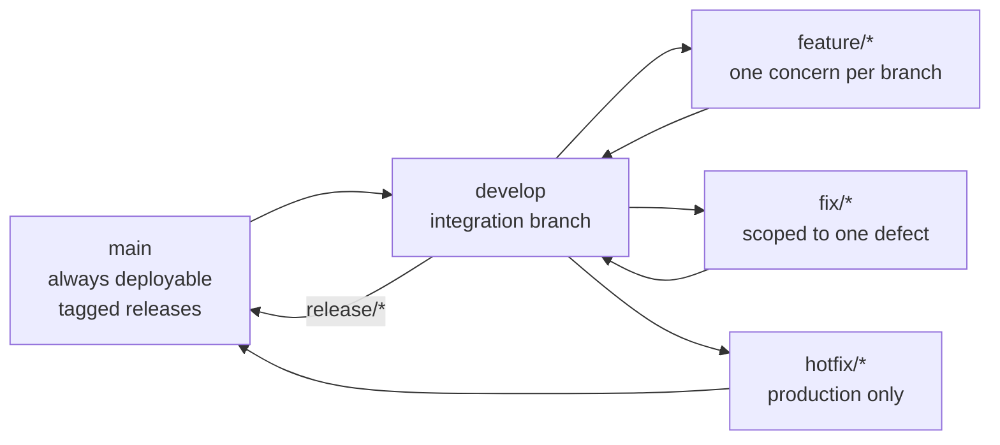
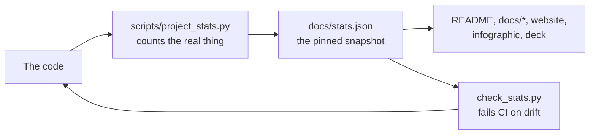

# 35 — GitHub Presence, Topics & Release Packaging

> Everything a reviewer, a recruiter or a teammate needs to see this project on
> GitHub, in copy-paste form. Nothing here is aspirational: every figure is
> measured by `scripts/project_stats.py` and pinned in `docs/stats.json`.

---

## Purpose

A repository is read in three layers, and each layer fails for a different
reason:

| Layer | Read by | Fails when |
| --- | --- | --- |
| **The repo card** — name, description, topics, About box | Someone deciding whether to look at all | The description is a slogan instead of a summary of what is actually here |
| **The README** | Someone who opened it | It opens with a feature list instead of the problem the system solves |
| **The documentation** | Someone who is convinced | The diagrams do not render, or the figures do not match the code |

This document is the copy-paste source for the first layer, and the checklist
for the second and third.

---

## The repository description (paste-ready)

GitHub allows up to 350 characters. This one is 331.

```
Web-to-Warehouse Product Intelligence Pipeline: compliant ingestion from 35
public sources, fuzzy duplicate detection, a 29-table Kimball warehouse on
PostgreSQL + MySQL with price history, 12 data-quality rules, Airflow
orchestration, 219 REST operations and a React 19 dashboard. DEPI Data
Engineering capstone.
```

**Shorter variant** (for a profile or a slide):

```
A compliance-first product intelligence pipeline: permitted web/API ingestion
→ cleaning → dedupe → PostgreSQL/MySQL warehouse with price history → SQL
analytics → Airflow → FastAPI + React. Every row provably observed.
```

**Longer variant** (for a README header or a conference submission):

```
A retailer needs the market picture every morning: what competitors charge,
what is in stock, what appeared or disappeared, and how it compares to the
internal catalogue. Collecting that by hand is slow and inconsistent. This
project replaces the spreadsheet with one continuously orchestrated system:
robots.txt-aware ingestion from 35 permitted public sources, a 29-step
normalisation engine, four-signal fuzzy duplicate detection, a Kimball star
schema that loads identically on PostgreSQL and MySQL, 12 enforced
data-quality rules whose verdicts are persisted per run, Airflow orchestration,
a 219-operation REST API and a 23-screen React 19 dashboard. Every row in the
warehouse traces back to a real, permitted upstream — proven by an audit that
walks every table and a self-test proving the audit rejects synthetic data.
```

---

## The About box (paste-ready)

**Short description** (the box beside the repository name, 160 characters):

```
Permitted-source product intelligence: ETL, dedupe, Kimball warehouse on
PostgreSQL + MySQL, 12 DQ rules, Airflow, 219 REST ops, React dashboard.
```

**Website:**

```
https://ahmedbakr78.github.io/Web-to-Warehouse-Product-Intelligence-Pipeline/
```

**Topics** — copy the whole block into *Settings → Topics*:

```
web-scraping
beautifulsoup
scrapy
etl
data-engineering
airflow
postgresql
mysql
fastapi
python
react
typescript
data-quality
data-warehouse
data-pipeline
data-lineage
provenance
deduplication
price-tracking
webhooks
alerts
analytics
sql-analytics
forecasting
anomaly-detection
rest-api
openapi
docker
docker-compose
github-actions
ci-cd
terraform
observability
grafana
prometheus
pandas
numpy
polars
beautifulsoup4
lxml
sqlalchemy
alembic
pydantic
httpx
pytest
vitest
ruff
mypy
tailwindcss
recharts
react-query
pwa
accessibility
wcag
depi
digital-egypt-pioneers-initiative
capstone-project
graduation-project
```

**Why these topics and not more.** GitHub shows at most 20 topics, and the
first ones are the ones that surface the repository in search. The list is
ordered so that the twenty that matter most are first:

1. `web-scraping`, `beautifulsoup`, `scrapy`, `etl`, `data-engineering`,
   `airflow`, `postgresql`, `fastapi`, `python`, `react` — the stack.
2. `data-quality`, `data-warehouse`, `data-pipeline`, `data-lineage`,
   `provenance`, `deduplication` — the *engineering* that distinguishes this
   from a tutorial scraper.
3. `price-tracking`, `forecasting`, `anomaly-detection`, `analytics`,
   `webhooks`, `alerts` — the product.
4. `depi`, `digital-egypt-pioneers-initiative`, `capstone-project` — the
   programme, so the DEPI cohort can find it.

---

## The social preview image

A repository card is looked at, not read. The preview image is
`docs/assets/infographic.png` — a single 2560x1440 slide that states the
problem, the solution, the architecture, the measured scale and the evidence
in about thirty seconds.

```bash
# Regenerate it from the live stats (never hand-edit the numbers)
make infographic
```

| Asset | Size | Used for |
| --- | --- | --- |
| `docs/assets/infographic.png` | 2560x1440 | the social preview |
| `docs/assets/infographic-dark.svg` | vector | dark-mode README embeds |
| `docs/assets/infographic.pdf` | vector | slides, print, the PDF report |
| `docs/assets/deck.pdf` | 12 slides | the defence deck |
| `docs/assets/deck.html` | browser | the deck with speaker notes |

The generator reads `docs/stats.json` and the live warehouse, so the preview
image cannot claim a figure the code does not produce. It is regenerated in
`make stats-update` and in the docs CI job.

---

## Topics as a search strategy

The topics are not decoration. They are how the repository is found by
someone who has never heard of it. Each cluster corresponds to a question a
searcher might type:

| A person searching for… | lands on this repo through… |
| --- | --- |
| "how to scrape without breaking robots.txt" | `web-scraping`, `beautifulsoup`, `scrapy`, `provenance` |
| "production ETL in Python" | `etl`, `data-pipeline`, `airflow`, `data-engineering` |
| "a real data warehouse schema" | `data-warehouse`, `postgresql`, `mysql`, `sqlalchemy`, `alembic` |
| "how do you know your data is real" | `data-lineage`, `provenance`, `data-quality` |
| "product price tracking" | `price-tracking`, `deduplication`, `forecasting` |
| "a FastAPI + React analytics app" | `fastapi`, `react`, `typescript`, `openapi`, `rest-api` |
| "a DEPI capstone project" | `depi`, `digital-egypt-pioneers-initiative`, `capstone-project` |

---

## Branching strategy

The repository uses **GitFlow**, adapted to a small team:



| Branch | Lives where | Merges into | Rule |
| --- | --- | --- | --- |
| `main` | remote | — | only receives a tagged release; always green |
| `develop` | remote | `main` | integration branch; every PR lands here first |
| `feature/*` | local | `develop` | one concern; deleted on merge |
| `fix/*` | local | `develop` | one defect; a test is added with it |
| `hotfix/*` | local | `main` **and** `develop` | production only, then cherry-picked forward |

**Commit message convention** — Conventional Commits, so the changelog can be
generated rather than written by hand:

```
<type>(<scope>): <subject>

type:  feat | fix | perf | docs | refactor | test | build | ci | chore
scope: ingestion | etl | api | analytics | dashboard | warehouse | quality | dx
```

Real examples from this repository's history:

```
fix(quality): clamp the freshness rule to zero hours old
perf(warehouse): index the timestamps every windowed query filters on
feat(analytics): publish a distinct-product count beside the observation count
docs(trust): document the three trust levels and the purge sweep
```

---

## Issue and pull-request templates

`.github/ISSUE_TEMPLATE/` and `.github/PULL_REQUEST_TEMPLATE.md` already exist.
The pull-request template asks for the four things a reviewer actually needs:

```markdown
## What changed
<!-- One sentence. The reviewer reads this first and only. -->

## Why
<!-- The problem this solves, or the defect it fixes. -->

## How it was verified
<!-- The commands you ran and their output. Not a claim - the output. -->

## Checklist
- [ ] `pytest` passes
- [ ] `ruff check app tests scripts dags` is clean
- [ ] `npm run typecheck && npm run lint && npm run test` are clean (frontend changes)
- [ ] `make stats-update` was run if a structural figure changed
- [ ] No synthetic or mock data entered a production path
```

That last checkbox is the one that matters most for this project, and it is
the one most often forgotten.

---

## Release packaging

### The release checklist

Reproduced in full in [31 — Releases](31_releases.md#pre-flight-checklist).
The short form, for a release that has to happen today:

```bash
# 1. The version is propagated everywhere
printf '1.13.0' > VERSION && .venv/bin/python scripts/sync_version.py

# 2. Every structural figure still matches the code
.venv/bin/python scripts/check_stats.py docs/stats.json --write
.venv/bin/python scripts/project_stats.py --sync-readme
.venv/bin/python scripts/check_stats.py docs/stats.json

# 3. The whole thing works, with real data
./run.sh --verify-only

# 4. Publish
git add -A && git commit -m "Release v1.13.0 — <theme>"
git tag -a v1.13.0 -m "v1.13.0 — <theme>"
git push && git push --tags
gh release create v1.13.0 --title "v1.13.0 — <theme>" --notes-file RELEASE_NOTES.md
```

### What a release note contains

| Section | What goes in it |
| --- | --- |
| Theme | One line. The single idea the release is about. |
| Added | New capability, with the endpoint or screen that proves it. |
| Fixed | The bug, **the cause**, and what now prevents it recurring. |
| Changed | Behaviour that is different, with the migration note. |
| Verified | The commands that were run and their results. |

The last section is what separates a release note from a wish list. It
should quote real output — `619 passed`, `104/104`, `No drift: all 17 pinned
figures match` — not intentions.

### The repository's own release history

| Version | Theme |
| --- | --- |
| 1.12.1 | Analytics that could never return a row: the inverted variance, the discarded vote counts, the tests that passed on empty lists |
| 1.12.0 | Truthful metrics, silent reload, mobile parity, window indexes, a hermetic test suite |
| 1.11.0 | Morning Briefing, the intelligence layer, the 10x demo warehouse, mobile/theme polish |
| 1.10.0 | Ingestion Max: TVMaze, Archive.org, DummyJSON recipes, the Scrapy engine, conditional GET, the team API |
| 1.9.0 | Real-only defaults, theme memory, modern scrollbars, the Account surface, `run.sh` |
| 1.8.0 | Query power Max: HAVING, OR logic, saved-view lifecycle, query history |

Full detail: [`CHANGELOG.md`](../CHANGELOG.md).

---

## Keeping the profile honest

The single most valuable property of this repository is that **no figure
quoted in prose can drift away from the code**. Three mechanisms enforce it:



| Mechanism | What it catches |
| --- | --- |
| `scripts/project_stats.py` | Counts tables, views, routes, rules, sources, tasks, commands, documents, diagrams, features and tests **from the code** |
| `scripts/check_stats.py` | Fails when a figure quoted in the README or the docs no longer matches `docs/stats.json` |
| `make stats-update` | Re-measures and rewrites the snapshot, so the update is one command |

That is why the README badge says `575 catalogued features` and the
dashboard says `629 entries in 42 groups`: they are measured by two
different collectors on two different axes, and both are labelled.

---

## Related documents

| Document | Covers |
| --- | --- |
| [31 — Releases](31_releases.md) | Versioning, tagging, the pre-flight checklist and the About box |
| [18 — Presentation Outline](18_presentation_outline.md) | The defence deck and the examiner Q&A |
| [24 — Demo Runbook](24_demo_runbook.md) | The screen-by-screen live script |
| [03 — Roles and Responsibilities](03_roles_and_responsibilities.md) | Who owns which lane |
| [CONTRIBUTORS.md](../CONTRIBUTORS.md) | The file-level responsibility map |
