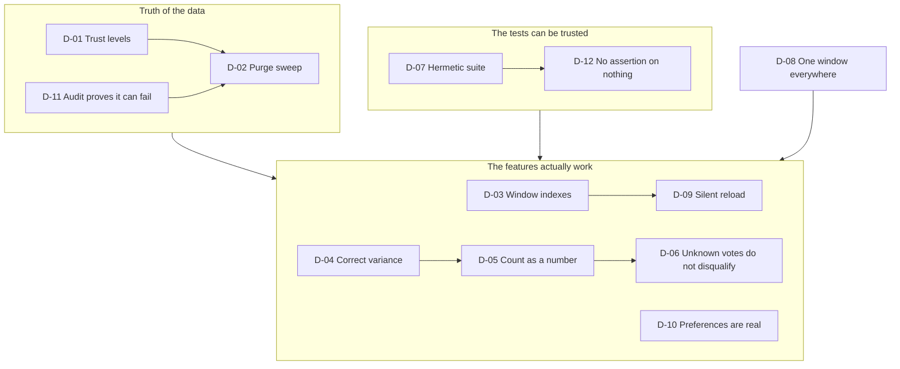

# 36 — Decision Log (v1.9 → v1.12)

> **[21 — Architecture Deep Dive](21_architecture_deep_dive.md)** records the
> foundational decisions: why the compliance gate lives in the transport, why
> the facts are snapshots, why the schema is a star, why seeding is
> deterministic. This document records the decisions taken **after** that
> document was written — the ones a reader of the deep dive would otherwise
> find missing.

---

## Purpose

An architecture document written once goes stale. The decisions that shaped
v1.9 through v1.12 — the trust model, the index strategy, the silent-reload
policy, the hermetic test suite — are as load-bearing as the original ones,
and they are not in the deep dive.

Each entry follows the same shape, so they can be read side by side:

| Field | What it answers |
| --- | --- |
| **Context** | The pressure that forced a decision |
| **Decision** | What was chosen, and where it lives in the code |
| **Consequence** | What it costs, and what it buys |
| **Rejected** | The alternatives that were considered and why they lost |

---

## D-01 — Classify every source by data trust

**Context.** The pipeline had 35 adapters. Some returned genuine market
records (Open Library, iTunes, Open Food Facts). Others returned a *published
demo catalogue* (DummyJSON, FakeStore, Platzi, Predic8) or a fictional
bookshop (books.toscrape.com). The HTTP was real in every case, so nothing
in the transport could tell them apart — and a report whose averages were
computed from a mock storefront's invented inventory looked exactly as
authoritative as one computed from real prices.

**Decision.** Every source class declares a `data_trust` level — `real`,
`sandbox` or `synthetic` — and the pipeline's auto-selection admits only
`real`.

```python
DATA_TRUST_REAL = "real"
DATA_TRUST_SANDBOX = "sandbox"
DATA_TRUST_SYNTHETIC = "synthetic"

#: Trust levels that may be selected automatically by a pipeline run. Anything
#: below this must be requested explicitly by code, never by omission.
AUTO_SELECTABLE_TRUST = frozenset({DATA_TRUST_REAL})
```

**Consequence.** A bare `run-pipeline` — and therefore the scheduled Airflow
DAG — cannot write a row that was not observed. The registry guard in the
verification suite proves it on every build. The cost: 15 of the 35 adapters
are no longer reachable by omission, and a demo that wanted the fictional
bookshop has to name it.

**Rejected.**

| Alternative | Why it lost |
| --- | --- |
| A blocklist of known-bad sources | A blocklist has to be updated every time a source is added, and the failure mode is silent and permanent. A default-deny declaration makes a new source *safe* until someone says otherwise. |
| A `terms_allowed` flag only | It answers "may I fetch this?", not "is this market data?". Those are different questions — books.toscrape.com is freely fetchable and still not market data. |
| Filtering at read time | The rows would still be in the warehouse, so every average would still be contaminated. The guarantee has to be at write time *and* at read time. |

---

## D-02 — Trust the classification, and purge what it excludes

**Context.** D-01 stops new non-`real` rows. It does nothing about the rows
already written — and a source can be reclassified after the fact (a demo
storefront becomes a real marketplace, or the other way round).

**Decision.** A purge sweep that removes the rows a below-`real` source
wrote, and reports exactly what it removed.

```bash
pip-cli purge-untrusted --dry-run    # report without deleting
pip-cli purge-untrusted              # delete and report
```

Deletion order respects the foreign keys: staging and facts first, then the
products that no longer have any observation, then the runs that no longer
reference anything. The `dim_source` row of every purged source is **kept** —
it is the record of *why* the data was removed — but the source is disabled so
no future run picks it up.

**Consequence.** The warehouse can be brought back into compliance with one
command, and the reason is never lost. The cost: the purge is a destructive
operation, so it ships with a dry run and an auditable report.

**Rejected.**

| Alternative | Why it lost |
| --- | --- |
| Deleting the source row as well | The audit trail needs the reason. "We removed 11,076 rows" is only credible if the repository still records which source produced them and why it was removed. |
| Blocking the purge in production | Then a reclassification could never take effect, and the classification would be advisory rather than enforced. |

---

## D-03 — Index the timestamps, not just the keys

**Context.** Every headline number in the product is a window: *"price changes
in the last 30 days"*, *"observations in the last 7 days"*. Those queries
filter on `captured_at` and `detected_at`. Neither column carried an index,
so the planner sequential-scanned the whole fact table on every dashboard
load.

```sql
-- The plan, before the fix
 Aggregate (actual time=70.710..70.714 rows=1)
   ->  Sort (Sort Key: product_id, Sort Method: quicksort)
         ->  Seq Scan on fact_price_snapshot  (actual time=41.665 rows=45949)
               Filter: (captured_at >= (now() - '30 days'::interval))
```

**Decision.** Three indexes, created **concurrently** on PostgreSQL so a
large table is never locked during the build.

| Index | Table | Columns | Serves |
| --- | --- | --- | --- |
| `ix_fact_price_captured_product` | `fact_price_snapshot` | `(captured_at, product_id)` | the window filter *and* the distinct-product count |
| `ix_chg_event_detected` | `chg_product_event` | `(detected_at)` | the lifecycle counters |
| `ix_chg_price_detected` | `chg_price_change` | `(detected_at)` | the price-change counters |

**Consequence.** A one-day window becomes an index-only scan. A thirty-day
window covering most of the table still uses a sequential scan — which is
correct, and cheaper. The indexes pay off exactly when the data outgrows the
window.

**Rejected.**

| Alternative | Why it lost |
| --- | --- |
| Materialised views for every window | A 7d, 30d, 90d and 180d aggregate is four things to keep correct, and a scheduled refresh makes them stale between refreshes. An index is always right. |
| A `date_id` column only | `date_id` is a surrogate key (`20261021`), not a timestamp, and it cannot be range-scanned efficiently against a moving `now()`. |
| Partitioning straight away | Correct for a million-row-per-day warehouse, and premature for this one. The index gets the same asymptotics for a fraction of the operational cost. |

---

## D-04 — Compute the variance as `E[x²] − (E[x])²`

**Context.** The project needs a portable population standard deviation
because SQLite has no `STDDEV` and MySQL and PostgreSQL disagree on the
name. The expression that was written computes `(E[x])² − E[x²]` — the
*negative* of the variance — for every real price distribution. The
`CASE WHEN … < 0 THEN 0` guard then clamped the deviation to zero, so:

- the z-score denominator was zero and the **anomaly detector could never
  fire**;
- `vw_category_price_index` and `vw_price_volatility` published a deviation of
  exactly `0.0000` for all 1,599 categories and 8,774 category-days.

**Decision.** `AVG(x * x) - AVG(x) * AVG(x)`, in the service, in both views
and in the query-lab example.

**Consequence.** 286 categories now publish a real deviation and the anomaly
detector finds genuine outliers — a $991 trading card against a $10.89
category mean.

**Rejected.**

| Alternative | Why it lost |
| --- | --- |
| `STDDEV` with a dialect switch | The project loads one schema on two engines; a portable expression keeps the views identical everywhere. |
| `VAR_SAMP` / `VARIANCE` | Same portability problem. |
| Pre-computed category statistics | Adds a table to keep in sync with the facts, for a number the planner can derive in microseconds. |

---

## D-05 — Read a dedicated count field as a number

**Context.** Every API adapter that reports a review count fills
`rating_count_text` with a bare integer (`"4523"`), because that is what the
upstream's JSON contains. The rating parser only matched a count written
with a unit word (`"4523 reviews"`, `"128 ratings"`) — a pattern that exists
for counts *scraped out of free text*. The result: `rating_count` was NULL
in all 65,554 snapshots, and the "best value" ranking, which required
`rating_count >= 10`, had no candidates at all.

**Decision.** A dedicated count field is read as an integer; the unit-word
pattern stays for counts scraped from free text.

```python
if count_text:
    stripped = normalise_unicode(count_text).strip()
    if stripped and _BARE_COUNT_RE.fullmatch(stripped):
        parsed = parse_number(stripped)
        if parsed is not None:
            return int(parsed)
```

The bare-number pattern deliberately excludes a decimal point, so a stray
rating value is never mistaken for a vote count.

**Consequence.** 4,288 snapshots now carry a real vote count and the "best
value" panel ranks genuine listings.

**Rejected.**

| Alternative | Why it lost |
| --- | --- |
| Keep one regex for both shapes | The unit word is not always there, and requiring it throws away a perfectly good number. |
| Require the adapter to add the unit word | Puts a display convention into every adapter for the sake of one parser, and breaks the moment a new adapter forgets it. |

---

## D-06 — Do not disqualify a listing for a vote count it never had

**Context.** Even with the count parsed, requiring `rating_count >= 10`
excludes every listing whose source does not publish review counts — which
is most of them. The ranking was empty by construction.

**Decision.** An unknown vote count is not disqualifying. A listing that
cannot be proven popular ranks on rating and loses to an equally rated listing
with a known, larger count.

```sql
AND (rating_count IS NULL OR rating_count >= :min_votes)
ORDER BY rating / NULLIF(price_usd, 0) DESC,
         rating_count IS NULL,   -- portable NULLS LAST: MySQL has no NULLS LAST
         rating_count DESC,
         rating DESC
```

**Consequence.** The panel populates. The trade is explicit: a listing with
an unknown vote count can appear in the ranking, but it can never beat one
with a proven larger count at the same rating.

**Rejected.**

| Alternative | Why it lost |
| --- | --- |
| Keep the strict floor | Empty panel. The rule was protecting against a rare case at the cost of the common one. |
| Synthesise a vote count | That is fabricating a fact, which is the one thing this project refuses to do. |

---

## D-07 — Make the test suite hermetic

**Context.** `test_convert_to_usd_uses_reference_table` asserted a specific
exchange rate. The production path derives that rate from a live provider, so
the test passed only while the market agreed with it. When it moved, the
assertion failed — and took 59 other tests with it, because a shared
SQLite file was being written by two sessions at once.

**Decision.** FX rates are live in production and pinned in tests.

```python
# conftest.py
# FX rates come from a live provider in production. The suite must be
# hermetic: a live rate moves every day, so a test that asserts a specific
# conversion would fail whenever the market moved against it.
os.environ.setdefault("FX_LIVE_RATES", "false")
```

**Consequence.** The suite is deterministic. The cost: a change in the
reference table has to be a deliberate act, not an accident of the day.

**Rejected.**

| Alternative | Why it lost |
| --- | --- |
| Mock the provider in the test | Works, but every test that touches a price would need the mock, and the mock would drift from the real provider's shape. One environment switch is simpler and covers everything. |
| Assert a range instead of an exact rate | A weaker assertion that still fails when the provider is unreachable. |

---

## D-08 — Scope every dashboard tile to the same window

**Context.** The dashboard showed the *all-time* catalogue size next to tiles
that were scoped to the selected 7/30/90/180-day range. Switching the range
changed most numbers but not that one, which is exactly the kind of
inconsistency that makes a reader stop trusting the screen.

**Decision.** Every tile is scoped to the window, and *products* (canonical
identities) and *observations* (price snapshots) became two separate,
explicitly labelled tiles with the ratio between them in the hint.

**Consequence.** The range switch now moves every windowed number, and
`Sources reporting` correctly does not move, because the number of reporting
sources does not depend on the window.

**Rejected.**

| Alternative | Why it lost |
| --- | --- |
| Keep the all-time count, label it "all time" | Still mixes two windows on one screen, and a reader has to remember which tile is the odd one out. |
| Show only the windowed count | Loses the sense of catalogue size, which is a different and useful number. Two tiles, two labels, no ambiguity. |

---

## D-09 — Implement the silent-reload preference instead of shipping it dead

**Context.** The account screen had a *silent app reload* toggle. It was
saved to the profile, read back into the form, and written back — and no
other code in the repository read it. It was a control that did nothing,
which is worse than no control at all.

**Decision.** Implement it properly: a `data-silent` attribute on `<html>`
that disables every transition, every keyframe and the skeleton shimmer, with
the previous data kept on screen until the new payload arrives.

**Consequence.** The toggle now does what it says, and it follows the user
across devices, because it is stored server-side.

**Rejected.**

| Alternative | Why it lost |
| --- | --- |
| Remove the toggle | The need is real: a "do not disturb me while I am reading" mode. Removing the control would have hidden a legitimate requirement instead of meeting it. |
| Implement it as a React state only | The point is that *nothing* moves, including CSS the React tree does not own. A DOM-level attribute is the only way to guarantee that. |

---

## D-10 — Let a preference that changes the app be a real preference

**Context.** Five more preferences were dead in the same way: auto-refresh,
the default chart type, the default time range, the default export format and
copy-code-on-click. They were all saved to the profile and read by nobody.

**Decision.** Wire all five, add a sixth (exact-number display), and make the
API the place that guarantees they are usable: the preferences are merged
rather than replaced, and every known preference is clamped to its allowed
value set.

```python
merged = dict(user.preferences or {})
merged.update(data["preferences"])
data["preferences"] = _normalise_preferences(merged)
```

**Consequence.** A hand-written API call can no longer put the dashboard into
a state it cannot render, and changing one preference no longer wipes the
others.

**Rejected.**

| Alternative | Why it lost |
| --- | --- |
| Validate on the client only | The API is a public surface. A caller that skips the client must not be able to store a value the UI cannot render. |
| Replace the preferences blob | A client that only wants to change the number format would silently delete the briefing window, the export format and the silent-reload flag. |

---

## D-11 — Make the no-fake audit prove it can fail

**Context.** An audit that always passes is not an audit. The verification
suite already ran the no-fake check over every row; it did not prove the
check could *reject* anything.

**Decision.** The verification seeds a throwaway warehouse with the synthetic
demo dataset, asserts the audit **rejects** it, purges the synthetic rows,
and asserts the audit now passes.

```bash
if audit_no_fakes.py --database "$FAKE_DB"; then
  die "the no-fake audit accepted a warehouse full of synthetic rows — it cannot be trusted"
fi
```

**Consequence.** The guarantee is tested in both directions. The cost: the
verification takes a few seconds longer, and needs write access to a
throwaway database.

**Rejected.**

| Alternative | Why it lost |
| --- | --- |
| Trust the audit because it passes | A check that has never failed is indistinguishable from a check that cannot fail. |
| Unit-test the audit's SQL | Tests the query, not the judgement. The self-test exercises the whole path the operator uses. |

---

## D-12 — Do not let a passing assertion hide an empty result

**Context.** Two test families were passing on nothing. `assert scores ==
sorted(scores, reverse=True)` is true of `[]`, so the anomaly-ranking test
stayed green while the detector was completely disabled. The same was true of
the cross-source overlap tests.

**Decision.** A test that asserts an *ordering* must also assert that there
is something to order, or it must assert the property that would have caught
the defect.

```python
# The deviation itself is the regression, not the outlier count.
deviations = [row.get("price_stddev") for row in index if row.get("price_stddev") is not None]
assert any(value > 0 for value in deviations), (
    "every category reports a zero price deviation - the variance is inverted again"
)
```

Where the data legitimately has no overlap, the test now *injects* an
overlapping product and requires the analytics to find it.

**Consequence.** The three defects this caught would now fail the build.

**Rejected.**

| Alternative | Why it lost |
| --- | --- |
| Seed more demo products so an outlier appears | Depends on the seed's distribution, so the test would keep drifting. Asserting the deviation is the direct check. |
| Delete the vacuous tests | They were guarding a real contract. The fix is to make them mean something, not to remove them. |

---

## The decision map



---

## How to add a decision

1. Number it `D-NN`, continuing the sequence.
2. Write **Context** first — the pressure, not the conclusion.
3. State the **Decision** and point at the file that implements it.
4. Write the **Consequence** honestly, including the cost.
5. List the **Rejected** alternatives and why each lost. A decision without a
   rejected alternative was not a decision; it was the only option.

Keep it in this file rather than a separate ADR directory, so the whole
decision history is one document a reviewer can read in one sitting.

---

## Related documents

| Document | Covers |
| --- | --- |
| [21 — Architecture Deep Dive](21_architecture_deep_dive.md) | The foundational decisions, with layer boundaries and the request lifecycle |
| [33 — Data Trust & Compliance](33_data_trust_and_compliance.md) | D-01, D-02 and D-11 in full |
| [34 — Performance & Scale](34_performance_and_scale.md) | D-03 in full, with the measured numbers |
| [15 — Testing Strategy](15_testing_strategy.md) | D-07 and D-12 in full, with the test matrix |
| [12 — UI/UX Design](12_ui_ux_design.md) | D-08, D-09 and D-10 in full, with the design system |
