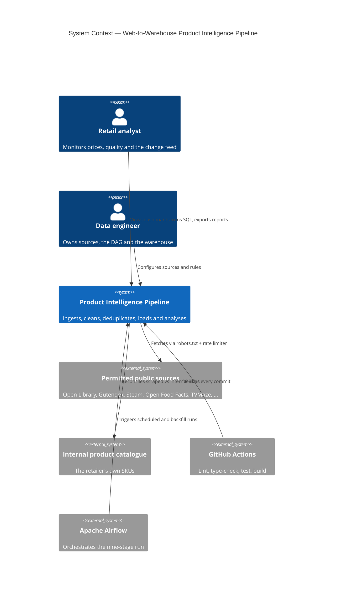
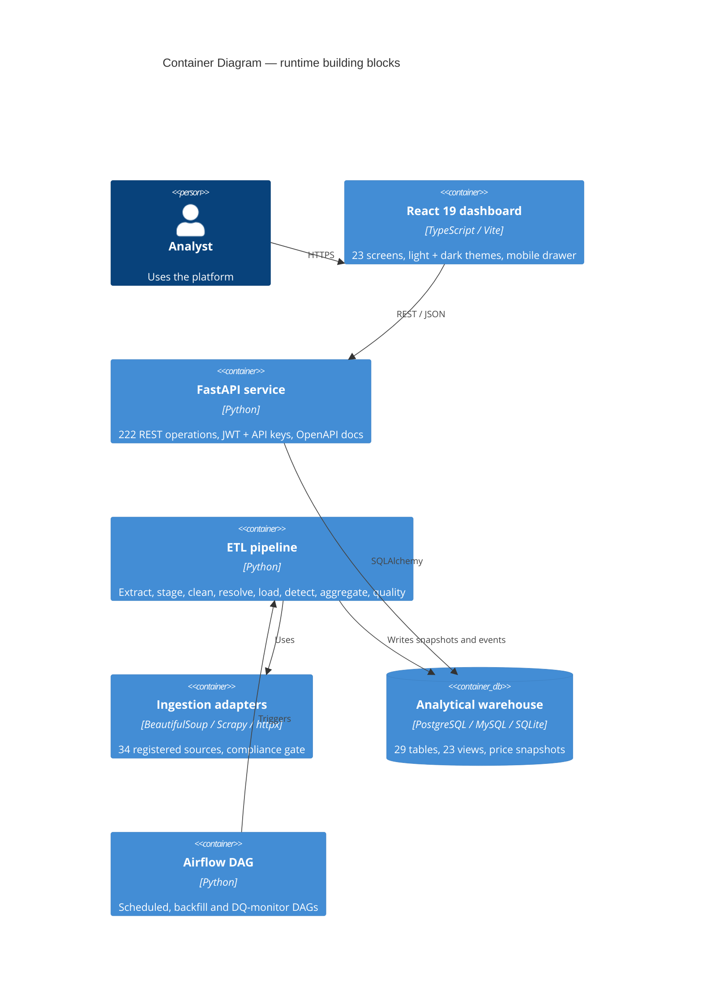
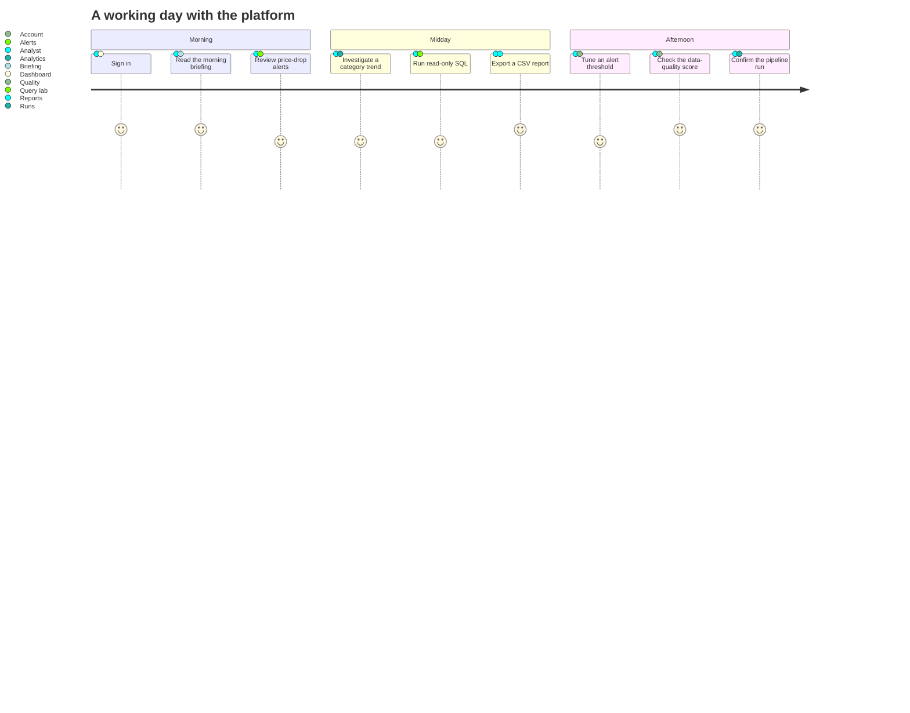
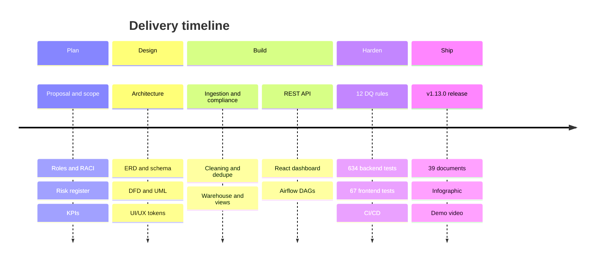
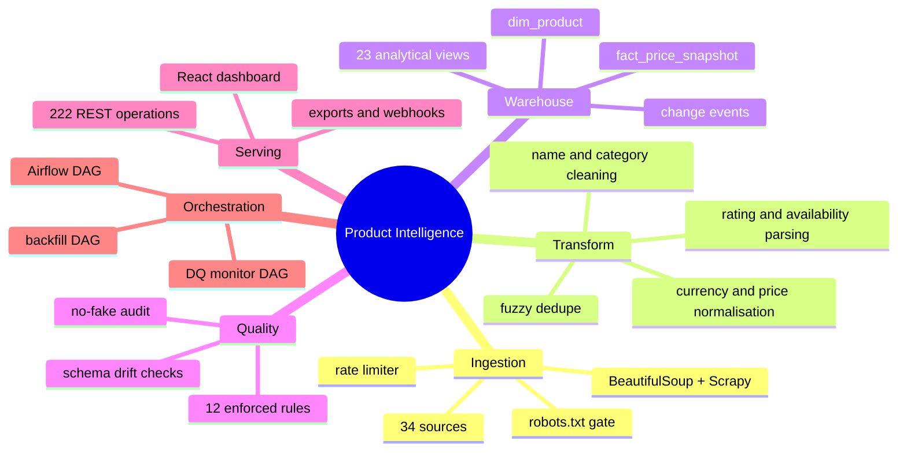
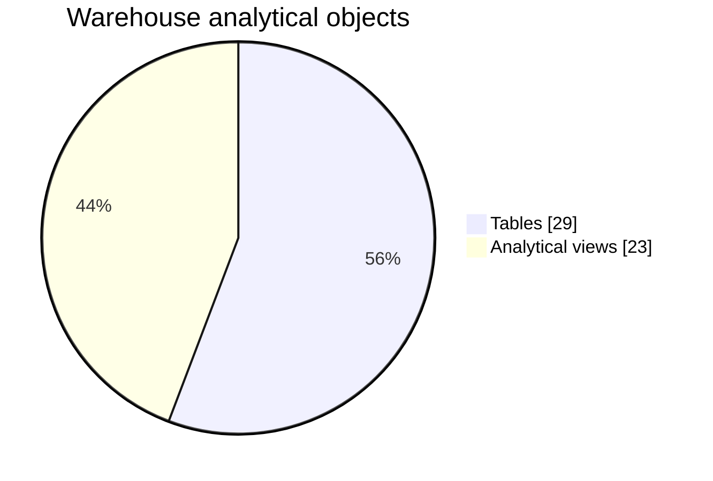
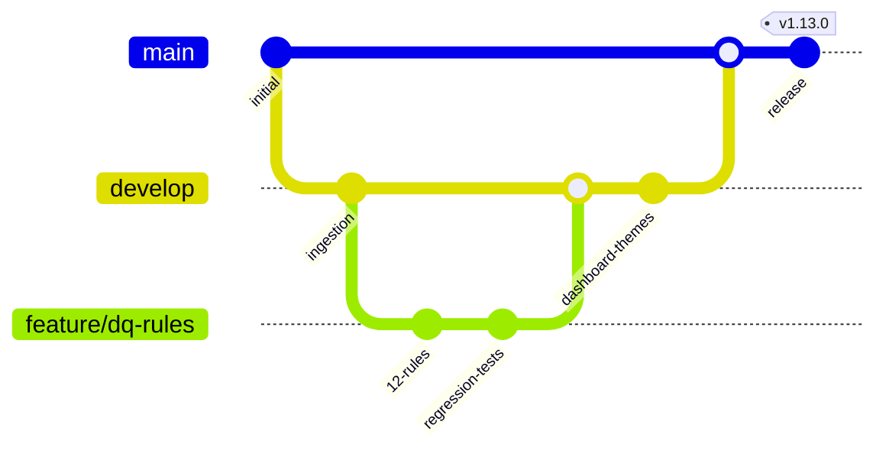
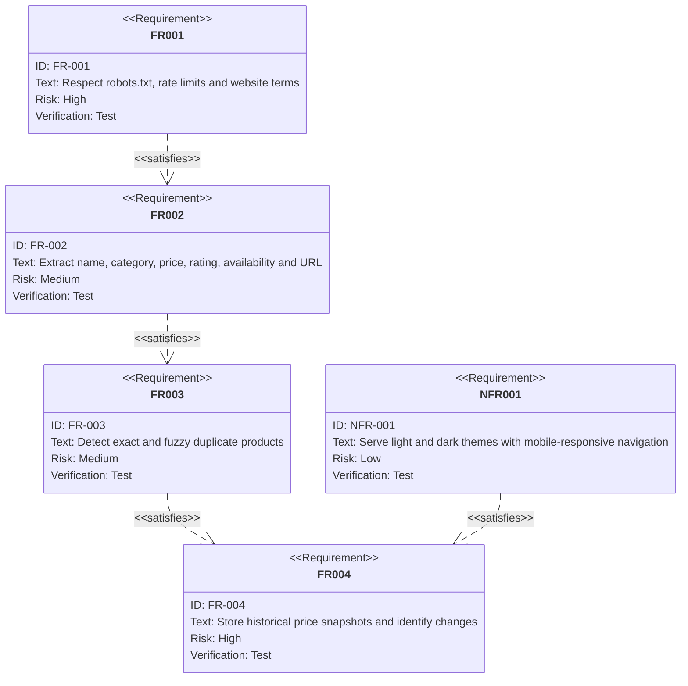

# Extended Diagram Suite

The repository already contains more than one hundred Mermaid diagrams across
`flowchart`, `sequenceDiagram`, `stateDiagram-v2`, `erDiagram`, `classDiagram`,
`gantt` and `graph`. This document **adds** eight diagram types that were not
used anywhere else, so the design is viewable from eight more angles. Every
node below corresponds to a component that actually exists in this repository;
nothing is invented.

All diagrams are valid Mermaid and are picked up automatically by
`python3 scripts/diagrams.py extract`.

---

## 1. C4 — system context

## 2. C4 — containers

## 3. Journey — analyst experience

## 4. Timeline — delivery milestones

## 5. Mindmap — capability map

## 6. Pie — warehouse object mix

## 7. GitGraph — branching strategy

## 8. Requirement — traceability

---

## Why these eight

| Type | Question it answers |
| --- | --- |
| C4 context | Who talks to the system and why? |
| C4 container | What runs where, and how do the pieces connect? |
| Journey | How does a user actually move through it? |
| Timeline | In what order was it delivered? |
| Mindmap | What capabilities exist, grouped? |
| Pie | What is the analytical surface made of? |
| GitGraph | How does the branching strategy work? |
| Requirement | Which requirements trace to which guarantees? |

Together with the existing flowchart / sequence / state / ER / class / Gantt
diagrams, the project now covers the full design-documentation spectrum.
