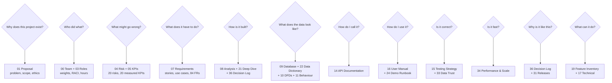

# Documentation Index

Web-to-Warehouse Product Intelligence Pipeline — DEPI graduation project, Data
Engineering track. Thirty-eight documents covering the proposal, planning,
requirements, design, implementation evidence and evaluation.

Every diagram is Mermaid, rendered natively by GitHub and to SVG for the static
site. Every structural number is measured by a script and re-verifiable with the
command cited beside it.

```mermaid
flowchart LR
    subgraph PLAN["Planning and evidence"]
        D1["01 Proposal"]
        D2["02 Plan"]
        D3["03 Roles"]
        D4["04 Risk"]
        D5["05 KPIs"]
        D6["06 Literature"]
        D7["07 Requirements"]
    end
    subgraph DESIGN["Design"]
        D8["08 System analysis"]
        D9["09 Database"]
        D10["10 Data flow"]
        D11["11 Behaviour"]
        D12["12 UI and UX"]
        D13["13 Deployment"]
        D14["14 API"]
    end
    subgraph BUILD["Implementation evidence"]
        D15["15 Testing"]
        D16["16 User manual"]
        D17["17 Technical"]
        D18["18 Presentation"]
        D19["19 Feature inventory"]
        D20["20 Feedback"]
    end
    subgraph DEEP["Deep dives and operations"]
        D21["21 Architecture"]
        D22["22 Data dictionary"]
        D23["23 Glossary"]
        D24["24 Demo runbook"]
        D25["25 Forecasting"]
        D26["26 Jobs and realtime"]
        D27["27 Reporting"]
        D28["28 Schema"]
        D29["29 Two-factor"]
        D30["30 Access control"]
        D31["31 Releases"]
        D32["32 Briefing"]
        D33["33 Data trust"]
    end
    subgraph EVIDENCE["Scale, presence and decisions"]
        D34["34 Performance"]
        D35["35 GitHub presence"]
        D36["36 Decision log"]
    end
    PLAN --> DESIGN --> BUILD --> DEEP
    DEEP --> EVIDENCE
```



| # | Document | What it covers |
| --- | --- | --- |
| 00 | [Team, Roles & Effort Split](00_team.md) | The six members, their weights and function ownership, and the ownership map |
| 01 | [Project Proposal](01_project_proposal.md) | Problem, objectives, scope, stakeholders, acceptance criteria, effort and budget, ethical and legal position, assumptions |
| 02 | [Project Plan](02_project_plan.md) | 12-week Gantt chart, milestones, deliverables matrix, resource allocation, sprint plan |
| 03 | [Task Assignment and Roles](03_roles_and_responsibilities.md) | Team roles, RACI for deliverables and decisions, communication plan, hours-log template |
| 04 | [Risk Assessment](04_risk_assessment.md) | 20-risk register with heat map, treatments, contingencies and the issues that materialised |
| 05 | [KPIs](05_kpis.md) | 20 KPIs with runnable SQL, targets versus measured values, API latency harness |
| 06 | [Literature Review](06_literature_review.md) | Six themes, 39 sources with verification status, synthesis and research gaps |
| 07 | [Requirements Gathering](07_requirements_gathering.md) | Stakeholders, 10 user stories with Given/When/Then, 20 use cases, 58 FRs, 26 NFRs, traceability |
| 08 | [System Analysis and Design](08_system_analysis_design.md) | Use-case diagram, architecture diagram, style and rationale |
| 09 | [Database Design](09_database_design.md) | Generated 29-table ERD, logical versus physical schema, normalisation, indexing, retention, dialect types |
| 10 | [Data Flow Diagrams](10_data_flow_diagrams.md) | Level 0/1/2 DFDs, data dictionary, control flows |
| 11 | [Behaviour Diagrams](11_behaviour_diagrams.md) | Sequence, activity, three state diagrams, class diagram |
| 12 | [UI/UX Design](12_ui_ux_design.md) | Screen wireframes, design system with contrast ratios, WCAG 2.1 AA, breakpoints, motion policy |
| 13 | [Deployment](13_deployment.md) | Stack, deployment and component diagrams, environment matrix, Compose services, ports, secrets, backup, scaling, CI/CD |
| 14 | [API Documentation](14_api_documentation.md) | Auth flow, role matrix, 222 operations, worked examples in curl/Python/JS, errors, versioning |
| 15 | [Testing Strategy](15_testing_strategy.md) | Test pyramid, case plan, UAT scenarios, coverage targets, quality gates, defect management |
| 16 | [User Manual](16_user_manual.md) | Sign-in, every screen, filters, exports, saved views, alerts, admin, troubleshooting, FAQ |
| 17 | [Technical Documentation](17_technical_documentation.md) | Module map, key algorithms, every configuration variable, source extension, performance and security |
| 18 | [Presentation Outline](18_presentation_outline.md) | Defence deck, Q&A preparation, three-minute demo script, rehearsal and fallback plans |
| 19 | [Feature Inventory](19_feature_list.md) | 612 features in forty-seven areas (F-001 to F-612), each with a file reference |
| 20 | [Feedback and Improvements](20_literature_feedback_and_improvements.md) | Lecturer feedback template, prioritised improvements, self-assessment and rubric |
| 21 | [Architecture Deep Dive](21_architecture_deep_dive.md) | Design drivers, decisions with rejected alternatives, request lifecycle, warehouse layering, known limitations |
| 22 | [Data Dictionary](22_data_dictionary.md) | Every table, column, type and meaning; controlled vocabularies; view catalogue; dialect portability |
| 23 | [Glossary and FAQ](23_glossary_and_faq.md) | Terms defined, then setup, pipeline, quality, security and development questions answered |
| 24 | [Demo Runbook](24_demo_runbook.md) | Pre-flight checklist, the screen-by-screen script, time-boxed variants and a failure playbook that falls back to `curl` |
| 25 | [Forecasting & Anomaly Detection](25_forecasting_and_anomaly_detection.md) | Damped Holt-Winters with measured accuracy, three anomaly detectors, seasonality, elasticity and pricing advice |
| 26 | [Background Jobs & Realtime](26_background_jobs_and_realtime.md) | Job lifecycle, leases, retries, cancellation, SSE topics and the cross-worker event problem |
| 27 | [Reporting & Document Generation](27_reporting_and_document_generation.md) | Typed blocks rendered to HTML, JSON, CSV and PDF from one definition; WeasyPrint deployment |
| 28 | [Schema & Migrations](28_schema_and_migrations.md) | Alembic revisions, drift detection, view ownership, and why Airflow lives in its own database |
| 29 | [Two-Factor Authentication & Sessions](29_two_factor_and_sessions.md) | TOTP enrolment, encrypted secrets, single-use recovery codes, per-device revocation |
| 30 | [Access Control, API Keys & Rate Limiting](30_access_control_and_rate_limiting.md) | Roles and rights, scoped API keys enforced twice, sliding-window limits with honest headers |
| 31 | [Releases](31_releases.md) | Versioning, tagging, the pre-flight checklist, the GitHub About box and the topics list |
| 32 | [Morning Briefing & Demo Scale](32_briefing_and_demo_scale.md) | Ranked action queue, endpoint contract, cache/noise policy, and the idempotent 10x demo expansion |
| 33 | [Data Trust & Compliance](33_data_trust_and_compliance.md) | The three trust levels, auto-selection rules, the purge sweep, robots.txt enforcement and the request-level audit trail |
| 34 | [Performance & Scale](34_performance_and_scale.md) | Measured latencies, table sizes, the index strategy, capacity planning and the honest limits |
| 35 | [GitHub Presence](35_github_presence.md) | The repository description, topics, About box, social preview, branching strategy and release packaging |
| 36 | [Decision Log](36_decision_log.md) | Every engineering decision from v1.9 to v1.12, with the context, the consequence and the rejected alternatives |

---

## Which document answers which question

The index is complete, but completeness is not the same as navigability. This
is the short map: find the question, follow the arrow.



| The question | Open |
| --- | --- |
| *Why does this project exist?* | [01 Project Proposal](01_project_proposal.md) |
| *Who did what, and who reviews it?* | [00 Team](00_team.md), [03 Roles](03_roles_and_responsibilities.md), [CONTRIBUTORS.md](../CONTRIBUTORS.md) |
| *What could go wrong, and how is it measured?* | [04 Risk](04_risk_assessment.md), [05 KPIs](05_kpis.md) |
| *What must the system do?* | [07 Requirements](07_requirements_gathering.md) |
| *How is it built, and why?* | [08 Analysis](08_system_analysis_design.md), [21 Deep Dive](21_architecture_deep_dive.md), [36 Decision Log](36_decision_log.md) |
| *What does the data look like?* | [09 Database](09_database_design.md), [22 Data Dictionary](22_data_dictionary.md), [10 DFDs](10_data_flow_diagrams.md), [11 Behaviour](11_behaviour_diagrams.md) |
| *How do I call the API?* | [14 API Documentation](14_api_documentation.md) |
| *How do I use the product?* | [16 User Manual](16_user_manual.md), [24 Demo Runbook](24_demo_runbook.md) |
| *How do I know it is correct?* | [15 Testing](15_testing_strategy.md), [33 Data Trust](33_data_trust_and_compliance.md) |
| *Will it hold up under load?* | [34 Performance & Scale](34_performance_and_scale.md) |
| *What is in the box, and how is it shaped?* | [19 Feature Inventory](19_feature_list.md), [17 Technical](17_technical_documentation.md) |
| *How is it released and presented?* | [31 Releases](31_releases.md), [35 GitHub Presence](35_github_presence.md), [18 Presentation](18_presentation_outline.md) |

---

## How to read these numbers

Structural figures are exact and re-verifiable:

| Claim | Verify with |
| --- | --- |
| 29 tables, 23 views | `make bootstrap`, or `make stats` |
| 222 REST operations in 24 routers | `http://localhost:8000/docs`, or `make stats` |
| 627 tests pass | `make test` |
| 104 API smoke checks pass | `.venv/bin/python scripts/api_smoke.py` |
| ruff and mypy clean | `make lint` and `make typecheck` |
| No schema drift | `make db-check` |
| 104 Mermaid diagrams | `make docs-render` |
| 12 DQ rules and the score | Quality screen, or `pip-cli quality` |

`scripts/project_stats.py` recounts all of these, `scripts/check_stats.py` fails
when a documented figure no longer matches reality, and `make stats-check` runs it
in CI. A number in these documents is therefore either measured or checked.

Row counts and latencies are **measurements, not constants**. They depend on how
much data a given database holds and on the hardware. Each figure records the
measurement taken at a stated moment — generally the development machine at the
stated date — and is not silently rewritten when a later run produces a different
number. Where a document reports a dataset size, the command that regenerates it is
named alongside.

---

## Measured facts referenced throughout

| Fact | Value |
| --- | --- |
| Version | 1.12.1 |
| Physical tables / analytical views | 29 / 23, identical on PostgreSQL 16 and MySQL 8.4 |
| REST operations / routers | 222 / 24 |
| Feature inventory / runtime catalogue | 612 rows in 47 areas (`docs/19`) / 700 features in 43 groups (`GET /meta/features`) |
| Data-quality rules / dimensions | 12 / 6, verdicts persisted per run |
| Ingestion sources | 34 registered adapters: 31 JSON APIs, 2 HTML scrapers, 1 offline synthetic — 21 of them classified as real market data |
| Documentation documents / diagrams | 38 / 108 Mermaid, all rendering to SVG |
| API regression suite | 627 pytest cases, 104 smoke checks |
| Demo accounts | `admin@example.com` / `Admin@12345`, `analyst@example.com` / `Analyst@12345`, `viewer@example.com` / `Viewer@12345` |

---

## Reading order

If you are reviewing this for the first time:

1. **[01 Project Proposal](01_project_proposal.md)** — what problem, and why.
2. **[08 System Analysis](08_system_analysis_design.md)** and
   **[21 Architecture Deep Dive](21_architecture_deep_dive.md)** — how it is built
   and why each decision was made.
3. **[25–30](25_forecasting_and_anomaly_detection.md)** — the newer subsystems:
   forecasting, jobs and realtime, reporting, migrations, two-factor, access control.
4. **[33 Data Trust & Compliance](33_data_trust_and_compliance.md)** — how the
   warehouse guarantees that every row was really observed.
5. **[36 Decision Log](36_decision_log.md)** — why the system is the way it is,
   including the alternatives that were rejected.
6. **[14 API Documentation](14_api_documentation.md)** and
   **[16 User Manual](16_user_manual.md)** — the two views most reviewers want.
7. **[15 Testing Strategy](15_testing_strategy.md)** — what is verified, and how.
8. **[24 Demo Runbook](24_demo_runbook.md)** — if you are seeing it live.

---

## Quick commands

```bash
make help          # every target
make up            # the six-service stack
make bootstrap     # schema, views and demo users
make demo-postgres # deterministic 120-day dataset
make run-pipeline  # one pipeline run
make verify        # the full quality gate
make docs-build    # regenerate the static site from this Markdown
make docs-render   # render every Mermaid diagram to SVG
make stats         # measured structural counts
make infographic   # the 2560x1440 DEPI poster
```

## Related

- `README.md` at the repository root — orientation and quick start
- `docs/stats.json` — the machine-readable counts, pinned by `make stats-update`
- `site/` — the generated static site, 40 pages plus assets
- `CHANGELOG.md` — what changed in each version